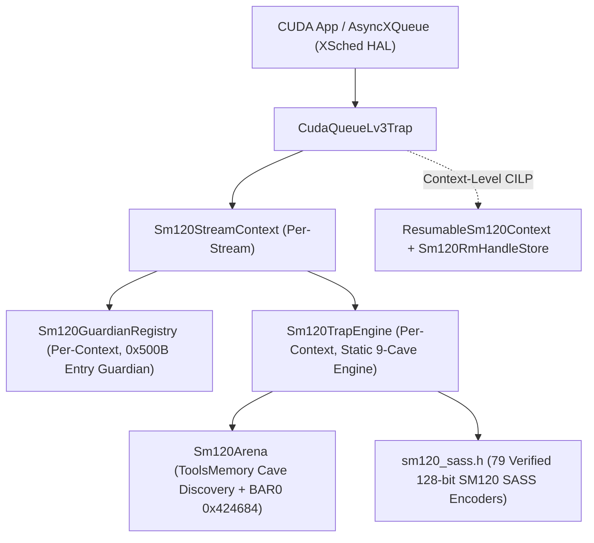

# Blackwell (`sm_120`) Level-3 硬件 Trap 抢占与恢复架构详解（v2）

**基线版本**：`v2.2.0-sm120`（静态 9-Cave 引擎 + **100% GDDR7 显存控制面 & 高优 Copy Engine DMA** + 永久 Entry Guardian + 用户态 `BPT.TRAP 0x1` 0 脉冲自陷恢复 + 自适应内核/模式路由器）  
**适用架构**：NVIDIA Blackwell (`sm_120`) — 已在 `RTX 5080`（`GB203`, 84 SMs, Driver `580.95.05`, CUDA 12.9）与 `RTX 5060`（`GB206`, 30 SMs, Driver `595.99.02`）实机验证  

---

## 1. 设计目标与双模式极简抽象

v2 架构面向用户端透明的 GPU 空间抢占，彻底移除 v1 过渡阶段的 Mode 2/3/4、`cmd=7`、运行时 `func_pc` 热补丁、2,000 次盲目 BAR0 轮询与冗余探针，仅保留正交互补的两种细粒度流级抢占模式与一种独立的上下文级抢占模块：

| 模式 / 模块 | 适用场景 | 硬件触发方式 | 显存开销 (`u_arena`) | 恢复机制 |
| :--- | :--- | :--- | :---: | :--- |
| **Mode 1 (`kEarlyExit`)** | 幂等内核（允许已开始未完成 CTA 重算） | BAR0 `0x00424684` 单脉冲早退 + Entry Guardian 拦截 `State C` | **0 B** | 重发波次按 `cta[b].state` 跳过已完成 `State A`，重跑 `State B/C` |
| **Mode 5 (`kTrapFrame`)** | **非幂等通用内核**（零源码修改、任意副作用不可重算） | BAR0 `0x00424684` 单脉冲保存全部在途 `State B` 硬件状态并释放 SM，Entry Guardian 拦截 `State C` | **按物理 SM 并发槽位紧凑池化**（与总 Grid 解耦） | 重发波次由 Entry Guardian 对 `State B` 主动执行用户态 **`BPT.TRAP 0x1`（0 Host 脉冲）**原位恢复 |
| **Context CILP (`ResumableSm120Context`)** | 跨 `CUcontext` 硬件上下文抢占 | RM `0x20801210` / `0x83de0317` / `0x83de0318` / `0xa06c0105` | 驱动硬件托管 | 硬件上下文切换原位恢复（与 Trap 引擎完全解耦） |

---

## 2. 系统总体架构与模块划分

全部 Level-3 实现位于 `xsched/platforms/cuda/hal/{include/xsched/cuda/hal,src}/level3/`：

1. **`sm120_sass.h`**：声明 79 条经 `nvdisasm -b SM120` 逐指令核验的 Blackwell 128-bit SASS 编码原语（含分段位移 `BRA`、`BRX`、`BPT.TRAP 0x1`、`BAR.SYNC.DEFER_BLOCKING`、`B2R`/`R2B`、`BMOV`、`UP2UR`/`UR2UP`、`ATOMG.E.ADD`/`OR`、`REDG.E.ADD`、`ELECT P0` 等）。
2. **`sm120_arena.h/.cpp`**：通过 `cuxtra` 遍历 `.text.traphandler` ToolsMemory 区域动态识别 `handler_va` 与 `tools_pc`（兼容不同驱动版本的地址偏移，如 Driver `580.95.05` 与 `595.99.02`），扫描全部可用代码洞（RTX 5080 共 11 Caves / 1,703 槽位；RTX 5060 共 11 Caves / 1,695 槽位），并在 `handler_va + 0x390` 注入唯一 `CALL.ABS` 钩子。
3. **`sm120_guardian.h/.cpp`**：在每个目标 `CUfunction` 首次发射前，经高优非阻塞 `op_stream_` 一次性分配并前置 `0x500` B（80 条指令）永久 Entry Guardian，修改函数入口点 `ep_inst_va` 并写入不可变 `Sm120KernelDesc`。
4. **`sm120_trap_engine.h/.cpp`**：包含 Context 级静态 9-Cave 引擎 `Sm120TrapEngine` 与 Per-Stream 状态机 `Sm120StreamContext`。
5. **`cuda_queue.h/.cpp` & `interrupt.cpp`**：`CudaQueueLv3Trap` 对接 XSched `AsyncXQueue` 生命周期（Launch、Suspend/Preempt、Restore、Resume），同时提供 `DirectLaunch` 通道供高优流免 Guardian 同步直接发射。
6. **`resumable_sm120.h/.cpp` & `sm120_rm_handles.h/.cpp`**：独立保留的 Context 级 CILP 抢占实现，与细粒度 Trap 引擎零耦合。

---

## 3. 静态 9-Cave 引擎布局（1,045 / 1,390 工作槽位）

引擎初始化时一次性从探测到的 11 个代码洞中选取容量 `>= 144` 槽位的 9 个工作代码洞，静态编译写入全部 Trap 处理逻辑，运行期**零指令修补**：

| Cave | 职能 | 实际占用 / 容量（条） | 关键硬件实现细节 |
| :---: | :--- | :---: | :--- |
| **Cave 0** | Trap 入口过滤 + 5 区间 Guard 边界 + Mode 1/5 Evict 主体 | **139 / 152** | 放行硬件 CILP（`R2 & 0x11`）与未托管上下文；清除 `R2` Bit 3；`cmd != 0` 转 Cave 1 重入保护分发器；Mode 1 无 `bar_sync_trap()` 早退；Mode 5 执行 5 区间 PC 判定（区分 `entry_dec=2` Guardian 裁决逃逸 vs `entry_dec=4` Trap 裁决同步）、动态 CTA Leader 选举（`ATOMG.E.OR warp_mask`）与紧凑 `slot_id` 分配 |
| **Cave 1** | Mode 5 Restore 主控 + 重入保护分发器 + `clean_exit` + `exit_stub` | **119 / 154** | 含 `c1_dispatch_guard_idx`（若 `TRAP_RETURN_PC == exit_stub_va` 必走 NO-OP RTT）、`trap_inflight` 原子在途计数、`c1_noop_recheck_idx` 伴随入陷重检、`is_live_warp` 死 Warp 清理退出（`c1_clean_exit_idx` → `exit_stub_va`）与 `bar_sync_trap()` 后的 `restored_slots++` |
| **Cave 2** | `R14..R253` 全架构 GPR 保存级联 | **136 / 153** | 读取 `SR_REGALLOC` 动态计算跳转表偏移，清零 `R11`（SM120 `BRX R10` 消费 64-bit `R10:R11`），当 `SR_REGALLOC >= 256` 显式谓词保护 `R253`，随后以 `ST.E.64` 级联保存 `R252..R14` |
| **Cave 3** | 0~15 号命名屏障 + `B2R.WARP` 保存/清理/恢复 | **99 / 159** | `save_idx` 由动态 `is_leader` 保存全部 16 个 CTA 命名屏障，各 Warp 保存自身 `B2R.WARP`；`clear_exit_idx` 清理屏障后直接跳转 `c1_clean_exit_idx` |
| **Cave 4** | Per-Warp 均匀寄存器与收敛屏障保存 | **113 / 158** | `ELECT P0` 选举单活跃 Lane 保存 `UR0..UR63`、`UPR`（经 `UP2UR UR7`）与 `B0..B15`（`BMOV.CLEAR`） |
| **Cave 5** | `R14..R253` 全架构 GPR 恢复级联 | **136 / 156** | 与 Cave 2 严格对称，清零 `R11` + `BRX R10` 恢复 `R14..R252` 与 `R253` |
| **Cave 6** | Per-Warp 均匀寄存器与收敛屏障恢复 | **112 / 158** | 先借 `UR7` + `UR2UP` 恢复 `UPR`，再全量恢复 `UR0..UR63` 与 `B1..B15`（`BMOV`） |
| **Cave 7** | 动态栈溢出与 `__noinline__` 递归 LMEM 保存/恢复 | **78 / 144** | 全无分支裁剪 `min(max(user_R1, min_lo), static_lo)`，覆盖静态 LMEM 与深度递归动态栈帧，全程保护 `R12:R13` 返回地址 |
| **Cave 8** | 动态 `SR_SMEMSZ` SMEM 环路 + 112B 硬件 Trap Frame | **113 / 156** | 先判定 `SR_SMEMSZ >= 0x401` 防止 0-SMEM 内核无符号下溢，再减 `0x400` 驱动保留区；支持 **Partial-CTA 回退**：若 `warp_mask != full_mask`，最低存活 Warp 以 32-lane 合并步长完整保存 SMEM |

> **槽位总计**：`139 + 119 + 136 + 99 + 113 + 136 + 112 + 78 + 113 = 1,045 / 1,390`（全部 9 个 Cave 均留有 `>= 13` 条指令安全余量，且在 RTX 5080 与 RTX 5060 两种驱动/硬件上完全一致）。

---

## 4. 永久 Entry Guardian 与五区间零竞态边界

### 4.1 80 槽位 Entry Guardian 布局（`0x000..0x4f0`，原内核位于 `+0x500`）

每个托管内核在首次发射前注入不可变的 80 条指令序言，支持任意 3D `gridDim/blockDim` 与 `active_kernel_idx` 多内核 FIFO 隔离；路由统一依据波次不变的 `is_restore_wave`（`+0x1c`），彻底消除恢复波次内发生二次抢占（`cmd: 6 -> 5`）时的同 CTA Warp 分裂：

- **`[0x000..0x270]`（区间 1，含 Slot 39 `BAR.SYNC 0`）**：
  - 未托管（`u_control_va == 0`）直接跳 `+0x500`（`DirectLaunch` 零干扰路径）；
  - `is_restore_wave != 0` 全体 Warp 一致跳转至 `restore_path` (`+0x2c0`)；
  - `is_restore_wave == 0` 且 `cmd != 0 && active_kernel_idx != 0 && my_idx != active_kernel_idx` 时，后续排队内核 `K2` 直接 `EXIT`；
  - 进入 `norm_gate`：`cmd == 1` 或 `cmd == 5` 时，`tid == 0` 写入 `cta[b].state` 与 `entry_dec`（`1` 或 `2`）并递增 `drained_cnt`，随后所有 Warp 在 `0x270` 执行 `BAR.SYNC 0` 建立统一判定栅栏。
- **`[0x280..0x2b0]`（区间 2，Post-`BAR.SYNC 0`）**：检查 `entry_dec != 0` 则执行 `EXIT` 早退，否则落入 `+0x500` 原内核正文。
- **`[0x2c0..0x3a0]`（区间 3，`restore_path`）**：
  - 若 `active_kernel_idx != 0 && my_idx != active_kernel_idx`，直接 `EXIT`（防止恢复波次二次抢占时后续排队 `K2` 越权进入）；
  - 若 `cta[b].state == 0`（**State A**，已完成）→ 立即 `EXIT`；
  - 若 `cta[b].state == 5`（**State B**，已换出）→ 执行用户态 **`BPT.TRAP 0x1`** 自陷进入 Cave 1 完成 0 脉冲原位恢复；
  - 其余（**State C**，`state == 1` 或 `2`）→ 保留 `R3 = state` 跳转 `replay_state_c` (`+0x3b0`)。
- **`[0x3b0..0x4c0]`（区间 4，`replay_state_c` 含 Slot 76 `BAR.SYNC 0`）**：`BAR.SYNC 0` → `tid == 0` 检查 `(cmd & 1)`（Evict `1/5` 均为奇数、Restore `2/6` 均为偶数）：正常恢复则清零 `state/entry_dec`，若遇二次抢占则保留 `state`、置 `entry_dec = 2` 并 `drained_cnt++` → 最终 `BAR.SYNC 0` (`+0x4c0`)。
- **`[0x4d0..0x4f0]`（区间 5，Post-`replay_state_c` `BAR.SYNC 0`）**：全 Warp 一致检查 `entry_dec != 0` 则 `EXIT`，否则落入 `+0x500` 首次执行原内核。

### 4.2 Cave 0 五区间无死锁协同判定

为根治 SM120 上“兄弟 Warp 已 `EXIT` 后残余 Warp 调用 `bar_sync_trap()` 永久死锁”问题，系统严格区分 **`entry_dec == 2`（Guardian 侧已裁决 Drain，兄弟可能已退出）** 与 **`entry_dec == 4`（Trap Handler 侧裁决 Drain，全员均在 Trap 中存活）**。当 Mode 5 Evict 脉冲命中时，Cave 0 按 5 个无符号 64-bit 区间处理 `pc_off = TRAP_RETURN_PC - ep_inst_va`：
1. `pc_off < 0x270`（区间 1）：若 `is_restore_wave && state == 0` 或 `entry_dec == 2` 则**绕过 `bar_sync_trap()` 直接逃逸至 `clear_bars_exit_va`**；否则写 `entry_dec = 4` 并汇合 `bar_sync_trap()` 标记 State C 退出；
2. `0x270 <= pc_off < 0x2c0`（区间 2，含 `BAR.SYNC 0` 本身）：若 `entry_dec == 2` 直接绕过 `bar_sync_trap()` 逃逸；否则（`0` 或 `4`）安全汇合 `bar_sync_trap()`（若兄弟写了 `4` 则一致走 State C，否则走 State B）；
3. `0x2c0 <= pc_off < 0x3b0`（区间 3）：若 `is_restore_wave && state == 0` 直接逃逸保留 State A；否则与区间 4 同样检查 `entry_dec == 2` 逃逸或写 `4` 同步；
4. `0x3b0 <= pc_off < 0x4c0`（区间 4）：若 `entry_dec == 2` 直接逃逸；否则写 `entry_dec = 4` 并同步退出；
5. `0x4c0 <= pc_off < 0x500`（区间 5）：复用区间 2 逻辑（`entry_dec == 2` 直接逃逸，否则安全同步）；`pc_off >= 0x500` 确认为原内核正文，执行完整 Mode 5 State B 保存。

---

## 5. 关键稳定性与性能机制

### 5.1 紧凑 `slot_id` 池化 `u_arena` 与显存布局

- 传统按 Grid 大小预分配的 v1 方案在 `16,384 CTAs` 下需 `4,096 MiB` 显存；v2 仅按当前 GPU 物理 SM 数与动态 SMEM/寄存器占用计算最大并发驻留 CTA 槽位 `max_slots`（带安全余量），换出时由 CTA 动态 Leader 原子申请紧凑 `slot_id = atomicAdd(&evicted_slots, 1)` 并存入 `cta[b].slot_id`。
- 单个紧凑槽位精确对齐布局：`[0x00..0x3f]` 16 个命名屏障 → Per-Warp 区（每 Warp `0x160` B：112B 硬件 Trap Frame + `B2R.WARP` + `UR0..63/UPR/B0..15`）→ Per-Thread GPR 区（按 `reg_ceil` 裁剪至 `min(align16(regs+16), 256)`）→ 动态 SMEM 区（按 `align4096(static + dyn)` 对齐匹配 Blackwell 硬件分配粒度）→ 动态 LMEM 区（按 `lmem_cap`）。
- 初始 `ctrl_cta_cap_` 为 **65,536 CTAs**（扩容前自动同步 `last_stream_`），并以 `kernel_arena_map_[kernel_idx]` 精确记录每个排队内核对应的 `arena_va`，杜绝多内核背靠背扩容时的 `arena` 错配。

### 5.2 100% GDDR7 显存控制面、高优 Copy Engine DMA 与 GPU 原生条件清理（`v2.2.0` 核心突破）

- **VRAM 驻留控制面（彻底消除 `DEF-01` PCIe Zero-Copy 瓶颈）**：
  - `Sm120ControlHeader` 与 `Sm120CtaEntry[65536]`（`ctrl_dev_`）全部常驻 **GPU GDDR7 显存**（享受 L2 Cache 与 384+ GB/s 显存带宽），Entry Guardian 与 Trap Handler 热路径上的原子读写与状态查询彻底告别 PCIe Gen5 跨总线往返（`~1.6–2.0 µs/op`），使 Entry Guardian 零抢占延迟由 `43.25 µs` 骤降至 **`0.43–0.97 µs`（45×–100× 加速）**，Mode 5 抢占延迟降至 **`48–70 µs`**。
- **高优先级 Copy Engine DMA 通道（`ctrl_op_stream_`）**：
  - 主机侧读写控制头（`ReadHeaderLocked` / `PreemptStream` / `PrepareRestore`）统一经最高优先级非阻塞流 `ctrl_op_stream_` 走纯硬件 **Copy Engine**（`Driver::MemcpyHtoDAsync_v2` / `MemcpyDtoHAsync_v2`），**严禁在抢占/恢复关键路径使用 Compute Engine 的 `cuMemsetD32Async`**。即便在 100% SM 饱和负载下，硬件 Copy Engine DMA 仍保持 `~12.6 µs` 恒定低延迟，绝不被在途计算内核阻塞。
- **256 槽位流内异步布局更新（`layout_stage_`）**：
  - `PrepareLaunch` 从固定主机环形缓冲 `layout_stage_`（`256 × 64 B = 16 KiB`）发起单次非阻塞 `MemcpyHtoDAsync_v2` 将 `Layout36` 严格按流序写入 VRAM `ctrl_dev_`，彻底取代 v2.1.0 的双跳中转并杜绝深队列回绕覆盖。
- **GPU 原生 1 线程条件清理（`sm120_cond_clear_hdr`）**：
  - 进程初始化时由 `Sm120TrapEngine::LoadHelperModule()` 加载 1 线程 PTX 辅助核 `sm120_cond_clear_hdr`（取代旧版 `cuLaunchHostFunc` 宿主机回调）。恢复波次末尾严格按流序入队该核（`~2 µs`），仅当 `cmd == 6`（`kCmdMode5Restore`）或 `cmd == 2`（`kCmdMode1Replay`）时原子清零 `ctrl_dev_[0..31]`；若在恢复中途发生二次抢占将 `cmd` 翻为 `5/1`，则自动 NO-OP，完全免除跨线程回调锁竞争。
- **空闲队列安全恢复与 `max_slots` 安全裕量（`DEF-07`）**：
  - `CudaQueueLv3Trap::Reactivate()` 仅在 `evicted_slots > 0 || drained_cnt > 0 || mode1_exit_cnt > 0` 时进入恢复模式，否则调用 `ResetControlSync()` 清零控制头。
  - `max_slots` 安全裕量提升至 `std::max(64u, sm_count * 2)`，并在 `PreemptStream` 等待前序恢复完成时将目标封顶为 `std::min(evicted_slots, max_slots)`，杜绝高频 `5 ms` 短核抢占溢出超时。

### 5.3 BAR0 硬件安全法则（D10）与重入保护 / 并发同步

1. **PTIMER 刷新脉冲（严守 D10）**：`Sm120Arena::FireEvictPulse()` 写入 `0x00424684 = 0x80001c01u` 后，**绝不读取 `0x00424684` 或 PGRAPH PRI 寄存器**，而是读取非 PRI 的 `NV_PTIMER_TIME_0 (0x00009400)` 刷新首个 Posted Write 并提供干净的 `~1 µs` 脉冲宽度，再写入 `0x00001c01u` 撤销 `STOP_TRIGGER`。
2. **多轮 Restore → Evict 同步（`trap_inflight` + `c1_noop_recheck_idx`）**：
   - Cave 1 入口原子递增 `ctrl_dev_->trap_inflight`，所有退出路径（正常恢复、死 Warp 退出、伴随入陷 NO-OP）在返回前原子递减；
   - 伴随同 SM `BPT.TRAP 0x1` 入陷的非 State B Warp 在 `c1_noop_recheck_idx` 重新检查 `cmd`，若 Host 已切换为 `cmd = 5/1` 则直接派发进 Cave 0 Evict；
   - `PreemptStream` 在上一轮为 `kCmdMode5Restore` 时等待 `restored_slots >= min(evicted_slots, max_slots) && trap_inflight == 0`，切换 `cmd` 后再确认 `trap_inflight == 0` 才发射 BAR0 脉冲。
3. **`TRAP_RETURN_PC == exit_stub_va` 重入防护 + 进度感知有界确认**：
   - Cave 1 的公共分发器 `c1_dispatch_guard_idx` 在派发任何非零 `cmd` 之前，首先比对 `local[0xffffa8] == exit_stub_va`，确保已重定向至 `EXIT` 的 Warp 永远走 NO-OP RTT，杜绝重入 `bar_sync_trap()` 或重复计数的可能；
   - `PreemptStream` 发射 1-shot 脉冲后监听流完成状态；空闲 GPU 常规场景下 **0 次重试（严格单脉冲）**；仅当极端共享桌面上下文导致进度计数连续停滞 `>= 15 ms` 时，才触发严格有界（`<= 8` 次）且重入安全的恢复脉冲。

### 5.4 自适应内核/模式路由器与生产级 Shim/HAL 加固（`v2.2.0`）

为确保任意闭源库与真实深度学习框架零故障运行，系统在 `Sm120GuardianRegistry`、`CudaQueueLv3Trap` 与 CUDA Shim 中建立了完整的生产防线：

1. **静态 SM120 `SYNCS`（`mbarrier`）指令扫描与自适应路由（`DEF-02` + `DEF-04`）**：
   - `Sm120GuardianRegistry::BinaryHasHwMbarrier()` 在首次插桩时对内核 128-bit SM120 SASS 执行 `op9 = w0 & 0x1ff` 静态扫描，精确识别 `0x1a7`（`SYNCS.ARRIVE/PHASECHK/CCTL`）与 `0x1b2`（`SYNCS.EXCH.64`）。
   - `CudaQueueLv3Trap::OnHwCommandSubmit()` 综合内核画像自动路由：含硬件 `SYNCS/mbarrier`、合作内核（`cuLaunchCooperativeKernel[_ptsz]` 经 `CudaCooperativeKernelLaunchCommand` 完整拦截）、跨波次 CTA Cluster（`ClusterSize > 1 && BlockCnt > sm_count`）以及 `CudaGraphCommand` 自动设置 `killable = false` 并清除 `kCommandPropertyDeactivatable`，**安全无缝降级至 Level-1 边界同步**；其余所有幂等/非幂等内核分别路由至 Mode 1 / Mode 5。
2. **内存安全 `XMemFree_v2` 延迟释放队列（`DEF-03`）**：
   - `XMemFree_v2()` 通过 `XQueueManager::HasAnySuspended()` 检测当前是否存在已挂起队列；若存在，则将待释放 `CUdeviceptr` 压入 `g_deferred_frees` 立即返回（零死锁，且保证被挂起 LP 内核正在使用的显存不被提前回收），并在后续无挂起状态的 `XMemFree_v2` / `XStreamSynchronize` / `XCtxSynchronize` 安全点统一排空释放。
3. **`cuDNN` 异步动态 SMEM 竞态自愈与 `LaunchEx` 深拷贝（`DEF-05`）**：
   - `CudaKernelCommand::EnsureDynamicSmem()` 在异步 `LaunchWorker` 遭遇主线程 `cuDNN` 提前调低 `CU_FUNC_ATTRIBUTE_MAX_DYNAMIC_SHARED_SIZE_BYTES` 引发的 `CUDA_ERROR_INVALID_VALUE` 时，自动提升动态 SMEM 上限并零开销重试，同时修复 `CudaKernelLaunchExCommand` 在 `param_cnt_ == 0` 时的属性深拷贝与变长参数缓冲区边界拷贝。
4. **无上下文工作线程自动绑定与 `last_kernel_` 并发互斥（`DEF-06` + 竞态修复）**：
   - `ScopedStreamContext` 在 `cuCtxGetCurrent() == nullptr` 时自动通过 `Driver::StreamGetCtx(stream, &sctx)` 解析并绑定目标流上下文；
   - `CudaQueueLv3Trap::last_kernel_` 统一受 `last_kernel_mtx_` 保护，且仅由 `LaunchWorker` 针对 `CudaKernelCommand`/`CudaGraphCommand` 更新，彻底消除多线程高频 QoS 下的 `shared_ptr` 竞态崩溃。
