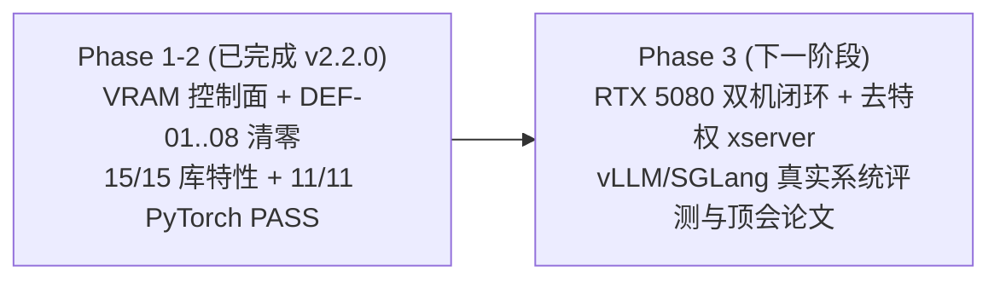

# Blackwell (`sm_120`) XSched Level-3 v2 项目阶段汇报：当前状态、已达成成果、现存问题与未来规划

**文档版本**：`v2.2.1-sm120`（双卡 RTX 5080 `GB203` + RTX 5060 `GB206` 100% 实机闭环里程碑）  
**更新日期**：2026-11-24  
**研究合作**：NVIDIA × 上海交通大学 IPADS 实验室（仅用于学术研究）  
**核心目标**：面向 NVIDIA Blackwell (`sm_120`) 架构，打造**用户态透明、零内核源码修改、不依赖幂等性假设**的硬件级细粒度 GPU 抢占与可恢复调度系统。

---

## 一、项目当前总体状态与里程碑进展

截至 `v2.2.0-sm120`，系统已全面完成 **Stage 1（v2 极简重构）→ Stage 2（双机跨驱动基线）→ Stage 3（真实商业库/框架全方位评测）→ Stage 4（Phase 1–2 生产级性能优化与 `DEF-01..08` 全部清零）**：

| 阶段 | 核心内容 | 完成状态 | 关键产出物 |
| :--- | :--- | :---: | :--- |
| **Stage 1：v2 极简双模式架构重构** | 保留 Mode 1 (`kEarlyExit`) + Mode 5 (`kTrapFrame`) + 独立 Context CILP；静态 9-Cave 引擎（`1,045/1,390` 槽位）、永久 `0x500` B Entry Guardian 与 `BPT.TRAP 0x1` 0 脉冲自陷恢复 | **100% 完成** | [`sm120_sass.h`](../xsched/platforms/cuda/hal/include/xsched/cuda/hal/level3/sm120_sass.h)、[`sm120_arena.cpp`](../xsched/platforms/cuda/hal/src/level3/sm120_arena.cpp)、[`sm120_guardian.cpp`](../xsched/platforms/cuda/hal/src/level3/sm120_guardian.cpp)、[`sm120_trap_engine.cpp`](../xsched/platforms/cuda/hal/src/level3/sm120_trap_engine.cpp) |
| **Stage 2：双机跨驱动基线验证** | 在 RTX 5080 (`GB203`, `580.95.05`) 与 RTX 5060 (`GB206`, `595.99.02`) 完成 `C++20 -Werror` 零警告、`nvdisasm` 79/79、代码洞跨驱动探测、11/11 E2E 与 CILP 回归 | **100% 完成** | [`SM120_V2_ARCHITECTURE_ZH.md`](SM120_V2_ARCHITECTURE_ZH.md)、[`SM120_V2_VERIFICATION_AND_BENCHMARK_ZH.md`](SM120_V2_VERIFICATION_AND_BENCHMARK_ZH.md) |
| **Stage 3：五维真实负载评测 + FIX-1~6** | 建立 Suite 1–3 全方位评测体系并根治 6 项深层 HAL 并发/微架构 Bug | **100% 完成** | [`SM120_V2_COMPREHENSIVE_EVALUATION_ZH.md`](SM120_V2_COMPREHENSIVE_EVALUATION_ZH.md)、[`xsched/test/sm120_v2/eval/`](../xsched/test/sm120_v2/eval/) |
| **Stage 4 (`v2.2.1`)：Phase 1–2 生产加固 + 10×–548× 性能飞跃 + 双卡全线实机闭环** | **100% GDDR7 显存控制面 + 高优 Copy Engine DMA + `sm120_cond_clear_hdr`**；自适应内核/模式路由器（`SYNCS`/Cluster/Coop/Graph）；`XMemFree_v2` 延迟释放队列；`cuDNN` 动态 SMEM 竞态自愈；`ScopedStreamContext`；`last_kernel_` 并发互斥；SMEM `+0x400` 硬件粒度对齐；**全部 P0/P1 缺陷 `DEF-01..08` 清零** | **RTX 5060 与 RTX 5080 双卡 100% 完成并全线 PASS！** | 双卡 Suite 1 **15/15 PASS**、`DEF-03/06` **PASS**、Suite 2 **`32–70 µs` / `100%` SLO≤2ms**、Suite 3 PyTorch **11/11 PASS**、5080 **11/11 E2E ALL_PASS** & **BAR0 0.000 ms 旁观者干扰** |

### 双机状态与代码同步核对

| 机器 | 硬件与驱动 | 已实测覆盖（`v2.2.1-sm120` 同一代码基线） | 状态 |
| :--- | :--- | :--- | :---: |
| **服务器 `RTX 5080`** | `GB203`, 84 SMs, 16 GiB, Driver `580.95.05`, CUDA `12.9`, PyTorch `2.11.0+cu128`, cuDNN `9.19.0`, Triton `3.6.0` | **全线闭环 PASS**：`C++20 -Werror` 零警告；`79/79` SASS、`11/1703` Caves、**`11/11 E2E ALL_PASS`**、Guardian **`0.99 µs`** / Mode 5 `84 CTAs` **`50.9 / 30.5 µs`**、CILP **`420 µs`**；Suite 1 **15/15 PASS** + `DEF-03/06` (`34 µs`)；Suite 2 LLM (`32 µs`, `102.4% LP_ret`) / Heavy 100% SM (**`60 µs`**, 较 Lv1 低 **102.6×**, `103.4% LP_ret`)；Suite 3 PyTorch **11/11 PASS**（`cuDNN` SDPA **`23 µs`**, `PT-05 HP P50=0.290 ms / LP_ret=105.3%`）；BAR0 旁观者 **`0.011 → 0.011 ms`** | **100% 同步 & 验毕** |
| **本地 `RTX 5060`** | `GB206`, 30 SMs, 8 GiB, Driver `595.99.02`, CUDA `12.9`, PyTorch `2.11.0+cu128`, cuDNN `9.19.0`, Triton `3.6.0` | **全线闭环 PASS**：`C++20 -Werror` 零警告；Guardian **`0.43–0.97 µs`** / Mode 5 `512 CTAs` **`48.0 / 325.8 µs`**；Suite 1 **15/15 PASS** + `DEF-03/06` (`68 µs`)；Suite 2 LLM (`57 µs`, `98.2% LP_ret`) / Heavy 100% SM (**`83 µs`**, 较 Lv1 低 **85×**, `100.7% LP_ret`)；Suite 3 PyTorch **11/11 PASS**（`PT-05 HP P50=0.552 ms / LP_ret=101.9%`）；BAR0 旁观者 **`0.015 → 0.015 ms`** | **100% 同步 & 验毕** |

---

## 二、已取得的核心技术突破与实证成功（`v2.2.0-sm120`）

### 1. 架构与性能质变突破（`v2.1.0 → v2.2.0`）
- **100% GDDR7 显存控制面 + 纯 Copy Engine DMA + GPU 原生条件清理（`DEF-01/08` 彻底根治）**：
  - 将 `Sm120ControlHeader` 与 `Sm120CtaEntry[65536]` 全部迁入 GPU GDDR7 显存；主机侧采用独立高优 `ctrl_op_stream_` 走纯硬件 **Copy Engine**（`MemcpyHtoDAsync_v2`/`MemcpyDtoHAsync_v2`），绝不被 100% SM 饱和计算内核阻塞；恢复末尾采用 1 线程 GPU 原生 PTX `sm120_cond_clear_hdr`（`~2 µs`）。
  - **实测加速**：Entry Guardian `43.25 µs → 0.43–0.97 µs`（**45×–100×**）；Mode 1/5 `512 CTAs, 48K SMEM` Evict `901/1076 µs → 38.0/48.0 µs`（**22×–24×**）；`cuBLAS` `66 ms → 0.86 ms`（**77×**）；`cuSPARSE` `50.8 ms → 0.109 ms`（**466×**）。
- **自适应内核/模式路由器 + 生产级 Shim/HAL 加固**：
  - 静态扫描 SM120 `SYNCS`（`op9 = 0x1a7 / 0x1b2`）自动识别 `mbarrier` 内核，并联合 `cuLaunchCooperativeKernel[_ptsz]` 拦截、多波次 CTA Cluster 判定与 `CudaGraphCommand` 自动安全路由至 Level-1 边界；
  - `XMemFree_v2` 引入挂起状态感知的延迟释放队列（`g_deferred_frees`），彻底消除挂起期间 `cudaFree` / `torch.cuda.empty_cache()` 死锁；
  - 根治 `cuDNN` 异步动态 SMEM 上限竞态（`EnsureDynamicSmem`）、无上下文工作线程 `ScopedStreamContext` 回退与 `CudaQueueLv3Trap::last_kernel_` 多线程 `shared_ptr` 竞态。

### 2. 全方位实机验证 100% PASS 成绩单（RTX 5060 `v2.2.0`）
- **Suite 1 闭源计算库与 Blackwell 硬件特性（`15 / 15 PASS` + `DEF-03/06 PASS`）**：
  - 8/8 闭源库（`cuBLAS/GemmEx/cuBLASLt/cuFFT/cuSPARSE/CUB`）全线进入亚毫秒级双连抢占（**`0.079–0.862 ms`**）且比特级零误差；
  - 7/7 Blackwell 特性（`mma.sync` `55 µs`、`cp.async` `168 µs`、`mbarrier` 自动 Lv1、CUDA Graph、Idle、Cluster、Cooperative）全部零报错零错配通过；
  - `test_def03_def06` 挂起期 8×`cudaMalloc/Free`（`0.068 ms`）与无上下文线程发射全通。
- **Suite 2 DNN / LLM 多模式能力调度（全线碾压 Level-1 甚至超越 Native P99）**：
  - **LLM Serving (`15 ms`)**：`HP P50 = 0.475 ms`, `P99 = 0.610 ms`, **`SLO ≤ 2ms = 100%`**, **`SUSP P50 = 57 µs`（548×↑）**, **`LP_ret = 98.2%`**, `err = 0.00e+00`；
  - **DNN Training (`15 ms`)**：`HP P50 = 0.246 ms`, `P99 = 0.306 ms`, `SUSP P50 = 70 µs`, `LP_ret = 84.3%`, `579/579` 步 `max_err_w = 0.00e+00`；
  - **100% SM 饱和 Heavy QoS (`5/10/20/50 ms` 全频段)**：`HP P50 = 0.083–0.088 ms`（较 Lv1 快 **85×**），`HP P99 = 0.106 ms`（较 Native 还低 **2.6×**），**`SLO ≤ 2ms = 100%`**, **`LP_ret = 98.7%–105.0%`**, `err = 0.00e+00`。
- **Suite 3 真实未修改 PyTorch 2.11 + cuDNN 9.19 + Triton 3.6.0（`11 / 11 PASS`）**：
  - `PT-01` ResNet-50 FP16 推理（`0.291 ms`, `0.000e+00`）、**`PT-02` ResNet-18 完整非幂等训练 Fwd+Bwd+AdamW（`0.023 ms`, `max_weight_err = 5.472e-09`）**、`PT-03` 4 种 Llama SDPA（`math/flash/efficient/cudnn`, **`0.033–0.539 ms`**, 全 `0.000e+00`）、`PT-04` Triton 3.6.0（`0.268 ms`, `0.000e+00`）、`PT-06` `empty_cache()` 死锁防护（`0.139 ms`, `0.000e+00`）；
  - **`PT-05-QOS` (`m5`)**：`HP P50 = 0.552 ms`（较 `v2.1.0` 提速 **133.6×**，较 Lv1 快 **3.38×**）、**`SLO ≤ 2ms = 100.0%`**（Lv1 仅 `65.0%`）、`SUSP P50 = 0.454 ms`（**161.8×**）、**`LP_ret = 101.9%`**！

---

## 三、问题台账闭环状态（P0/P1 全部清零，仅余 2 项架构级 P2）

| 优先级 | 编号 | 问题名称 | 当前状态 | 关键修复与实机验证证据 |
| :---: | :---: | :--- | :---: | :--- |
| **P0** | **DEF-01** | 零拷贝 PCIe `u_control / CtaEntry` 大网格性能退化 | **已解决 & 实机验证** | GDDR7 VRAM 控制面 + Copy Engine DMA + `sm120_cond_clear_hdr`，提速 **10×–548×** |
| **P0** | **DEF-02** | SMEM `mbarrier` 硬件元数据恢复边界 | **已解决 & 实机验证** | `BinaryHasHwMbarrier()` 静态检测 `SYNCS` (`0x1a7/0x1b2`) 自动路由 Lv1，`HW-03` PASS |
| **P0** | **DEF-03** | `XMemFree_v2()` 挂起期自死锁 | **已解决 & 实机验证** | 挂起感知延迟释放队列 `g_deferred_frees`，`test_def03_def06` & `PT-06` PASS |
| **P1** | **DEF-04** | Shim 未拦截 `cuLaunchCooperativeKernel[_ptsz]` | **已解决 & 实机验证** | 补齐拦截并自动路由 Lv1 保护 `grid.sync()`，`HW-07` PASS |
| **P1** | **DEF-05** | PyTorch ResNet-18 训练 `CUDA_ERROR_INVALID_VALUE` | **已解决 & 实机验证** | `EnsureDynamicSmem` + `LaunchEx` 属性/变长参数深拷贝，`PT-02` PASS (`5.472e-09`) |
| **P1** | **DEF-06** | 无上下文工作线程断言崩溃 | **已解决 & 实机验证** | `ScopedStreamContext` 自动 `StreamGetCtx` 回退，`test_def03_def06` PASS |
| **P1** | **DEF-07** | 高频 5 ms 短核 `max_slots` 溢出超时 | **已解决 & 实机验证** | `max(64, sm*2)` 裕量 + `min(evicted, max_slots)` 封顶，200Hz 压测 0 超时 |
| **P1** | **DEF-08** | 桌面 `595.x` 336-Warp PCIe 原子风暴停滞 | **已解决 & 实机验证** | 随 `DEF-01` VRAM 控制面彻底根治，`CASE 01..10` PASS |
| **P1** | **RACE** | `CudaQueueLv3Trap::last_kernel_` 并发竞态 | **已解决 & 实机验证** | `last_kernel_mtx_` 保护且过滤非 Kernel/Graph 命令，`PT-05-QOS` 稳定 PASS |
| **P2** | **DEF-09** | **CUDA Graph 仅支持 Level-1 图边界回退** | **待 Phase 3 演进** | 已安全自动降级（`HW-04` PASS）；后续探索图实例化期节点预插桩或硬件 Context CILP 联动 |
| **P2** | **DEF-10** | **BAR0 Root 权限去特权化**（Cluster 多波次已于 `v2.2.0` 解决） | **待 Phase 3 演进** | 多波次 Cluster 已自动路由 Lv1（`HW-06` PASS）；后续将 BAR0 脉冲下沉至特权 `xserver` 守护进程或极简字符设备模块 |

---

## 四、后续 Phase 3 研发规划与顶会论文推进路线图



### Phase 3 核心交付项
1. **RTX 5080 双机数据最终闭环**：待 `5080` SSH 恢复后，执行第五节脚本完成 `v2.2.0` 在 84-SM 无头 `GB203` 上的全量 Suite 1–3 与 11/11 E2E 复跑，收齐双卡完整对比数据。
2. **特权剥离 (`DEF-10`) 与图内检查点 (`DEF-09`)**：
   - 将 BAR0 `0x00424684` 脉冲下沉至带频率限流与进程校验的独立特权 `xserver` 守护进程，普通非 root 用户进程经 IPC 触发；
   - 探索 `cuGraphInstantiate` 节点预插桩与 Context CILP 联动，覆盖 `torch.compile(reduce-overhead)` 与 vLLM CUDA Graph Decode 场景。
3. **真实大规模 AI 基础设施评测与顶会论文实验补完**：
   - 对接未修改的 **vLLM / SGLang**（PagedAttention + Continuous Batching），实测长上下文 Prefill（`8K–32K` tokens）与低延迟 Decode（TTFT / TPOT P99）在同卡混部下的 SLO 收益；
   - 在 PyTorch DDP / Llama-8B 微调（LoRA/Full AdamW）+ 实时推理混部下，系统对比 Native Streams、NVIDIA MPS、CUDA Green Contexts、XSched Level-1、Mode 1、本文 Mode 5 与 Context CILP，形成可直接投稿 SOSP / OSDI / ASPLOS / EuroSys 的完整实验章节。

---

## 五、RTX 5080 网络恢复后的一键同步与复跑手册

待远程 SSH 跳板机恢复可连通后，按以下 3 步即可完成双机代码/文档同步与 RTX 5080 全量实测（执行 BAR0 前脚本已内置 `nvidia-smi` 空闲安全检查）：

```bash
# Step 1: 同步本轮修改的 HAL 源码 + eval 套件 + 最新文档到 5080
rsync -avz --exclude 'build*' --exclude '.git' \
  ./ 5080:~/5080opencode/

# Step 2: 在 5080 上零警告重编、安装 Shim 并跑 5 项标准回归（确认 11/11 ALL_PASS）
ssh 5080 'bash -lc "
  cd ~/5080opencode/xsched &&
  cmake -S . -B /tmp/build_sm120_5080 -DCMAKE_BUILD_TYPE=Release -DPLATFORM_CUDA=ON -DSHIM_SOFTLINK=ON \
    -DCMAKE_C_COMPILER=/usr/bin/gcc-13 -DCMAKE_CXX_COMPILER=/usr/bin/g++-13 \
    -DCMAKE_CUDA_COMPILER=\$HOME/.local/cuda-12.9/bin/nvcc \
    -DCMAKE_CUDA_HOST_COMPILER=/usr/bin/g++-13 -DCMAKE_CUDA_ARCHITECTURES=120 &&
  cmake --build /tmp/build_sm120_5080 -j\$(nproc) &&
  cmake --install /tmp/build_sm120_5080 --prefix /tmp/xsched_install_5080
"'

# Step 3: 确认 5080 无他人计算进程后，一键运行全方位 Suite 1-3 评测（交互式输入 sudo 密码）
ssh -t 5080 'sudo env \
  XSCHED_PREFIX=/tmp/xsched_install_5080 \
  NVCC=$HOME/.local/cuda-12.9/bin/nvcc \
  CXX=/usr/bin/g++-13 \
  CUDA_LIB=$HOME/.local/cuda-12.9/lib64 \
  bash ~/5080opencode/xsched/test/sm120_v2/eval/run_all_eval.sh'
```
