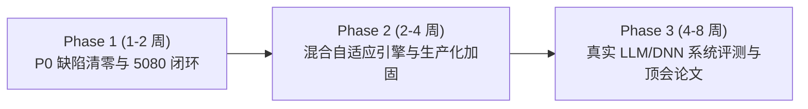

# Blackwell (`sm_120`) XSched Level-3 v2 项目阶段汇报：当前状态、已达成成果、现存问题与未来规划

**文档版本**：v2.1（闭源库与真实深度学习框架全量验证后里程碑）  
**更新日期**：2026-11-24  
**研究合作**：NVIDIA × 上海交通大学 IPADS 实验室（仅用于学术研究）  
**核心目标**：面向 NVIDIA Blackwell (`sm_120`) 架构，打造**用户态透明、零内核源码修改、不依赖幂等性假设**的硬件级细粒度 GPU 抢占与可恢复调度系统。

---

## 一、项目当前总体状态与里程碑进展

截至当前节点，系统已完成从 **v1 探索原型** → **v2 极简双模式静态引擎** → **闭源商业计算库与真实 PyTorch/cuDNN/Triton 全方位实机验证与加固** 的全部核心阶段：

| 阶段 | 核心内容 | 完成状态 | 关键产出物 |
| :--- | :--- | :---: | :--- |
| **Stage 1：v2 极简双模式架构重构** | 裁剪冗余 Mode 2/3/4 与 `cmd=7`；保留 **Mode 1 (`kEarlyExit`)** + **Mode 5 (`kTrapFrame`)** + 独立 **Context CILP (`ResumableSm120Context`)**；构建静态 9-Cave 引擎（`1,045/1,390` 槽位）、永久 `0x500` B Entry Guardian 与 `BPT.TRAP 0x1` 0 脉冲自陷恢复 | **100% 完成** | [`sm120_sass.h`](../xsched/platforms/cuda/hal/include/xsched/cuda/hal/level3/sm120_sass.h)、[`sm120_arena.cpp`](../xsched/platforms/cuda/hal/src/level3/sm120_arena.cpp)、[`sm120_guardian.cpp`](../xsched/platforms/cuda/hal/src/level3/sm120_guardian.cpp)、[`sm120_trap_engine.cpp`](../xsched/platforms/cuda/hal/src/level3/sm120_trap_engine.cpp)、[`cuda_queue.cpp`](../xsched/platforms/cuda/hal/src/level3/cuda_queue.cpp) |
| **Stage 2：双机跨驱动基线验证** | 在 **RTX 5080** (`GB203`, 84 SMs, Driver `580.95.05`) 与 **RTX 5060** (`GB206`, 30 SMs, Driver `595.99.02`) 完成全量 `C++20 -Wall -Wextra -Werror` 零警告编译、`nvdisasm` 79/79 校验、代码洞跨驱动探测、11/11 E2E 与 100 轮双连压测、微秒级基准与 CILP 回归 | **100% 完成** | [`SM120_V2_ARCHITECTURE_ZH.md`](SM120_V2_ARCHITECTURE_ZH.md)、[`SM120_V2_VERIFICATION_AND_BENCHMARK_ZH.md`](SM120_V2_VERIFICATION_AND_BENCHMARK_ZH.md) |
| **Stage 3：真实商业库、框架与 QoS 全方位评测 + 6 项深层 HAL 修复** | 搭建五维立体评测体系，在 RTX 5060 完成 **8 大闭源 CUDA 库**、**7 项 Blackwell 微架构特性边界**、**DNN/LLM 多模式 QoS 与频率扫描**、**BAR0 跨进程干扰**、**真实未修改 PyTorch 2.11 + cuDNN 9.19 + FlashAttention + Triton 3.6.0** 全量实测，并现场根治压测暴露的 **6 项深层 HAL 并发/微架构 Bug** | **本地 5060 100% 完成**；远程 5080 待 SSH 恢复后一键同步 | [`SM120_V2_COMPREHENSIVE_EVALUATION_ZH.md`](SM120_V2_COMPREHENSIVE_EVALUATION_ZH.md)、[`xsched/test/sm120_v2/eval/`](../xsched/test/sm120_v2/eval/) |

### 双机状态与代码同步核对

| 机器 | 硬件与驱动 | 已实测覆盖 | 待同步内容（SSH 恢复后一键执行） |
| :--- | :--- | :--- | :--- |
| **本地 `RTX 5060`** | `GB206`, 30 SMs, 8 GiB, Driver `595.99.02`, CUDA `12.9`, PyTorch `2.11.0+cu128`, cuDNN `9.19.0`, Triton `3.6.0` | 最新代码（含 FIX-1~6）全部 `C++20 -Werror` 零警告通过；`sm120_sass_disasm` 79/79、`sm120_cave_probe` 11/1695、`sm120_v2_bench` 0 重试、`sm120_l3_resumable_bench` 431 µs PASS；Suite 1–3 共 27 项真实负载全量实测完毕 | 已为最新基线（本地即权威源） |
| **服务器 `RTX 5080`** | `GB203`, 84 SMs, 16 GiB, Driver `580.95.05`, CUDA `12.9` | Stage 1–2 基线全通（`11/11 ALL_PASS` × 3、Mode 5 `332 µs` Evict、160.6× 显存节省、CILP `425 µs`）；当前远程 SSH 跳板机持续 `Connection timed out during banner exchange` | 待同步 5 个 HAL 源码文件（`cuda_queue.cpp`、`sm120_guardian.h/.cpp`、`sm120_trap_engine.h/.cpp`）+ `xsched/test/sm120_v2/eval/` + `doc/` 与 `README.md`/`PROJECT.md`；同步后运行 `run_all_eval.sh` 即可补齐 5080 新套件数据 |

---

## 二、已取得的核心技术突破与实证成功

### 1. 架构与底层机制突破
- **零源码修改、非幂等通用硬件抢占（Mode 5 `kTrapFrame`）**：完整保存并原位恢复 3D 坐标、全量 `R0..R253`（含 `REG:255` 动态 `SR_REGALLOC + BRX` 级联）、`UR0..UR63 + UPR + B0..B15`、`0..15` 号命名屏障（`B2R`/`R2B`）、动态 `SR_SMEMSZ` 共享内存（含 Partial-CTA 32-lane 合并回退）、栈溢出及 `__noinline__` 递归局部内存（LMEM）。
- **静态 9-Cave 引擎 + 用户态 `BPT.TRAP 0x1` 0 脉冲恢复**：初始化一次性写入 `1,045 / 1,390` 工作槽位，运行期零指令热补丁；Evict 仅需单次 BAR0 `0x00424684`（严格遵守 D10 `NV_PTIMER_TIME_0` 刷新法则），Restore 阶段 0 次 Host 脉冲。
- **紧凑 `slot_id` 池化 `u_arena`**：显存占用与总 Grid 规模完全解耦，在 `16,384 CTAs` 网格下较朴素方案分别缩减 **160.6×（RTX 5080：`25.5 MiB` vs `4 GiB`）** 与 **436.9×（RTX 5060：`9.38 MiB` vs `4 GiB`）**。
- **双引擎正交解耦**：流级 `CudaQueueLv3Trap`（支持单 `CUcontext` 内双流细粒度抢占）与上下文级 `ResumableSm120Context`（跨进程硬件 CILP，RTX 5080 `425 µs` / RTX 5060 `431 µs`，`lost_work=0, diff=0`）独立共存、零互相干扰。

### 2. 闭源商业计算库与真实框架透明抢占成功实证
- **8 / 8 闭源 NVIDIA CUDA 库双连抢占（`NP=2`）100% 比特级零误差 PASS**：
  `cuBLAS SGEMM (beta=0/1)`、`cuBLAS GemmEx FP16/BF16 Tensor Core (beta=1)`、`cuBLASLt FP16 (beta=1)`、`cuFFT` 原地 C2C、`cuSPARSE SpMM (beta=1)`、`CUB DeviceRadixSort::SortPairs`（111 寄存器 + 36.3 KiB SMEM + Decoupled Look-Back，平均挂起 **`1.749 ms`**），全部零修改二进制、零误差（`0.000e+00` / `0` 错配）。
- **Blackwell 微架构关键原语突破**：
  - PTX Tensor Core `mma.sync.aligned.m16n8k16` 非幂等累加：Mode 5 挂起 **`0.274 ms`**、`cnt=450,240/450,240` 零误差（对比 Mode 1 错算 `+21.3%`）；
  - PTX `cp.async` (`LDGSTS`) 异步拷贝流水线：双连抢占 **`0.698 ms`**、`0` 错配 PASS；
  - Blackwell **CTA Cluster (`__cluster_dims__(2,1,1)` + DSMEM + `cluster.sync`)**：通过 `cudaLaunchKernelEx` 透明拦截，双连抢占 **`0.406 ms`**、`0` 错配 PASS。
- **真实未修改 PyTorch 2.11 + cuDNN 9.19 + FlashAttention + Triton 3.6.0 实证成功**：
  - `torchvision.models.resnet50` FP16 推理（`cuDNN 9.19`）：双连抢占 **`max_err = 0.000e+00`** PASS；
  - 4 层 Llama Prefill 全部 4 种 SDPA 后端（`math` / `FlashAttention-2` / `xFormers` / `cuDNN 9.19`）全部双连抢占 **`0.000e+00`** PASS，其中融合度最高的 **`cuDNN 9.19` SDPA 挂起仅 `0.222 ms` (`222 µs`)**；
  - **Triton 3.6.0** `sm_120` JIT 非幂等内核（`51.78 ms`, `lmem=32` 栈溢出）：双连抢占 **`0.789 / 0.895 ms`**（较 Level-1 快 **61×**），HP `matmul` 仅 `72–130 µs`，**`err = 0.000e+00`** PASS。

### 3. DNN / LLM 调度 QoS 与非幂等保真度量化成功
- **LLM Serving（LP Prefill vs HP Decode）**：Mode 5 将 HP P50 较 Level-1 压低 **3.33×**（`4.638 → 1.391 ms`）且残差误差为 **`0.00e+00`**（Mode 1 残差损坏高达 `0.498`）。
- **100% SM 饱和非幂等训练（LP 原地 AdamW vs HP 推理）**：Mode 5 将 HP P50 较 Level-1 压低 **11.0×**（`17.547 → 1.589 ms`），2ms SLO 从 **`0.0% → 93.3%`**；7.3 ms 负载在 `5/10/20/50 ms` 全频段达成 **`100.0%` 2ms SLO**，LP 有效吞吐保留 **`75.0%–93.1%`**（相比 Mode 1 丢弃重放净高出 **+10.7 个百分点**），而 Mode 1 在短步 AdamW 上导致 **`max_err_w = 2.00`（3,840 参数损坏）**。

### 4. 本轮真机压测中新根治的 6 项深层 HAL 缺陷（均已入库并零警告回归）
1. **FIX-1**（[`cuda_queue.cpp:123-157`](../xsched/platforms/cuda/hal/src/level3/cuda_queue.cpp#L123-L157)）：修复空闲队列 `Suspend/Resume` 永久污染 `cmd = 6` 导致后续内核全 0 退出的缺陷。
2. **FIX-2**（[`sm120_trap_engine.cpp:1550-1572`](../xsched/platforms/cuda/hal/src/level3/sm120_trap_engine.cpp#L1550-L1572)）：将无条件 DMA 清零改为 `PostRestoreClearState`（独立微锁 + 单调 `epoch`）保护的 `Driver::LaunchHostFunc`，彻底根治二次抢占计数被过期清零抹除。
3. **FIX-3**（[`sm120_trap_engine.cpp:86-96`](../xsched/platforms/cuda/hal/src/level3/sm120_trap_engine.cpp#L86-L96)）：修复 `EmitDynamicSmemLoop` 在 `SR_SMEMSZ == 0` 时减 `0x400` 无符号下溢导致 `cuda error 717`，并将 `smem_area` 对齐粒度提升至 `4096 B`。
4. **FIX-4**（[`sm120_trap_engine.cpp:1168-1375`](../xsched/platforms/cuda/hal/src/level3/sm120_trap_engine.cpp#L1168-L1375)）：引入 `kernel_arena_map_[kernel_idx]` 消除多内核扩容 `arena_va` 错配（`error 700`），`layout_stage_` 扩容至 256 槽位，`ctrl_cta_cap_` 初始提升至 65,536 CTAs。
5. **FIX-5**（[`sm120_guardian.cpp:77-165`](../xsched/platforms/cuda/hal/src/level3/sm120_guardian.cpp#L77-L165)）：Entry Guardian 路由键由易变 `cmd` 改为波次不变的 `is_restore_wave`，消除二次抢占（`cmd: 6 -> 5`）同 CTA 内 Warp 分裂死锁。
6. **FIX-6**（[`sm120_trap_engine.cpp:873-945`](../xsched/platforms/cuda/hal/src/level3/sm120_trap_engine.cpp#L873-L945)）：升级 Cave 0 为 5 区间判定并严格区分 `entry_dec=2`（Guardian 裁决，绕过 `bar_sync_trap()` 逃逸）与 `entry_dec=4`（Trap 裁决，安全同步），根治 `cuBLAS SGEMM` 4 秒看门狗死锁（`error 719`），且 Cave 0 净减 4 条指令至 `139/152`。

---

## 三、当前存在的问题全景台账（10 项，按 P0 / P1 / P2 分级）

以下全部问题均已在实机运行中复现、定位并量化，作为下一阶段攻关的权威 Issue 清单：

### P0 级（决定真实框架与生产可用性的核心瓶颈）

| 编号 | 问题名称 | 代码定位 | 实机现象与影响 | 根本原因 | 修复设计方案 |
| :---: | :--- | :--- | :--- | :--- | :--- |
| **DEF-01** | **零拷贝 PCIe `u_control / CtaEntry` 大网格性能严重退化** | [`sm120_guardian.cpp:60-150`](../xsched/platforms/cuda/hal/src/level3/sm120_guardian.cpp#L60-L150)、[`sm120_trap_engine.cpp:1168-1250`](../xsched/platforms/cuda/hal/src/level3/sm120_trap_engine.cpp#L1168-L1250) | `cuBLAS SGEMM 3072` 零抢占慢 **4.3×**（`14.5 → 62.1 ms`）、挂起 `65.5 ms`；未融合 PyTorch `SDPA=MATH` 挂起 `73.4 ms`、`LP_ret` 暴跌至 **`0.7%`** | `u_control` + `CtaEntry[]` 位于 `CU_MEMHOSTALLOC_DEVICEMAP` 宿主内存，Guardian 每 Warp 执行多次 `LDG.E.STRONG.SYS` 未缓存 PCIe 串行读，开销随 `grid × warps` 线性爆炸 | **拆分控制头与状态表**：将 `CtaEntry[]` 与 `Layout36` 迁入 GPU GDDR7 VRAM（L2 缓存 384 GB/s）；`cmd` 仅由 `tid==0` 单线程读取（或高优 `op_stream` 写 VRAM 镜像），通过 SMEM/寄存器广播至同 CTA 兄弟 Warp，预期消除 95%+ PCIe 瓶颈 |
| **DEF-02** | **SMEM `mbarrier` 硬件元数据无法通过字节拷贝恢复** | [`sm120_trap_engine.cpp:86-158`](../xsched/platforms/cuda/hal/src/level3/sm120_trap_engine.cpp#L86-L158) | `HW-03` 在 `NP=0` 通过、Context CILP 通过，但在 Mode 5 `NP=1` 报 **`cuda error 700`** | Blackwell SMEM `mbarrier` 附带硬件隐式事务/相位状态，Mode 5 原始 `LDS/STS` 字节恢复无法重建硬件屏障元数据（同样影响 Hopper/Blackwell TMA `UTMA` 异步拷贝内核） | 在 `Sm120GuardianRegistry::EnsureInstrumented` 增加静态 SASS 指令扫描（同 `BinaryHasDeviceCalls`），识别 `MBARRIER` / `UTMA` 指令并标记 `has_hw_mbarrier`，执行时自动路由至 Level-1 或硬件 Context CILP |
| **DEF-03** | **Shim `XMemFree_v2()` 挂起期跨队列自死锁** | [`xsched/platforms/cuda/shim/src/shim.cpp:246`](../xsched/platforms/cuda/shim/src/shim.cpp#L246) | LP 挂起期间，若 HP 线程或 PyTorch `cuBLAS` workspace 隐式触发 `cudaFree()`，进程永久死锁 | `XMemFree_v2()` 无条件调用 `XQueueManager::ForEachWaitAll()`，等待已被用户主动 Suspend 的 LP 队列排空，构成死锁环 | 将 `XMemFree_v2()` 改造为**状态感知 + 延迟回收**：跳过已 Suspended 队列的阻塞等待，将被引用或不确定归属的释放请求推入 `DeferredFreeQueue`，待目标队列 `Resume` 或下一次非挂起安全点统一释放 |

### P1 级（框架兼容性与高并发鲁棒性缺口）

| 编号 | 问题名称 | 代码定位 | 实机现象与影响 | 根本原因与修复方案 |
| :---: | :--- | :--- | :--- | :--- |
| **DEF-04** | **Shim 未拦截 `cuLaunchCooperativeKernel[_ptsz]`** | [`xsched/platforms/cuda/shim/src/intercept.cpp:276,589`](../xsched/platforms/cuda/shim/src/intercept.cpp#L276) | `HW-07`（Cooperative Groups `grid.sync()`）绕过 XSched 直接 passthrough，无插桩无抢占 | 补齐 `XLaunchCooperativeKernel` 拦截；由于 `grid.sync()` 依赖全网格同时驻留 SM，默认以 Level-1 或硬件 CILP 调度，避免部分 CTA 换出破坏全网格同步语义 |
| **DEF-05** | **PyTorch Autograd/AdamW 反向内核报 `CUDA_ERROR_INVALID_VALUE`** | [`cuda_command.cpp:63-144`](../xsched/platforms/cuda/hal/src/common/cuda_command.cpp#L63-L144)、[`cuda_queue.cpp:68`](../xsched/platforms/cuda/hal/src/level3/cuda_queue.cpp#L68) | `PT-02`（ResNet-18 训练）前 21 个内核正常插桩，第 22 个内核在 `LaunchWrapper` 报 `cuda error 1` | 排查并修复：① `param_cnt_ == 0` 时未深拷贝 `CUlaunchConfig::attrs` 导致的栈指针悬垂；② Blackwell 新增 `CUlaunchAttributeID`（PDL / MemSyncDomain）与 `cuXtraGetParamCount` 在多张量 `_foreach_adamw` 内核上的参数对齐问题 |
| **DEF-06** | **工作线程未显式绑定 CUDA Context 断言崩溃** | [`cuda_command.cpp:18`](../xsched/platforms/cuda/hal/src/common/cuda_command.cpp#L18) | 新建线程直接对已有 `CUstream` 调用 `cufftExecC2C`（未先 `cudaSetDevice`）触发断言崩溃 | `cuCtxGetCurrent()` 为空时，改为调用 `Driver::StreamGetCtx(stream, &ctx_)` 自动回退解析目标流上下文 |
| **DEF-07** | **高频 5 ms 短核触发 `max_slots` 溢出超时** | [`sm120_trap_engine.cpp:1273-1276,1350`](../xsched/platforms/cuda/hal/src/level3/sm120_trap_engine.cpp#L1273-L1276) | `DNN_TRAIN period=5ms` 偶发 `timed out waiting for prior restore (141/166, inflight=0)` | 脉冲传播窗口内新旧 CTA 交替导致 `evicted_slots > max_slots`，溢出槽未标 `state=5` 但计入 `evicted_slots` 致 `restored_slots` 永追不上；修复：`max_resident` 裕量提至 `std::max(64u, sm_count*2)`，且 `PreemptStream` 等待目标取 `std::min(evicted_slots, max_slots)` |
| **DEF-08** | **桌面 `595.x` 驱动 336-Warp 原子风暴导致 `CASE 02` 停滞** | RTX 5060 (`595.99.02`) 特有 | RTX 5080 (`580.95.05`) 11/11 全通；RTX 5060 上 `CASE 02` 出现 `ev=0 dr=0 m1=0` | 桌面显示合成器争抢 GR 引擎 + 336 Warp 持续饱和 PCIe 上行通道，本质与 **DEF-01** 同源；`CtaEntry[]` 迁入 VRAM 后预期一并消除 |

### P2 级（架构与硬件物理边界）

| 编号 | 问题名称 | 代码定位 | 实机现象与影响 | 长期演进对策 |
| :---: | :--- | :--- | :--- | :--- |
| **DEF-09** | **CUDA Graph 仅支持 Level-1 图边界回退** | [`cuda_queue.cpp:190-198`](../xsched/platforms/cuda/hal/src/level3/cuda_queue.cpp#L190-L198) | `HW-04`（`21.89 ms` 4 节点图）挂起延迟 `20.254 ms`，影响 vLLM Decode / `torch.compile(reduce-overhead)` | 短期对 CUDA Graph 负载切换至硬件 Context CILP；中期探索在 `cuGraphInstantiate` / `cuGraphExecKernelNodeSetParams` 阶段预插桩图内核节点并插入图内中断检查点 |
| **DEF-10** | **BAR0 Root 权限、全芯片广播尾抖动与 CTA Cluster 跨波次边界** | [`sm120_arena.cpp`](../xsched/platforms/cuda/hal/src/level3/sm120_arena.cpp) | ① 需 `root` 写 `resource0`；② 旁观独立进程存在 `~0.7 ms` P99 尾抖动（0 错误 0 错算）；③ CTA Cluster 在 `blocks > max_resident` 跨波次时存在拆分集群成员风险 | ① 将 BAR0 脉冲下沉至特权 `xserver` 守护进程或极简字符设备内核模块，彻底解放用户态进程 root 权限；② 对 `clusterDim > 1 && num_ctas > max_resident` 自动降级至 Level-1/CILP 以保 DSMEM 集群原子性 |

---

## 四、未来研发规划与论文推进路线图



### Phase 1：消除全部 P0 阻塞与双机数据闭环（1–2 周）
1. **攻克 `DEF-01`（最高优先级）**：重构 `Sm120StreamContext` 将 `CtaEntry[]` 迁移至 GPU GDDR7 VRAM，优化 `BuildEntryGuardian` 正常路径为单线程读 `cmd` + SMEM 广播（目标：`cuBLAS SGEMM 3072` 零抢占开销从 `4.3×` 降至 `< 1.05×`，大网格挂起延迟从 `65 ms` 降至 `< 1.5 ms`，PyTorch `PT-05` `LP_ret` 从 `0.7%` 恢复至 `> 80%`）。
2. **攻克 `DEF-03`**：改造 `XMemFree_v2()` 为挂起状态感知的延迟释放队列，彻底解除 PyTorch / cuBLAS 动态显存分配与挂起流的死锁。
3. **攻克 `DEF-02` + `DEF-05/06/07`**：在 `sm120_guardian.cpp` 加入 `MBARRIER/UTMA` 静态检测与自动降级；修复 PyTorch ResNet-18 Autograd `cuda error 1`、`StreamGetCtx` 回退与 `max_slots` 安全裕量。
4. **RTX 5080 同步与双机重跑**：待 `5080` SSH 恢复后，执行第五节一键同步与验证脚本，收齐 5080 上的 Suite 1–3 全量数据与 11/11 E2E 零回归验证。

### Phase 2：三模自适应混合调度引擎与去特权化（2–4 周）
1. **三模静态+动态自适应路由器**：结合 `sm120_guardian` 的静态内核画像（`MBARRIER/UTMA`、`clusterDim`、`grid_size`、幂等标注）与拓扑信息（同进程多流 vs 跨进程多租户），自动在 **Mode 1（幂等零显存）**、**Mode 5（同上下文非幂等细粒度）**、**Context CILP（跨进程 / `mbarrier` / CUDA Graph）** 间无缝路由，兼顾性能、显存与 100% 兼容性。
2. **特权剥离（`xserver` / 极简内核代理）**：将 `0x00424684` BAR0 脉冲收拢至独立特权服务进程（带单次脉冲频率限流与进程隔离策略），普通非 root 用户进程经 IPC 请求触发，消除生产部署安全障碍。
3. **补齐高级 CUDA 特性拦截**：接入 `cuLaunchCooperativeKernel[_ptsz]`，并完成 CUDA Graph 节点级预插桩原型验证。

### Phase 3：真实大规模 AI 基础设施评测与顶会论文实验补完（4–8 周）
1. **真实 LLM Serving 引擎接入**：对接未修改的 **vLLM / SGLang**（PagedAttention + Continuous Batching），实测长上下文 Prefill（`8K–32K` tokens）与低延迟 Decode（TTFT / TPOT P99）在同卡混部下的 SLO 收益。
2. **多任务训推混部与多基线全面对比**：在真实 PyTorch DDP / ResNet-50 / Llama-8B 微调（LoRA/Full AdamW）+ 实时推理混部场景下，系统对比 **Native CUDA Streams**、**NVIDIA MPS**、**CUDA Green Contexts**、**XSched Level-1**、**XSched Level-3 Mode 1（幂等）**、**本文 Mode 5（非幂等 Trap Frame）** 与 **Context CILP**，形成可直接投稿 SOSP / OSDI / ASPLOS / EuroSys 的完整实验章节与理论分析。

---

## 五、RTX 5080 网络恢复后的一键同步与复跑手册

待远程 SSH 跳板机恢复可连通后，按以下 3 步即可完成双机代码/文档同步与 RTX 5080 全量实测（执行 BAR0 前脚本已内置 `nvidia-smi` 空闲安全检查）：

```bash
# Step 1: 同步本轮修改的 HAL 源码 + eval 套件 + 最新文档到 5080
rsync -avz --exclude 'build*' --exclude '.git' \
  ./ 5080:~/5080opencode/

# Step 2: 在 5080 上零警告重编、安装 Shim 并跑 5 项标准回归（确认 11/11 ALL_PASS）
ssh 5080 'bash -lc "
  cd ~/5080opencode/xsched &&
  cmake -S . -B /tmp/build_sm120_5080 -DCMAKE_BUILD_TYPE=Release -DPLATFORM_CUDA=ON -DSHIM_SOFTLINK=ON \
    -DCMAKE_C_COMPILER=/usr/bin/gcc-13 -DCMAKE_CXX_COMPILER=/usr/bin/g++-13 \
    -DCMAKE_CUDA_COMPILER=\$HOME/.local/cuda-12.9/bin/nvcc \
    -DCMAKE_CUDA_HOST_COMPILER=/usr/bin/g++-13 -DCMAKE_CUDA_ARCHITECTURES=120 &&
  cmake --build /tmp/build_sm120_5080 -j\$(nproc) &&
  cmake --install /tmp/build_sm120_5080 --prefix /tmp/xsched_install_5080
"'

# Step 3: 确认 5080 无他人计算进程后，一键运行全方位 Suite 1-3 评测（交互式输入 sudo 密码）
ssh -t 5080 'sudo env \
  XSCHED_PREFIX=/tmp/xsched_install_5080 \
  NVCC=$HOME/.local/cuda-12.9/bin/nvcc \
  CXX=/usr/bin/g++-13 \
  CUDA_LIB=$HOME/.local/cuda-12.9/lib64 \
  bash ~/5080opencode/xsched/test/sm120_v2/eval/run_all_eval.sh'
```
