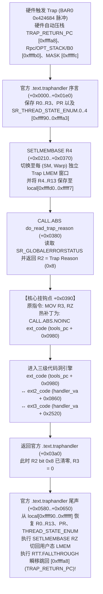
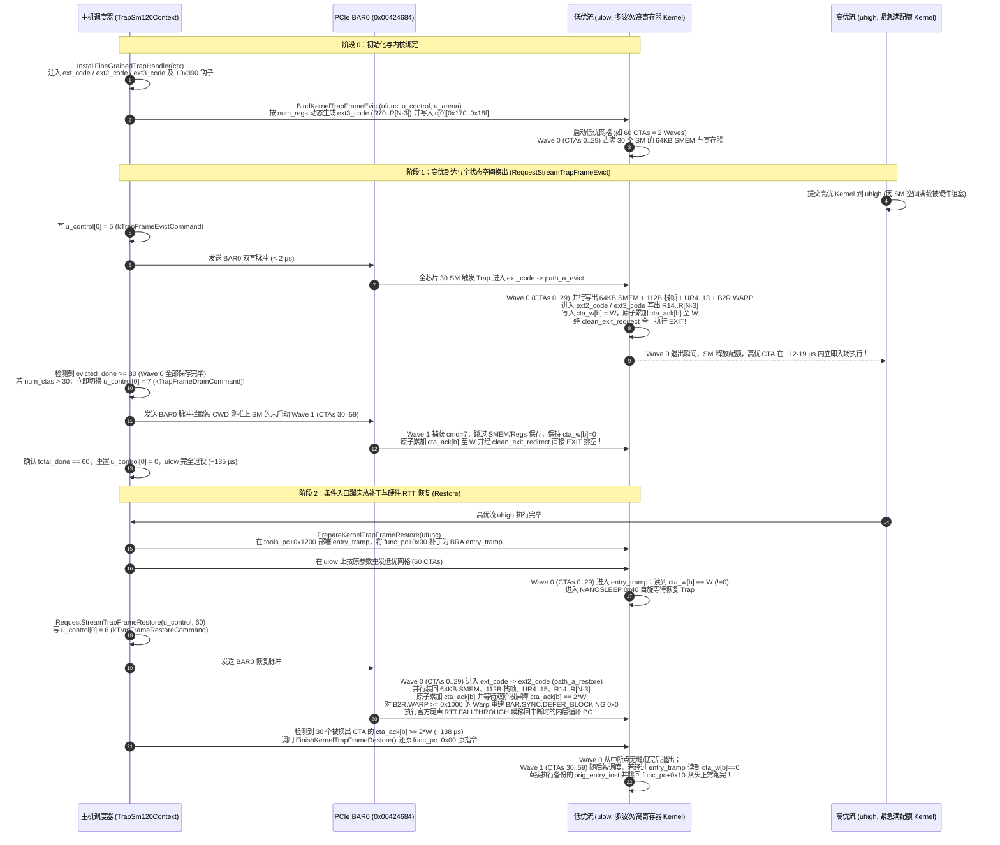

# Blackwell SM120 (RTX 5060 / GB206) 通用零源码修改细粒度空间抢占与硬件恢复架构白皮书 (`Universal Mode 5 / TrapFrame Engine`)

> **文档定位**：本文档对我们在 NVIDIA Blackwell `SM120`（GeForce RTX 5060 / `GB206`，Open-RM 驱动 `595.99.02`，CUDA `12.9`）上研发并实机验证的**细粒度硬件 Trap 抢占体系（Modes 1–5，核心聚焦于零用户源码修改的通用全状态空间换出与 `RTT.FALLTHROUGH` 硬件恢复引擎 `Universal Mode 5`）**进行全方位的深度技术剖析。
>
> **涵盖内容**：
> 1. **模型方法原理**：抢占分类、BAR0 MMIO 全芯片广播触发 Trap 的微架构机理、`.text.traphandler` 硬件栈帧与软件分发链路；
> 2. **地址空间拓扑与内存协议**：7 大可执行 Trap 代码段地址推导、`c[0x0]` 常量内存描述符、`u_control` 主机映射控制字与 `u_arena` 全局显存快照池字节级布局；
> 3. **抢占与恢复调用触发全链路**：主机 C++ API 调度闭环、多波次快速排空 (`cmd=7`) 与普通态条件入口蹦床 (`entry_tramp`) 状态机；
> 4. **三级代码洞（`ext_code` + `ext2_code` + `ext3_code` + `entry_tramp`）逐指令（Line-by-Line）完整注释与数据流分析**；
> 5. **模型能力边界、适用性矩阵与当前微架构限制剖析**；
> 6. **理论带宽/延迟数值分析模型与 8 大实机基准测试方法详解**；
> 7. **后续进一步优化路线图（第 4 级代码洞、按需动态 SMEM 裁剪、多命名屏障与 LMEM 栈增量保存、免重发调度）**；
> 8. **SM120 底层逆向工程知识百科（未公开 Driver Export Table、地址偏移铁律、SASS 指令集陷阱与计分板时序规范）**。

---

## 1. 模型的方法原理：从 ALU 让出到零源码修改全状态空间换出与恢复

### 1.1 GPU 细粒度抢占的本质矛盾与五种模式演进

在现代 GPU（如 Blackwell `SM120`）上，每个流多处理器（SM）拥有严格受限的四类物理空间配额：
- **通用寄存器堆（Register File）**：每 SM 固定 `65,536` 个 32-bit 寄存器（单线程最高 `255` 个寄存器）；
- **统一寄存器堆（Uniform Register File）**：每 Warp 独立 `UR0..UR63`；
- **共享内存（Shared Memory / L1 Data Cache）**：每 CTA 最高约 `64 KiB ~ 100 KiB`（其中 SM120 驱动固定保留每 CTA 头部 `1,024 B`）；
- **硬件 Warp 与 CTA 槽位（Hardware Slots）**：每 SM 最高 `48` 个并发 Warp、`16 ~ 32` 个并发 CTA，以及 `16` 个硬件命名屏障（Named Barriers `0..15`）。

当低优先级算子（Low-Priority Kernel）占满 SM 的任意一项空间配额（例如每 CTA 占用 `64 KiB` Shared Memory 或每线程占用 `93 ~ 238` 个寄存器）时，即使主机向高优先级 CUDA Stream 提交紧急任务，GPU 硬件的 **Compute Work Distributor (CWD)** 也会因**空间配额不足（Spatial Quota Exhaustion）**而将高优 CTA 死锁在发射队列外，直到低优 CTA 彻底执行 `EXIT` 指令退役。

为此，我们在 [`trap_sm120.cpp`](file:///run/media/wy/40D41982D4197AFC/1file/Desktop/code/code/xsched/level3opencode/xsched/platforms/cuda/hal/src/level3/trap_sm120.cpp) 中构建了五级递进的细粒度抢占架构：

| 模式代号 | 架构名称 | 核心机制 | 是否释放 SM 空间配额 (Regs/SMEM/Warps) | 是否需要修改用户 Kernel 源码 | 典型抢占/恢复延迟 (`P50`) |
| :--- | :--- | :--- | :---: | :---: | :---: |
| **Mode 1** | `Early-Exit` (`cmd = 1`) | Trap 改写 `TRAP_RETURN_PC` 为 `exit_stub_va` (`EXIT`)，配合 CommandLog 重放 | ✅ **100% 释放** | ❌ 无需改源码（幂等算子）或 Level 2 桩 | 排空 `~17–49 µs` |
| **Mode 2** | `In-Place Pause` (`cmd = 2`) | Trap 保存原 `TRAP_RETURN_PC` 至 `local[0xffff88]`，跳入 `pause_tramp` (`NANOSLEEP`) 原地休眠 | ❌ 仅让出 ALU，保留片上空间 | ❌ **100% 零源码修改** | 暂停 `0.83 µs` / 恢复 `25.9 µs` |
| **Mode 3** | `Per-CTA Hybrid` (`cmd = 3`) | 按 `control[4+2*cta_id]` 对同一 Kernel 内不同 CTA 分别执行 `Early-Exit` 或 `In-Place Pause` | ⚖️ 按比例释放指定 CTA 配额 | ❌ **100% 零源码修改** | 混合抢占 `~30 µs` |
| **Mode 4** | `Safe-Point Spill` (`cmd = 4`) | Trap 仅用 `< 2 µs` 原子置位 `*request_va |= 1` 并立即 `RTT` 返回；Kernel 在循环 Tile 边界安全点仅压缩写出跨步存活变量后 `EXIT` | ✅ **100% 释放**（写出数据量极小，如 SGEMM 仅 `120 KiB`） | ⚠️ 需在 Kernel 循环边界插入安全点宏 | 入场 `9.1 µs` / 排空 `23.8 µs` / 恢复 `6.9 µs` |
| **Mode 5 (`trapframe`)** | **`Universal Trap-Frame Evict & RTT Restore` (`cmd = 5, 6, 7`)** | **完全在 `.text.traphandler` 三级代码洞内转储每 CTA `64 KiB` SMEM、`112B` 硬件 Trap 栈帧、全架构范围 `R14..R252`（最高 `255` regs/thread）、`UR4..UR15` 与 `B2R.WARP` 屏障状态后 `EXIT`；恢复时通过三态条件入口蹦床 + `RTT.FALLTHROUGH` 瞬移回被打断的任意 SASS 指令 PC** | ✅ **100% 释放全部寄存器、SMEM 与 Warp 槽位** | ✅ **100% 零用户源码修改（任意原生 C++ CUDA Kernel）** | 高优入场 **`12.3–22.9 µs`** / 排空 **`39–127 µs`** / 恢复 **`126–148 µs`** |

---

### 1.2 BAR0 硬件广播触发 Trap 的底层微架构机理

在 NVIDIA GPU 传统软件栈中，触发调试 Trap 通常依赖 `NV83DE_CTRL_CMD_DEBUG_SUSPEND_CONTEXT` (`0x83de0317`) 内核态 `ioctl`，其陷入内核态 RM 驱动、遍历 TSG Runlist 并等待事件返回的软件开销高达 `150 ~ 400 µs`。

通过逆向剖析 Blackwell `GB206` 的 PCIe BAR0 寄存器空间（映射 `/sys/bus/pci/devices/0000:01:00.0/resource0` 起始 16 MiB），我们发现了全芯片 SM 调试控制器广播寄存器 **`NV_PGRAPH_PRI_GPCS_TPCS_SM_DBGR_CONTROL0`（BAR0 偏移 `0x00424684`）** 的直接硬件脉冲触发方法（见 [`PulseFineGrainedTrap`](file:///run/media/wy/40D41982D4197AFC/1file/Desktop/code/code/xsched/level3opencode/xsched/platforms/cuda/hal/src/level3/trap_sm120.cpp#L1919-L1924)）：

```cpp
void PulseFineGrainedTrap()
{
    FG.bar0[0x424684 >> 2] = 0x80001c01u; // 第 1 步：置位 Bit 31 (STOP_TRIGGER_ENABLE)，保持低位 0x1c01 配置
    (void)FG.bar0[0x424684 >> 2];         // 第 2 步：执行一次 PCIe MMIO 同步读操作，强制刷穿 PCIe Posted Write 缓冲并确保全芯片 30 个 SM 锁存脉冲上升沿
    FG.bar0[0x424684 >> 2] = 0x00001c01u; // 第 3 步：清除 Bit 31，恢复常态，防止 Warp 从 Trap 执行 RTT 返回后再次重入自陷
}
```

#### 微架构信号传播链路（耗时 `< 2.0 µs`）：
1. **PRI 广播总线（PRI Broadcast Bus）**：地址 `0x00424684` 属于 `GPCS_TPCS_SM` 广播孔径（Aperture）。主机 CPU 发起单次 32-bit 写操作，GPU 硬件 PRI 路由器在单个时钟周期扇出（Fan-out）至全芯片所有 GPC、所有 TPC 下的全部 **30 个物理 SM**。
2. **SM 硬件异常注入与 `SR_GLOBALERRORSTATUS`**：每个物理 SM 上正在执行的活跃 Warp 在当前指令退休边界检测到 `STOP_TRIGGER` 上升沿，硬件自动：
   - 将特殊寄存器 `SR_GLOBALERRORSTATUS` 的 **Bit 3 (`0x8`, `BPT_INT` / 异步断点中断)** 置位；
   - 将当前 Warp 被打断的下一条用户态指令虚拟地址（64-bit PC）压入局部内存高端 **`local[0xffffa8..0xffffaf]` (`TRAP_RETURN_PC`)**；
   - 将当前 Warp 的 SIMT 重收敛栈顶（`Rpc`、`OPT_STACK`、`B0`）压入 **`local[0xffffb0..0xffffbf]`**，将活跃线程掩码压入 **`local[0xfffffc..0xffffffff]` (`TRAP_RETURN_MASK`)**；
   - 将硬件执行模式切换为 **`trap_mode = 1`（特权陷阱态，全 32 Lanes 强制收敛执行）**，并将指令指针跳转到驱动注册的 `.text.traphandler` 入口（`handler_va + 0x0000`）。

---

### 1.3 官方 `.text.traphandler` 序言/尾声机制与 `+0x0390` 无损挂钩原理

当 Warp 进入 `handler_va + 0x0000`（完整反汇编见 [`mmio/spill/live_handler.sass`](file:///run/media/wy/40D41982D4197AFC/1file/Desktop/code/code/xsched/level3opencode/mmio/spill/live_handler.sass)）时，官方 Trap Handler 按以下顺序执行：



#### 为什么选择 `handler_va + 0x0390` 作为唯一挂钩点？
1. **寄存器与局部内存环境已完全就绪**：在 `+0x0390` 处，官方序言已经执行完 `SETLMEMBASE R4`，并且把用户态的 **`R0..R13`、`PR`、`SR_THREAD_STATE_ENUM.0..4`、`TRAP_RETURN_PC`、`Rpc/OPT_STACK/B0`、`TRAP_RETURN_MASK`** 整整齐齐地保存在了当前 Trap LMEM 的 **`[0xffff90..0xffffff]`（共 112 字节）** 连续窗口中！这意味着我们在 `ext_code` 中：
   - 可以**自由使用 `R0..R13` 与 `P0..P6` 作为工作寄存器**（因为当 `ext_code` 返回 `+0x03a0` 后，官方尾声会自动从 `[0xffffc0..0xfffff8]` 把 `R0..R13` 和 `PR` 恢复回寄存器堆！）；
   - 只需用 7 条 `LDL.128` 就能把 `[0xffff90..0xffffff]` 的全部 112 字节硬件 Trap 栈帧一次性搬进显存，或在恢复时用 7 条 `STL.128` 覆写 `[0xffff90..0xffffff]`，交由官方尾声执行硬件 `RTT.FALLTHROUGH` 自动还原全套现场！
2. **Trap Reason `R2` 已由官方子程序解析完毕**：紧邻的前一条指令 `+0x0380` 是 `CALL.ABS.NOINC do_read_trap_reason`，返回时 `R2` 存放着精确的陷阱原因位掩码（对于 BAR0 `0x424684` 触发的中断，`R2 == 0x8`；对于硬件 CILP 上下文切换或异常，`R2 & 0x11 != 0`）。
3. **单指令原子热替换**：`+0x0390` 原本是一条简单的 16 字节指令 `MOV R3, RZ`。我们将其替换为 `CALL.ABS.NOINC ext_va`，并在 `ext_code` 退出前的 `done` 块（`idx 58`）补上被替换的 `MOV R3, 0`，随后通过 `IADD R12, R12, 0x10; RET.ABS R12` 精确返回 `+0x03a0`。

---

## 2. 地址空间拓扑、七大 Trap 代码段布局与内存通信协议

### 2.1 驱动 Trap Handler 七大可执行代码段虚拟地址拓扑

通过对运行时 GPU 虚拟地址空间的探测与反汇编比对（[`mmio/spill/compare_live.txt`](file:///run/media/wy/40D41982D4197AFC/1file/Desktop/code/code/xsched/level3opencode/mmio/spill/compare_live.txt)），我们揭示了 NVIDIA 驱动 `595.99.02` 在每个 `CUcontext` 中映射的 **7 个连续可执行 Trap Handler 代码对象（Code Objects）** 及其尾部天然存在的 `NOP` (`0x7918`) 代码洞：

| 段序号 | 相对 `handler_va` 偏移范围 | 相对 `tools_pc` 偏移范围 | 官方符号名 | 段总大小 | 尾部可执行 `NOP` 洞范围与容量 | 在本架构中的用途 |
| :---: | :--- | :--- | :--- | :---: | :--- | :--- |
| **1** | `+0x0000 .. +0x1200` | `tools_pc - 0x4400` | `.text.traphandler` | `4,608 B` | **`+0x0860 .. +0x1200`（`154` 条指令 = `2,464 B`）** | **二级代码洞 `ext2_code`**（`63` 条指令：`path_a_restore` 主干、`path_a_notify` 双阶段屏障与 `B2R.WARP` 重建）+ **三态条件入口蹦床 `entry_tramp`**（`+0x0c60 = ext2_va + 64*16`，`15` 条指令） |
| **2** | `+0x1200 .. +0x2400` | `tools_pc - 0x3200` | `.text.do_read_trap_reason` | `4,608 B` | `+0x1b00 .. +0x2400`（`144` 条指令 = `2,304 B`） | 预留备用代码洞 |
| **3** | `+0x2400 .. +0x2f00` | `tools_pc - 0x2000` | `.text.do_preempt_restore` | `2,816 B` | **`+0x2520 .. +0x2f00`（`158` 条指令 = `2,528 B`）** | **三级代码洞 `ext3_code`**（`140` 条指令：`clean_exit_redirect` 分化退场中和 + 全架构范围 **`R14..R252`** 无间隙精确动态保存/恢复，支持 `1..255` 任意寄存器数） |
| **4** | `+0x4400 .. +0x5700` | **`tools_pc + 0x0000 .. +0x1300`** | `.text.do_pause` (`tools_image`) | `4,864 B` | **`tools_pc + 0x0980 .. +0x1300`（`152` 条指令 = `2,432 B`）** | **一级代码洞 `ext_code`**（`138` 条指令）+ **`exit_stub`**（`+0x12b0`, `2` 条指令）+ **`pause_tramp`**（`+0x12d0`, `3` 条指令） |
| **5** | `+0x5700 .. +0x6200` | `tools_pc + 0x1300` | `.text.do_preempt_save` | `2,816 B` | `+0x5900 .. +0x6200`（`144` 条指令 = `2,304 B`） | 预留备用代码洞 |
| **6** | `+0x8100 .. +0xac00` | `tools_pc + 0x3d00` | `.text.cilp_traphandler_save` | `11,008 B` | `+0xa380 .. +0xac00`（`136` 条指令 = `2,176 B`） | 硬件 CILP 保存例程（逆向参考模板） |
| **7** | `+0xac00 .. +0xd300` | `tools_pc + 0x6800` | `.text.cilp_traphandler_restore` | `10,496 B` | `+0xca80 .. +0xd300`（`136` 条指令 = `2,176 B`） | 硬件 CILP 恢复例程（`handler_va + 0xd300` 为可执行映射硬边界，越界取指会触发 `cudaErrorIllegalAddress 700`） |

#### `handler_va` 动态推导公式（零硬编码地址）：
在 [`InstallFineGrainedTrapHandler`](file:///run/media/wy/40D41982D4197AFC/1file/Desktop/code/code/xsched/level3opencode/xsched/platforms/cuda/hal/src/level3/trap_sm120.cpp#L2026-L2051) 中，我们通过 CUDA 内部导出表获取 `tools_pc`（即段 4 `.text.do_pause` 基址），读取 `tools_pc + 0x130` 与 `+0x140` 处的两条 `MOV` 立即数指令合成 64-bit `trt` 指针，并精确计算出 `handler_va`：
$$\text{trt} = \text{Imm32}([\text{tools\_pc} + \text{0x130}]) \mid (\text{Imm32}([\text{tools\_pc} + \text{0x140}]) \ll 32)$$
$$\text{base} = \text{trt} - \text{0xc38300}, \quad \text{handler\_va} = \text{base} + \text{0x15f0f00} \equiv \text{tools\_pc} - \text{0x4400}$$

---

### 2.2 常量内存 `c[0x0]` 布局与 Kernel 绑定协议

在 SM120 上，每个正在执行的 Kernel 均拥有一块由硬件自动映射的常量内存 Bank 0（`c[0x0]`），其中包含了硬件启动描述符与调试器参数槽位 `c[0x0][0x170..0x18f]`（可通过 `cuXtraSetDebuggerParams(CUfunction, &params, 28)` 按 `CUfunction` 独立写入，**不同 Kernel 互不干扰，未绑定的高优 Kernel 的 `c[0x0][0x170..0x177]` 恒为 `0`**）：

| 常量内存偏移 | 大小 | 字段名称 | 写入方式 / 来源 | 详细含义 |
| :--- | :---: | :--- | :--- | :--- |
| **`c[0x0][0x170..0x177]`** | `8 B` | `preempt_buf` (`control_va`) | `BindFineGrainedKernel` | 主机映射控制缓冲区 `u_control` 的 64-bit GPU 虚拟地址（若为 `0`，表示该 Kernel 未受管，`ext_code` 在第 8 条指令直接放行） |
| **`c[0x0][0x178..0x17f]`** | `8 B` | `guardian` (`arena_va` / `request_va`) | `BindFineGrainedKernel` | Mode 4 下为 4B `request_va` 显存地址；**Mode 5 下为全局快照池 `u_arena` 的 64-bit 基地址** |
| **`c[0x0][0x180..0x183]`** | `4 B` | `lo32(kernel_idx)` (`num_regs`) | `BindKernelTrapFrameEvict` | Mode 1 下为 `preempt_idx`；**Mode 5 下存放该 Kernel 的 `CU_FUNC_ATTRIBUTE_NUM_REGS` (`SR_REGALLOC`) 整数值**，供 `ext2_code` 动态门控寄存器保存上限 |
| **`c[0x0][0x184..0x187]`** | `4 B` | `hi32(kernel_idx)` (`tag`) | `BindKernelTrapFrameEvict` | Mode 4/5 签名魔数 **`0x80000000`**（`uint64_t(INT64_MIN) >> 32`），防止误触发 |
| **`c[0x0][0x188..0x18b]`** | `4 B` | `sched_enabled` | `BindFineGrainedKernel` | 恒置为 `1u` |
| **`c[0x0][0x358..0x35f]`** | `8 B` | `stat_info_va` (`UR6:UR7`) | CUDA 硬件/驱动自动填入 | 编译器内部状态指针（用户态常通过 `LDCU.64 UR6, c[0x0][0x358]` 加载） |
| **`c[0x0][0x360..0x36b]`** | `12 B` | `blockDim.x, .y, .z` | CUDA 硬件自动填入 | 当前 Kernel 的线程块维度（`0x360 = blockDim.x`, `0x364 = blockDim.y`, `0x368 = blockDim.z`） |
| **`c[0x0][0x370..0x37b]`** | `12 B` | `gridDim.x, .y, .z` | CUDA 硬件自动填入 | 当前 Kernel 的网格维度（`0x370 = gridDim.x`, `0x374 = gridDim.y`, `0x378 = gridDim.z`） |

---

### 2.3 主机映射控制缓冲区 `u_control` 协议 (`cudaHostAllocMapped`)

`u_control` 是一块通过 `cudaHostAlloc(..., cudaHostAllocMapped)` 分配的零拷贝锁页内存，CPU 与 GPU 可同时以原子语义直接读写：

| 32-bit 字索引 | 字节偏移 | 寻址寄存器表达式 | 字段名 | 取值与状态机协议 |
| :--- | :---: | :--- | :--- | :--- |
| **`control[0]`** | `+0x00` | `[R4 + 0x0]` | `global_cmd` | 全局控制命令字：<br>- `0`: 常态 / Resume (`kResumeCommand`)<br>- `1`: Mode 1 Early-Exit<br>- `2`: Mode 2 In-Place Pause<br>- `3`: Mode 3 Per-CTA 选择性控制在 `control[4+2*cta_id]`<br>- `4`: Mode 4 Safe-Point Checkpoint 信号<br>- **`5`: Mode 5 `kTrapFrameEvictCommand`（全状态空间换出）**<br>- **`6`: Mode 5 `kTrapFrameRestoreCommand`（`RTT.FALLTHROUGH` 全状态恢复）**<br>- **`7`: Mode 5 `kTrapFrameDrainCommand`（多波次未启动 Wave 1+ 快速排空，不保存 SMEM/Regs）** |
| **`control[1]`** | `+0x04` | `[R4 + 0x4]` | `reserved` | 保留对齐字 |
| **`control[2..3]`** | `+0x08..0x0f` | `[R4 + 0x8]` | `preempted_kernel_idx` | Mode 1 下由退出的 CTA 写入 `c[0x0][0x180..0x187]` 的 64-bit `kernel_idx` |
| **`control[4 + 2*b + 0]`** | `+0x10 + 8*b` | `[R6 + 0x0]` / `[R8 + 0x0]` | `cta_w[b]` (`w`) | **CTA `b` 的已换出标志与每块 Warp 数 `W`**：<br>- `0`：该 CTA 尚未在换出阶段保存过状态（若同时 `ack == 0` 则为 **State A：抢占前已自然跑完退役的早期波次 CTA**；若 `ack == W > 0` 则为 **State C：在 `cmd=7` Drain 阶段被直接排空的未启动波次 CTA**）；<br>- `W (> 0)`：**State B**：该 CTA 在 `cmd=5` Evict 阶段已完整保存状态，且该 CTA 含 `W` 个 Warp（如 128 线程块 `W = 4`）。 |
| **`control[4 + 2*b + 1]`** | `+0x14 + 8*b` | `[R6 + 0x4]` / `[R8 + 0x4]` | `cta_ack[b]` (`ack`) | **CTA `b` 的跨 Warp 原子完成计数器**（每个 Warp 的 Lane 0 执行 `REDG.E.ADD [R8+4], 1`）：<br>- **State A（抢占前已自然完成）**：从未进入 Evict/Drain Trap，故 `w == 0` 且 **`ack == 0`**（恢复时 `entry_tramp` 读到 `ack == 0` 直接执行 `EXIT` 跳过！）；<br>- **State B（`cmd=5` Evict 被换出）**：当 `ack` 从 `0` 累加到 `W` 时，表示该 CTA 的全部 `W` 个 Warp 已保存完毕并退场（`w == W, ack == W`）；<br>- **State C（`cmd=7` Drain 未启动被排空）**：`w` 保持 `0`，当 `ack` 累加到 `W` 时，表示该未启动 CTA 的全部 `W` 个 Warp 已快速排空退场（`w == 0, ack == W`；恢复时 `entry_tramp` 读到 `ack != 0 && w == 0` 直接跳回原入口从头执行！）；<br>- 在 `cmd=6` (Restore) 阶段：当全部 `W` 个 Warp 完成 `64 KiB` SMEM 写入与寄存器恢复后，各 Warp 的 Lane 0 再次对 `ack` 原子 `+1`，**所有 Warp 在 `ext2_code idx 56..58` 自旋等待直到 `ack == 2 * W`**（双阶段跨 Warp SMEM 一致性屏障！），随后重建 `BAR.SYNC` 并执行 `RTT.FALLTHROUGH`。 |

---

### 2.4 全局显存快照池 `u_arena` 字节级精确布局

`u_arena` 是位于 GDDR7 全局显存中的连续缓冲区，分为两部分：**前部为每线程 `1,152 B` (`0x480 B`) 的线程栈帧与全量寄存器保存槽位**，**后部（从偏移 `224 * 65536 = 14 MiB` 即 `0xe00000` 起）为每 CTA `64 KiB` (`0x10000 B`) 的用户 Shared Memory 镜像区**。

#### （1）单线程 `1,152 B` (`[R6 + 0x000 .. R6 + 0x47f]`) 栈帧与寄存器区（基址 `R6 = arena_va + global_tid * 1152`）：

| 线程槽位内偏移 | 大小 | 宽度 | 保存内容 | 读写位置 |
| :--- | :---: | :---: | :--- | :--- |
| **`+0x00 .. +0x0f`** | `16 B` | `.128` | `local[0xffff90..0xffff9f]`：`SR_THREAD_STATE_ENUM.0..3` | `ext_code idx 106..107` / `ext2_code idx 11..12` |
| **`+0x10 .. +0x1f`** | `16 B` | `.128` | `local[0xffffa0..0xffffaf]`：`SR_THREAD_STATE_ENUM.4` + **`TRAP_RETURN_PC` (64-bit)** | `ext_code idx 108..109` / `ext2_code idx 13..14` |
| **`+0x20 .. +0x2f`** | `16 B` | `.128` | `local[0xffffb0..0xffffbf]`：SIMT 重收敛栈 **`Rpc.LO`, `Rpc.HI`, `OPT_STACK`, `B0`** | `ext_code idx 110..111` / `ext2_code idx 15..16` |
| **`+0x30 .. +0x3f`** | `16 B` | `.128` | `local[0xffffc0..0xffffcf]`：通用寄存器 **`R0, R1, R2, R3`**（經 `SETLMEMBASE` 映射） | `ext_code idx 112..113` / `ext2_code idx 17..18` |
| **`+0x40 .. +0x4f`** | `16 B` | `.128` | `local[0xffffd0..0xffffdf]`：通用寄存器 **`R4, R5, R6, R7`** | `ext_code idx 114..115` / `ext2_code idx 19..20` |
| **`+0x50 .. +0x5f`** | `16 B` | `.128` | `local[0xffffe0..0xffffef]`：通用寄存器 **`R8, R9, R10, R11`** | `ext_code idx 116..117` / `ext2_code idx 21..22` |
| **`+0x60 .. +0x6f`** | `16 B` | `.128` | `local[0xfffff0..0xffffff]`：通用寄存器 **`R12, R13`**、谓词寄存器 **`PR` (`P0..P6`)**、活跃掩码 **`TRAP_RETURN_MASK`** | `ext_code idx 118..119` / `ext2_code idx 23..24` |
| **`+0x70 .. +0x73`** | `4 B` | `.32` | **`status` 线程状态字**：`0`=未换出/初始，`5`=已换出，`6`=已恢复，`7`=已快速排空 | `ext_code idx 87, 97` / `ext2_code idx 0..4` |
| **`+0x74 .. +0x77`** | `4 B` | `.32` | **`B2R.WARP` 硬件命名屏障状态字**：Bit 12 (`0x1000`) 标识该 Warp 在换出瞬间已到达 `__syncthreads()` (`BAR.SYNC 0`) | `ext_code idx 135..136` / `ext2_code idx 59..61` |
| **`+0x78 .. +0x7f`** | `8 B` | `.64` | 通用寄存器 **`R14, R15`**（公式：`0x40 + 4 * r`） | `ext3_code idx 12` / `idx 76` |
| **`+0x80 .. +0x433`** | `948 B` | `.128/.64/.32` | 全架构范围通用寄存器 **`R16 .. R252`**（偏移严格遵循 `0x40 + 4 * r = 0x80 .. 0x430`，每当 `r % 4 == 0` 时自然 16 字节对齐，最高支持 SM120 架构极限 `num_regs = 255`！） | `ext3_code idx 13..73` / `idx 77..137` |
| **`+0x440 .. +0x44f`** | `16 B` | `.128` | 统一寄存器 **`UR4, UR5, UR6, UR7`** | `ext_code idx 120..124` / `ext2_code idx 25..29` |
| **`+0x450 .. +0x45f`** | `16 B` | `.128` | 统一寄存器 **`UR8, UR9, UR10, UR11`** | `ext_code idx 125..129` / `ext2_code idx 30..34` |
| **`+0x460 .. +0x46f`** | `16 B` | `.128` | 统一寄存器 **`UR12, UR13, UR14, UR15`**（完整 16B 保存与恢复） | `ext_code idx 130..134` / `ext2_code idx 35..39` |
| **`+0x470 .. +0x47f`** | `16 B` | — | 16 字节对齐保留槽位（总步长 `0x480 = 1,152 B` = `72 × 16 B`） | — |

> [!TIP]
> **为什么选择 `0x480` (`1,152 B`) 作为线程槽位步长、选择 `0x40 + 4 * r` 作为通用寄存器 `R[r]` 的保存偏移？**  
> 1. `0x480 = 1152 = 72 × 16` 是 16 字节的整数倍，确保无论 `global_tid` 是多少，每个线程的基址 `R6 = arena_va + global_tid * 0x480` 永远满足 **16 字节对齐**；
> 2. `0x40 = 64` 也是 16 的倍数，使得对于任意满足 `r % 4 == 0` 的四元组寄存器 `R[4k]..R[4k+3]`（从 `R16` 直到 `R251`，共 `59` 组 4 寄存器向量），其显存偏移 `0x40 + 16k`（`+0x080 .. +0x42f`）**天然满足 GPU `ST.E.128` / `LD.E.128` 硬件指令所强制要求的 16 字节对齐**，且最高用户寄存器 `R252`（`+0x430..+0x433`）与 `+0x440` 处的 `UR4..UR15` 互不重叠！

#### （2）单 CTA `64 KiB` Shared Memory 镜像区（基址 `arena_va + (cta_id + 224) * 65536`）：
- 每个 CTA 拥有独立的 `65,536 B` (`64 KiB`) 槽位，从 `224 * 65536 = 14 MiB` (`0xe00000`) 处开始排列，存放该 CTA 用户态 Shared Memory 窗口 `shmem[0x0400 .. 0x103ff]` 的完整快照；
- 在多 Warp CTA（含 `threads_per_cta = blockDim.x * blockDim.y` 个线程）中，线程 `tid` 负责搬运偏移 `tid * 4, (tid + threads_per_cta) * 4, ...` 直至 `65,536 B`，全块所有 Warp 100% 合并访存（Coalesced Memory Access）并行完成。

---

## 3. 抢占逻辑、调用触发结构与全生命周期控制状态机

### 3.1 主机端与 GPU 端交互全流程时序图



### 3.2 六大主机侧核心 API 控制逻辑详解

1. **`TrapSm120Context::InstallFineGrainedTrapHandler(CUcontext ctx)`**：
   - 映射 BAR0 物理地址空间（优先 `/sys/bus/pci/devices/0000:01:00.0/resource0`，回退 `/dev/mem` `0xb2000000`）；
   - 通过 `CU_ETID_ToolsTrapHandler` 与 `CU_ETID_ToolsMemory` 获取 `tools_pc` 并推导 `handler_va = tools_pc - 0x4400`；
   - 校验 `handler_va + 0x380`、`+0x390`、`+0x220` 的指令指纹，确保驱动版本匹配且未被重复挂钩；
   - 备份并向 GPU 代码洞写入 `ext_code` (`tools_pc + 0x0980`)、`ext2_code` (`handler_va + 0x0860`)、默认 `ext3_code` (`handler_va + 0x2520`)、`exit_stub` (`tools_pc + 0x12b0`) 与 `pause_tramp` (`tools_pc + 0x12d0`)；
   - 最后将 `handler_va + 0x0390` 热补丁为 `CALL.ABS.NOINC ext_va`，并调用 `cuXtraInvalInstrCache(ctx)` 刷新全芯片指令缓存（I-Cache）。

2. **`TrapSm120Context::BindKernelTrapFrameEvict(CUfunction func, uint64_t control_va, uint64_t trap_frames_va)`**：
   - 调用 `cuFuncGetAttribute(&num_regs, CU_FUNC_ATTRIBUTE_NUM_REGS, func)` 查询该 Kernel 的真实硬件寄存器分配数 `N`（即 `SR_REGALLOC`）；
   - 若 `num_regs > 72`，立即调用 `BuildFineGrainedExt3Code(num_regs, ...)` 为该 Kernel 量身生成 `R70 .. R[num_regs - 3]` 的精确 `.128`/`.64`/`.32` 保存与恢复指令序列，写入 `ext3_va` (`handler_va + 0x2520`) 并刷新 I-Cache；
   - 将 `(kCheckpointKernelTag | num_regs)`、`control_va` 与 `trap_frames_va` (`u_arena`) 写入该 `CUfunction` 的 `c[0x0][0x170..0x18f]`。

3. **`TrapSm120Context::RequestStreamTrapFrameEvict(volatile uint32_t *control_host, int num_ctas)`**：
   - **第一阶段（驻留波次全状态封存，`cmd = 5`）**：将 `control_host[0]` 置为 `5` (`kTrapFrameEvictCommand`) 并触发 BAR0 脉冲。轮询 `control_host[4 + 2*b + 0/1]` (`w` 与 `ack`)，统计已完成全状态保存的 CTA 数 `evicted_done`（满足 `w > 0 && ack >= w`）以及正在保存中的半完成 CTA 数 `active_partial`（`0 < ack < w`）。
   - **第二阶段（超配网格未启动波次快速排空，`cmd = 7`）**：对于多波次网格（`num_ctas > 30`），一旦检测到驻留的 Wave 0 全部保存完毕（`evicted_done >= 30 && active_partial == 0`），立即将 `control_host[0]` 切换为 **`7` (`kTrapFrameDrainCommand`)**，等待 `3 µs` 让硬件 CWD 将未启动的 Wave 1+ CTA 推上 SM，随后以 `6 µs` 短周期连续发送 BAR0 脉冲。Wave 1+ CTA 在 `ext_code idx 98..99` 识别到 `cmd == 7`，直接跳过耗时的 `64 KiB` SMEM 与寄存器转储，保持 `w == 0` 并将 `ack` 累加至 `W` 后直接 `EXIT`。
   - 当 `evicted_done + drained_done == num_ctas`（全部 CTA 均已退出）时，将 `control_host[0]` 归零并返回。

4. **`TrapSm120Context::PrepareKernelTrapFrameRestore(CUfunction func)`**：
   - 通过 `cuXtraGetEntryPoint(func)` 获取目标 Kernel 的首条指令虚拟地址 `func_pc`，备份前 2 条指令 `func_entry_backup[0..3]`（32 字节）；
   - 在 `entry_tramp_va = tools_pc + 0x1200`（`ext_va + 136 * 16`）处写入 11 条指令的**普通态条件入口蹦床（Conditional Normal-Mode Entry Trampoline）**，其中第 10 条指令原位嵌入备份的 `orig_entry_inst`（`func_pc + 0x00` 原指令），第 11 条指令为跳回 `func_pc + 0x10` 的相对分支 `BRA`；
   - 将 `func_pc + 0x00` 覆写为 `BRA entry_tramp_va` 并刷新 I-Cache。

5. **`TrapSm120Context::RequestStreamTrapFrameRestore(volatile uint32_t *control_host, int num_ctas)`**：
   - 扫描 `control_host[4 + 2*b + 0]`，统计 `w > 0` 的待恢复 CTA 总数 `target_evicted`（对于 2 波次 60 CTA 网格，`target_evicted == 30`，因为 Wave 1 的 `w == 0`）；
   - 将 `control_host[0]` 置为 `6` (`kTrapFrameRestoreCommand`)，发送 BAR0 脉冲并轮询 `w > 0 && ack >= 2 * w`；
   - 一旦全部 `target_evicted` 个被换出 CTA 均跨过 `2 * W` 恢复屏障并执行 `RTT.FALLTHROUGH` 返回原循环，立即将 `control_host[0]` 归零并返回（无需等待 Wave 0 跑完剩余计算，更无需等待 Wave 1 调度！）。

6. **`TrapSm120Context::FinishKernelTrapFrameRestore()`**：
   - 将备份的 `func_entry_backup` 写回 `func_pc + 0x00` 并刷新 I-Cache（此时即使 Wave 1 仍在运行或刚进入 `entry_tramp`，由于 `func_pc + 0x00` 恢复的是与 `entry_tramp` 完全等价的原入口指令，对在途和后续启动均 100% 线程安全）。

---

## 4. 三级代码洞（`ext_code` / `ext2_code` / `ext3_code` / `entry_tramp`）逐指令完整注释与微架构分析

本章对注入 GPU 的全部四个代码区域进行**逐条指令（Instruction-by-Instruction）**的详尽拆解。源码对应 [`xsched/platforms/cuda/hal/src/level3/trap_sm120.cpp`](file:///run/media/wy/40D41982D4197AFC/1file/Desktop/code/code/xsched/level3opencode/xsched/platforms/cuda/hal/src/level3/trap_sm120.cpp#L1926-L2424)。

---

### 4.1 一级代码洞：`ext_code`（位于 `tools_pc + 0x0980`，共 136 条有效指令 + 11 条 `NOP` 对齐 = 147 槽位）

`ext_code` 是由 `handler_va + 0x0390` 的 `CALL.ABS.NOINC` 直接调用的统一主入口（`trap_mode = 1`）。它负责：
- 过滤非 BPT_INT 异常与未绑定 Kernel（`idx 0..8`）；
- 计算 3D 网格线性 `cta_id` 并读取全局/分块控制字 `cmd`（`idx 9..22`）；
- 分发 Mode 1 (`Early-Exit`)、Mode 2 (`In-Place Pause`)、Mode 3 (`Per-CTA`)、Mode 4 (`Safe-Point Signal`) 与 Mode 5 (`Universal TrapFrame`)（`idx 23..75`）；
- 在 Mode 5 (`path_a_entry` / `path_a_evict`, `idx 76..135`) 中计算多 Warp 线程块几何参数、并行写出 `64 KiB` 用户 Shared Memory、写出 `112B` 硬件 Trap 栈帧、写出 `UR4..UR13` 与 `B2R.WARP`，并跳转至二级代码洞 `ext2_code`。

#### （1）阶段 A：Trap 原因过滤、Kernel 绑定校验与 3D `cta_id` 计算（`idx 0 .. idx 22`）

| 指令索引 `idx` | 字节偏移 | C++ 构造器 / 指令来源 | 等价 SM120 SASS 汇编指令 | 计分板与逐行微架构解析 |
| :---: | :---: | :--- | :--- | :--- |
| **`0`** | `+0x000` | `test_r2_ctxsw` | `LOP3.LUT P0, RZ, R2, 0x11, RZ, 0xc0, !PT` | 检查 `R2` (Trap Reason) 是否包含 Bit 0 (`0x1`, 调试器单步/挂起) 或 Bit 4 (`0x10`, 硬件 CILP 上下文切换)。若包含则置 `P0 = true`。 |
| **`1`** | `+0x010` | `fg_bra_p0(56)` | `@P0 BRA done` (`idx 58`) | 若是系统级 CILP 或调试事件，立即跳到 `done` 原样返回官方 Handler，绝不干扰驱动正常上下文切换。 |
| **`2`** | `+0x020` | `MOV R10, R2` | `MOV R10, R2` | 将原始未修改的 Trap Reason 备份在 `R10` 中。 |
| **`3`** | `+0x030` | `clear_r2_bit8` | `LOP3.LUT R2, R2, 0xfffffff7, RZ, 0xc0, !PT` | **关键动作**：清除 `R2` 的 Bit 3 (`0x8`, BAR0 广播断点位)！若不清零，从 `ext_code` 返回 `+0x03a0` 后官方 Handler 会认为存在未处理断点而跳入 `do_pause` 永久挂起。 |
| **`4`** | `+0x040` | `fg_ldc_u32(4, 0x170)` | `LDC.U32 R4, c[0x0][0x170]` (`&wr=0x0, ?trans10`) | 加载 `control_va` 低 32 位至 `R4`。 |
| **`5`** | `+0x050` | `fg_ldc_u32(5, 0x174)` | `LDC.U32 R5, c[0x0][0x174]` (`&wr=0x0, ?trans10`) | 加载 `control_va` 高 32 位至 `R5`（此时 `R4:R5` 构成完整的 64-bit `control_va` 指针）。 |
| **`6`** | `+0x060` | `fg_isetp_ne_rz(4)` | `ISETP.NE.AND P0, PT, R4, RZ, PT` (`&req=0x01`) | 等待计分板 0，检查 `lo32(control_va) != 0`（判断当前被广播打断的 Kernel 是否绑定了抢占缓冲区）。 |
| **`7`** | `+0x070` | `fg_bra_not_p0(50)` | `@!P0 BRA done` (`idx 58`) | **高优流免打扰快速通道**：若同一 Context 内的高优 Kernel 被全芯片广播脉冲打断，因其 `c[0x0][0x170] == 0`，仅执行前 8 条指令（`< 0.3 µs`）即通过 `RTT.FALLTHROUGH` 无损返回原指令继续执行！ |
| **`8`** | `+0x080` | `S2R R0, SR_CTAID.Y` | `S2R R0, SR_CTAID.Y` (`&wr=0x1`) | 读取当前 CTA 的 `blockIdx.y` 至 `R0`。 |
| **`9`** | `+0x090` | `LDC R3, c[0x0][0x374]` | `LDC.U32 R3, c[0x0][0x374]` (`&wr=0x1`) | 读取 `gridDim.y` 至 `R3`。 |
| **`10`** | `+0x0a0` | `S2R R6, SR_CTAID.X` | `S2R R6, SR_CTAID.X` (`&wr=0x1`) | 读取 `blockIdx.x` 至 `R6`。 |
| **`11`** | `+0x0b0` | `S2R R8, SR_CTAID.Z` | `S2R R8, SR_CTAID.Z` (`&wr=0x0`) | 读取 `blockIdx.z` 至 `R8`。 |
| **`12`** | `+0x0c0` | `LDC R7, c[0x0][0x370]` | `LDC.U32 R7, c[0x0][0x370]` (`&wr=0x0`) | 读取 `gridDim.x` 至 `R7`。 |
| **`13`** | `+0x0d0` | `IMAD R0, R3, R8, R0` | `IMAD R0, R3, R8, R0` (`&req=0x03`) | 计算 `R0 = gridDim.y * blockIdx.z + blockIdx.y`。 |
| **`14`** | `+0x0e0` | `IMAD R0, R0, R7, R6` | `IMAD R0, R0, R7, R6` (`&req=0x01`) | 计算三维网格展平的线性块号：**`R0 = cta_id = (gridDim.y * blockIdx.z + blockIdx.y) * gridDim.x + blockIdx.x`**。 |
| **`15`** | `+0x0f0` | `IADD3 R3, R0, 4, R0` | `IADD3 R3, PT, PT, R0, 0x4, R0` | 计算该 CTA 在 `u_control` 数组中的 32-bit 字下标：**`R3 = 2 * cta_id + 4`**（对应 `control[4 + 2*cta_id]`）。 |
| **`16`** | `+0x100` | `IMAD.WIDE.U32 R6, R3, 4, R4` | `IMAD.WIDE.U32 R6, R3, 0x4, R4` | 计算该 CTA 控制槽位的 64-bit 虚拟地址：**`R6:R7 = control_va + (4 + 2*cta_id) * 4 = &control[4 + 2*cta_id]`**。 |
| **`17`** | `+0x110` | `fg_ld_e_strong_gpu_r0_r4()` | `LD.E.STRONG.GPU R0, [R4.64]` (`&wr=0x0`) | 以 GPU 强一致语义读取全局命令字 `R0 = control[0]` (`global_cmd`)。 |
| **`18`** | `+0x120` | `fg_isetp_ne_imm(0, 3)` | `ISETP.NE.AND P0, PT, R0, 0x3, PT` (`&req=0x01`) | 检查 `global_cmd != 3`（是否为 Mode 3 分块控制模式）。 |
| **`19`** | `+0x130` | `fg_bra_p0(1)` | `@P0 BRA check_mode` (`idx 21`) | 若不是 Mode 3，直接使用全局命令 `R0` 跳至 `idx 21`。 |
| **`20`** | `+0x140` | `fg_ld_e_strong_gpu_r0_r6()` | `LD.E.STRONG.GPU R0, [R6.64]` (`&wr=0x0`) | 若是 Mode 3 (`global_cmd == 3`)，从 `[R6]` 读取当前 CTA 专属命令字 `R0 = control[4 + 2*cta_id]`。 |

#### （2）阶段 B：Modes 1 / 2 / 3 / 4 分发与处理（`idx 21 .. idx 75`）

| 指令索引 `idx` | 字节偏移 | C++ 构造器 / 指令来源 | 等价 SM120 SASS 汇编指令 | 计分板与逐行微架构解析 |
| :---: | :---: | :--- | :--- | :--- |
| **`21`** | `+0x150` | `fg_isetp_ge_u32_imm(0, 4)` | `ISETP.GE.U32.AND P0, PT, R0, 0x4, PT` | `check_mode`：检查命令字 `R0 >= 4`（Mode 4 `cmd=4` 或 Mode 5 `cmd=5,6,7`）。 |
| **`22`** | `+0x160` | `fg_bra_p0(38)` | `@P0 BRA checkpoint_signal` (`idx 61`) | 若 `R0 >= 4`，跳转至 `idx 61` 进入 Mode 4 / Mode 5 分发器。 |
| **`23`** | `+0x170` | `fg_isetp_ne_imm(0, 2)` | `ISETP.NE.AND P0, PT, R0, 0x2, PT` | 检查 `R0 != 2`（是否为 Mode 2 原位暂停）。 |
| **`24`** | `+0x180` | `fg_bra_p0(15)` | `@P0 BRA check_exit` (`idx 40`) | 若不是 Mode 2，跳至 `idx 40` 检查 Mode 1 Early-Exit。 |
| **`25..39`** | `+0x190..+0x270` | `do_pause` (Mode 2) | 15 条无分支谓词化指令 | **Mode 2 原位暂停**：读取 `[0xffffa8]` (`TRAP_RETURN_PC`)，若尚未指向 `pause_tramp_va` (`tramp0_lo/1_lo/2_lo`)，则将原 `TRAP_RETURN_PC` 备份至 `local[0xffff88]`，并将 `[0xffffa8]` 改写为 `pause_tramp_va`（全掩码跳 `NANOSLEEP 0x100; BRA -2`，分化子掩码跳 `tramp2_lo` 自旋），随后跳至 `done_r1` (`idx 57`)。 |
| **`40..50`** | `+0x280..+0x320` | `check_exit` (Mode 1) | 11 条指令 (`idx 47` 为 `exit_redirect`) | **Mode 1 Early-Exit**：若 `R0 == 1`，向 `[R6+0x4]` (`restore_flag`) 写入 `1`，向 `[R4+0x8]` 写入 `c[0x0][0x180..0x187]` (`preempt_idx`)；**`idx 47..50` (`exit_redirect`)** 将 `[0xffffa8]` (`TRAP_RETURN_PC`) 改写为 `exit_stub_va` (`tools_pc + 0x12b0`) 并跳至 `done_r1` (`idx 57`)。 |
| **`51..56`** | `+0x330..+0x380` | `check_resume` (Mode 2 恢复) | 6 条指令 | **Mode 2 原位恢复 (`R0 == 0`)**：若当前 `[0xffffa8]` 处于 `pause_tramp_va` 的任意一条指令上，则从 `local[0xffff88]` 读回原 `TRAP_RETURN_PC` 并写回 `[0xffffa8]`。 |
| **`57..60`** | `+0x390..+0x3c0` | `done_r1` / `done` | `MOV R1, 0xffff80`<br/>`MOV R3, 0`<br/>`IADD.64 R12, R12, 0x10`<br/>`RET.ABS.NODEC R12 0x20` | **统一返回桩 (`idx 57..60`)**：恢复官方 Handler 期望的 `R1 = 0xffff80` 与 `R3 = 0`（指示官方尾声执行 `@!P0 RTT.FALLTHROUGH` 而非 `EXIT.PREEMPTED`），将返回地址 `R12:R13` (`handler_va + 0x0390`) 加 `0x10` 指向 `+0x03a0`，并执行 `RET.ABS` 返回官方 Handler 尾声！ |
| **`61..75`** | `+0x3d0..+0x4b0` | `checkpoint_signal` | Mode 4 vs Mode 5 路由与 Mode 4 原子置位 | **`idx 63`** 将命令字备份至 `R1 = R0`（`4, 5, 6, 7`）；**`idx 64..66`** 校验 `c[0x0][0x184] == 0x80000000` 签名；**`idx 67..68`** 检查 `R1 != 4`：若 `R1 != 4`（即为 Mode 5 的 `5, 6, 7`），跳至 **`idx 76` (`path_a_entry`)**；若 `R1 == 4`（Mode 4），由 Lane 0 执行 `@P0 REDG.E.OR.STRONG.GPU [R4.64], 1` 置位 `*request_va` 后立即跳回 `done` (`idx 57`)。 |

#### （3）阶段 C：Universal Mode 5 主干入口 `path_a_entry` 与 `path_a_evict`（`idx 76 .. idx 135`）

当 `R1` 为 `5` (Evict)、`6` (Restore) 或 `7` (Fast Drain) 时，执行流进入 `idx 76`：

| 指令索引 `idx` | 字节偏移 | C++ 构造器 | 等价 SM120 SASS 汇编指令 | 计分板与逐行微架构解析 |
| :---: | :---: | :--- | :--- | :--- |
| **`76`** | `+0x4c0` | `fg_s2r_tid_x(4)` | `S2R R4, SR_TID.X` (`&wr=0x0`) | 读取 `threadIdx.x` 至 `R4`，分配写计分板 `0`。 |
| **`77`** | `+0x4d0` | `fg_s2r_tid_y(5)` | `S2R R5, SR_TID.Y` (`&wr=0x1`) | 读取 `threadIdx.y` 至 `R5`，分配写计分板 `1`（支持 2D 线程块如 `(32, 4)`）。 |
| **`78`** | `+0x4e0` | `fg_ldc_u32_w2(0, 0x360)` | `LDC.U32 R0, c[0x0][0x360]` (`&wr=0x2`) | 读取 `blockDim.x` 至 `R0`，分配写计分板 `2`。 |
| **`79`** | `+0x4f0` | `fg_ldc_u32_w3(10, 0x364)` | `LDC.U32 R10, c[0x0][0x364]` (`&wr=0x3`) | 读取 `blockDim.y` 至 `R10`，分配写计分板 `3`。 |
| **`80`** | `+0x500` | `fg_imad_regs(4, 5, 0, 4, 0x07)` | `IMAD R4, R5, R0, R4` (`&req=0x07`) | 等待计分板 `0,1,2`，计算块内一维线程号：**`R4 = tid = tid.y * blockDim.x + tid.x`**。 |
| **`81`** | `+0x510` | `fg_ldc_64_r8_178()` | `LDC.64 R8, c[0x0][0x178]` (`&wr=0x0`) | 读取 64-bit 快照池基址 **`R8:R9 = arena_va`**，分配写计分板 `0`。 |
| **`82`** | `+0x520` | `fg_imad_rz(5, 0, 10)` | `IMAD R5, R0, R10, RZ` (`&req=0x0c`) | 等待计分板 `2,3`，计算每 CTA 总线程数：**`R5 = threads_per_cta = blockDim.x * blockDim.y`**。 |
| **`83`** | `+0x530` | `fg_iadd3_neg4(0, 3)` | `IADD3 R0, PT, PT, R3, -4, RZ` | 由 `R3 = 2*cta_id + 4` 减去 `4` 得 `R0 = 2 * cta_id`。 |
| **`84`** | `+0x540` | `fg_shf_r_u32(0, 0, 1)` | `SHF.R.U32.HI R0, RZ, 0x1, R0` | 右移 1 位还原 **`R0 = cta_id`**。 |
| **`85`** | `+0x550` | `fg_imad_regs(10, 0, 5, 4, 0x00)` | `IMAD R10, R0, R5, R4` | 计算全网格全局线性线程号：**`R10 = global_tid = cta_id * threads_per_cta + tid`**。 |
| **`86`** | `+0x560` | `fg_imad_wide_u32(6, 10, 0x480, 8)` | `IMAD.WIDE.U32 R6, R10, 0x480, R8` (`&req=0x01`) | 等待 `R8:R9` (`arena_va`)，计算当前线程专属 **`1,152 B` (`0x480`)** 栈帧槽位地址：**`R6:R7 = my_frame_va = arena_va + global_tid * 1152`**（此后 `R6:R7` 在整个保存/恢复流程中恒定作为线程栈帧基址指针！）。 |
| **`87`** | `+0x570` | `fg_ld_e_strong_gpu_r0_r6_off(0x70)` | `LD.E.STRONG.GPU R0, [R6.64+0x70]` (`&wr=0x0`) | 读取当前线程的 `status` 状态字至 `R0`。 |
| **`88`** | `+0x580` | `fg_imad_shl_u32_rz(4, 4, 4)` | `IMAD.SHL.U32 R4, R4, 0x4, RZ` | 计算当前线程在 Shared Memory 中的起始字节偏移：**`R4 = tid * 4`**。 |
| **`89`** | `+0x590` | `fg_imad_shl_u32_rz(5, 5, 4)` | `IMAD.SHL.U32 R5, R5, 0x4, RZ` | 计算全 CTA 并行搬运 Shared Memory 的循环字节步长：**`R5 = threads_per_cta * 4`**（例如 128 线程块每次迭代跨越 `512 B`）。 |
| **`90`** | `+0x5a0` | `fg_iadd3_imm(10, 3, 444)` | `IADD3 R10, PT, PT, R3, 444, RZ` | 计算 `R10 = (2*cta_id + 4) + 444 = 2 * (cta_id + 224)`。 |
| **`91`** | `+0x5b0` | `fg_imad_wide_u32(8, 10, 0x8000, 8)` | `IMAD.WIDE.U32 R8, R10, 0x8000, R8` | 计算当前 CTA 在 `u_arena` 中的 `64 KiB` SMEM 镜像基址：`R8:R9 = arena_va + (cta_id + 224) * 65536`（从 `14 MiB` 偏移起）。 |
| **`92`** | `+0x5c0` | `fg_imad_wide_u32(8, 4, 1, 8)` | `IMAD.WIDE.U32 R8, R4, 0x1, R8` | 加上线程偏移 `R4`：**`R8:R9 = &arena_smem[cta_id][tid * 4]`**。 |
| **`93`** | `+0x5d0` | `fg_isetp_eq_imm(1, 6)` | `ISETP.EQ.AND P0, PT, R1, 0x6, PT` (`&req=0x01`) | 等待 `idx 87` 的 `status` 加载完成 (`&req=0x01`)，同时判断命令字 `R1 == 6` (`kTrapFrameRestoreCommand`)。 |
| **`94`** | `+0x5e0` | `fg_bra_p0_to(..., ext2_va + 0)` | `@P0 BRA path_a_restore` (`ext2_code idx 0`) | **恢复分支跨洞跳转**：若 `R1 == 6`，直接带着已算好的 `R0 (status)`, `R1 (cmd=6)`, `R3 (2*cta_id+4)`, `R4 (tid*4)`, `R5 (stride)`, `R6:R7 (my_frame_va)`, `R8:R9 (smem_va)` 跳入二级代码洞 `ext2_code idx 0`！ |
| **`95`** | `+0x5f0` | `fg_isetp_ne_rz(0)` | `ISETP.NE.AND P0, PT, R0, RZ, PT` | 若是换出/排空（`R1 == 5` 或 `7`），检查 `status (R0) != 0`（防止同一 Warp 在多脉冲轮询下重复保存）。 |
| **`96`** | `+0x600` | `fg_bra_p0(-40)` | `@P0 BRA done_r1` (`idx 57`) | 若 `status != 0`，说明该 Warp 已处理过，直接返回。 |
| **`97`** | `+0x610` | `fg_st_e_r6_off_r1(0x70)` | `ST.E.STRONG.GPU [R6.64+0x70], R1` | **`path_a_evict` 起点**：将当前命令字 `R1`（`5` 或 `7`）写入线程状态槽 `[R6 + 0x70]`。 |
| **`98`** | `+0x620` | `fg_isetp_eq_imm(1, 7)` | `ISETP.EQ.AND P0, PT, R1, 0x7, PT` | **多波次快速排空检测**：检查 `R1 == 7` (`kTrapFrameDrainCommand`)。 |
| **`99`** | `+0x630` | `fg_bra_p0_to(..., ext2_va + 41*16)` | `@P0 BRA path_a_notify` (`ext2_code idx 41`) | **未启动 Wave 1+ 快速排空跳线**：若 `R1 == 7`，说明这是在活跃波次退出后刚被硬件 CWD 推上 SM 的未启动 CTA，**直接跳过 `idx 100..137` 的 64 KiB SMEM 与寄存器转储**，直达 `ext2_code idx 41` 原子通知主机并退出！ |
| **`100`** | `+0x640` | `fg_lds_r0_r4()` | `LDS.U32 R0, [R4 + 0x400]` (`&req=0x03, &wr=0x0`) | **全 CTA 协同 `64 KiB` SMEM 保存循环起点**：从用户态 Shared Memory 偏移 `R4 + 0x400`（跳过 SM120 驱动保留的 `1,024 B` 头部）读取 4 字节至 `R0`。 |
| **`101`** | `+0x650` | `fg_st_e_r8_off_r0(0x0)` | `ST.E.STRONG.GPU [R8.64], R0` (`&req=0x03, &rd=0x1`) | 等待 `LDS` 完成，将 `R0` 写出至全局显存 SMEM 镜像 `[R8:R9]`。 |
| **`102`** | `+0x660` | `fg_imad_iadd(4, 4, 5)` | `IMAD R4, R4, 0x1, R5` | SMEM 局部偏移步进：`R4 += R5` (`threads_per_cta * 4`)。 |
| **`103`** | `+0x670` | `fg_imad_wide_u32(8, 5, 1, 8)` | `IMAD.WIDE.U32 R8, R5, 0x1, R8` | 显存镜像指针步进：`R8:R9 += R5`。 |
| **`104`** | `+0x680` | `fg_isetp_ge_u32_imm(4, 0x10000)` | `ISETP.GE.U32.AND P0, PT, R4, 0x10000, PT` | 检查是否已搬完整个 `64 KiB` (`0x10000 = 65,536 B`) 用户 SMEM 窗口。 |
| **`105`** | `+0x690` | `fg_bra_not_p0(-6)` | `@!P0 BRA idx 100` | 若 `R4 < 65536`，跳回 `idx 100` 继续下一轮合并搬运（128 线程块仅需迭代 `128` 次）。 |
| **`106..119`** | `+0x6a0..+0x770` | `7 × (fg_ldl_128_r8 + fg_st_e_128_r6_r8)` | `LDL.128 R8, [0xffff90 + 16*k]`<br/>`ST.E.128 [R6.64 + 16*k], R8` (`k=0..6`) | **112 字节硬件 Trap 栈帧高速向量转储**：用 7 组 128-bit (16B) 局部内存读取 + 全局显存写入，将 `local[0xffff90..0xffffff]` 中的 `SR_THREAD_STATE_ENUM.0..4`、`TRAP_RETURN_PC`、`Rpc/OPT_STACK/B0`、`R0..R13`、`PR`、`TRAP_RETURN_MASK` 完整存入 `[R6 + 0x00 .. R6 + 0x6f]`。 |
| **`120..124`** | `+0x780..+0x7c0` | `4 × fg_mov_r_ur + fg_st_e_128_r6_rs(0x440, 8)` | `MOV R8..R11, UR4..UR7`<br/>`ST.E.128 [R6.64+0x440], R8` | 将统一寄存器 **`UR4..UR7`**（其中 `UR4` 含用户态 DSMEM 基址 `0x400`，`UR6:UR7` 含状态描述符指针）读入 `R8..R11` 并以单条 128-bit 指令存入 `[R6 + 0x440]`。 |
| **`125..129`** | `+0x7d0..+0x810` | `4 × fg_mov_r_ur + fg_st_e_128_r6_rs(0x450, 8)` | `MOV R8..R11, UR8..UR11`<br/>`ST.E.128 [R6.64+0x450], R8` | 将统一寄存器 **`UR8..UR11`** 存入 `[R6 + 0x450]`。 |
| **`130..134`** | `+0x820..+0x860` | `4 × fg_mov_r_ur + fg_st_e_128_r6_rs(0x460, 8)` | `MOV R8..R11, UR12..UR15`<br/>`ST.E.128 [R6.64+0x460], R8` | 将统一寄存器 **`UR12..UR15`** 完整存入 `[R6 + 0x460]`。 |
| **`135`** | `+0x870` | `b2r_warp_r8` (`fg_b2r_warp_r8`) | `B2R.WARP R8, 0x0` (`&wr=0x0`) | **跨 Warp 硬件命名屏障探测**：读取当前 Warp 在 CTA 硬件命名屏障 0 (`__syncthreads()`) 上的到达状态字至 `R8`（若该 Warp 在 Trap 发生前已执行 `BAR.SYNC 0` 并正在等待兄弟 Warp，则 `R8` 的 Bit 12 即 `0x1000` 置位！）。 |
| **`136`** | `+0x880` | `fg_st_e_32_r6_rs(0x74, 8)` | `ST.E.32 [R6.64+0x74], R8` (`&req=0x01`) | 将 `B2R.WARP` 状态字存入 `[R6 + 0x74]`。 |
| **`137`** | `+0x890` | `fg_bra_to(ext_va+137*16, ext3_va+12*16)` | `BRA ext3_save_regs` (`ext3_code idx 12`) | 跨段跳转至三级代码洞 `ext3_code idx 12`（`handler_va + 0x25e0`），统一保存 `R14..R[num_regs-3]`（最高支持 `R252` 即 `255` 寄存器满配！）。 |

---

### 4.2 普通态三态条件入口蹦床：`entry_tramp`（位于 `handler_va + 0x0c60 = ext2_va + 64 * 16`，共 15 条指令）

在恢复阶段（`PrepareKernelTrapFrameRestore`），用户 Kernel 入口 `func_pc + 0x00` 被热补丁为一条无条件跳转 `BRA entry_tramp_va`。此时重发的 CTA 以**普通用户态（`trap_mode = 0`）**进入 `entry_tramp`，并根据 `[control_va + 8*cta_id + 16/20]` 中的 `(w, ack)` 对三种状态的 CTA 执行精确分流：

| 指令索引 `idx` | 字节偏移 | C++ 构造器 | 等价 SM120 SASS 汇编指令 | 逐行微架构解析 |
| :---: | :---: | :--- | :--- | :--- |
| **`0`** | `+0x000` | `fg_ldc_u32(4, 0x170)` | `LDC.U32 R4, c[0x0][0x170]` (`&wr=0x0`) | 在普通态下读取 `control_va` 低 32 位至 `R4`（此时内核尚未执行任何用户指令，`R0, R4, R5, R6, R7` 均为未初始化的死寄存器，可安全借用！）。 |
| **`1`** | `+0x010` | `fg_ldc_u32(5, 0x174)` | `LDC.U32 R5, c[0x0][0x174]` (`&wr=0x0`) | 读取 `control_va` 高 32 位至 `R5`。 |
| **`2`** | `+0x020` | `fg_s2r_ctaid_x_w1(0)` | `S2R R0, SR_CTAID.X` (`&wr=0x1`) | 读取当前 CTA 的 `blockIdx.x` (`cta_id`) 至 `R0`。 |
| **`3`** | `+0x030` | `fg_imad_wide_u32(6, 0, 8, 4)` | `IMAD.WIDE.U32 R6, R0, 0x8, R4` (`&req=0x03`) | 等待 `R4:R5` 与 `R0` 就绪，计算 `R6:R7 = control_va + 8 * cta_id`。 |
| **`4`** | `+0x040` | `fg_ld_e_strong_gpu_r0_r6_off(0x14)` | `LD.E.STRONG.GPU R0, [R6.64+0x14]` (`&wr=0x0`) | 首先读取 `[control_va + 8*cta_id + 20]`，即 **`R0 = control[4 + 2*cta_id + 1] = cta_ack[cta_id]`**！ |
| **`5`** | `+0x050` | `fg_isetp_ne_rz(0)` | `ISETP.NE.AND P0, PT, R0, RZ, PT` (`&req=0x01`) | 判断 `cta_ack[cta_id] != 0`（检查当前 CTA 是否参与过 `cmd=5` 换出或 `cmd=7` 排空）。 |
| **`6`** | `+0x060` | `fg_bra_p0(1)` | `@P0 BRA idx 8` | 若 `cta_ack[cta_id] != 0`（属于被换出的 State B 或被排空的 State C），跳过 `idx 7` 的 `EXIT`，进入 `idx 8` 进一步检查 `cta_w`！ |
| **`7`** | `+0x070` | `exit_inst` | `EXIT` | **State A（抢占前已自然跑完的早期波次 CTA）零开销秒退通道**：若 `cta_ack[cta_id] == 0`，说明该 CTA 在抢占发生前就已经自然执行完 `EXIT`，此处直接原地执行 `EXIT`，**0 重复计算、0 副作用污染**！ |
| **`8`** | `+0x080` | `fg_ld_e_strong_gpu_r0_r6_off(0x10)` | `LD.E.STRONG.GPU R0, [R6.64+0x10]` (`&wr=0x0`) | 读取 `[control_va + 8*cta_id + 16]`，即 **`R0 = control[4 + 2*cta_id + 0] = cta_w[cta_id]`**！ |
| **`9`** | `+0x090` | `fg_isetp_ne_rz(0)` | `ISETP.NE.AND P0, PT, R0, RZ, PT` (`&req=0x01`) | 判断 `cta_w[cta_id] != 0`（区分被换出的 State B 与被排空的未启动 State C）。 |
| **`10`** | `+0x0a0` | `fg_bra_not_p0(2)` | `@!P0 BRA idx 13` | **State C（未启动波次 CTA，`w == 0 && ack > 0`）直通快车道**：若 `cta_w[cta_id] == 0`，跳过 `idx 11..12` 的自旋，直达 `idx 13` 从头正常执行！ |
| **`11`** | `+0x0b0` | `fg_nanosleep_imm(0x40)` | `NANOSLEEP 0x40` | **State B（曾被换出的 CTA，`w > 0 && ack > 0`）**：每次休眠 `64 ns` 低功耗等待主机发送 `cmd=6` BAR0 恢复 Trap（当恢复 Trap 到达并完成 `RTT.FALLTHROUGH` 后，PC 将直接瞬移回原循环中断点，永不再回到此自旋环）。 |
| **`12`** | `+0x0c0` | `fg_bra_rel(-2)` | `BRA idx 11` | 闭环自旋等待 BAR0 Trap。 |
| **`13`** | `+0x0d0` | `orig_entry_inst` | 原 `func_pc + 0x00` 处的备份指令（通常为 `LDC.U64 R4, c[0x0][0x358]` 或栈帧初始化） | 对于 State C 的未启动波次 CTA，在代码洞内原地执行被 `BRA entry_tramp` 覆盖掉的原入口第 0 条指令！ |
| **`14`** | `+0x0e0` | `fg_bra_to(..., func_pc + 16)` | `BRA (func_pc + 0x10)` | 无缝跳回原内核的第 1 条指令（`func_pc + 0x10`），以 100% 原生速度从头运行完整个未启动 CTA！ |

---

### 4.3 二级代码洞：`ext2_code`（位于 `.text.traphandler` 尾部 `handler_va + 0x0860`，共 63 条指令）

在将全部通用寄存器 `R14..R[num_regs-3]` 的保存与恢复统一整合至三级代码洞 `ext3_code` 后，`ext2_code` 精简为 **63 条指令**，分为两大核心区段（并在 `idx 64..78` 处承载上述 15 条指令的 `entry_tramp`）：
1. **Section 1 (`idx 0..40`, `path_a_restore`)**：恢复阶段主干，协同恢复 `64 KiB` SMEM、恢复 `112B` 硬件 Trap 栈帧、通过 `R2UR` 恢复 `UR4..UR15`，随后无条件跳入 `ext3_code idx 76` 恢复 `R14..R[num_regs-3]`；
2. **Section 2 (`idx 41..62`, `path_a_notify`)**：多 Warp 原子完成计数 (`cta_ack[b] += 1`)、恢复阶段双阶段 `2 * W` 跨 Warp SMEM 同步屏障、`B2R.WARP` (`BAR.SYNC.DEFER_BLOCKING 0x0`) 硬件屏障重建，以及最终跳转返回官方尾声执行 `RTT.FALLTHROUGH`。

#### （1）Section 1：`path_a_restore`（`idx 0 .. idx 40`）— 协同恢复 SMEM、112B 栈帧与 `UR4..UR15`

| 指令索引 `idx` | 字节偏移 | C++ 构造器 | 等价 SM120 SASS 汇编指令 | 逐行微架构解析 |
| :---: | :---: | :--- | :--- | :--- |
| **`0..1`** | `+0x000..+0x010` | `fg_isetp_eq_imm(0, 0)` + `@P0 BRA clean_exit_redirect` | `ISETP.EQ.AND P0, PT, R0, RZ, PT`<br/>`@P0 BRA (ext3_va + 0)` | 防御性检查：若 `status (R0) == 0`，直接跳至 `clean_exit_redirect` 执行 `EXIT` 退场。 |
| **`2..3`** | `+0x020..+0x030` | `fg_isetp_ne_imm(0, 5)` + `@P0 BRA done_r1` | `ISETP.NE.AND P0, PT, R0, 0x5, PT`<br/>`@P0 BRA (ext_va + 57*16)` | **幂等恢复保护**：若 `status != 5`（例如 `status == 6`，表示该 Warp 已在前一次脉冲中完成了恢复并回到了用户循环），直接跳至 `done_r1` 执行 `RTT.FALLTHROUGH` 继续运行用户代码！ |
| **`4`** | `+0x040` | `fg_st_e_r6_off_r1(0x70)` | `ST.E.STRONG.GPU [R6.64+0x70], R1` | 将 `status` 更新为 `6` (`kTrapFrameRestoreCommand`)，标记该线程已进入恢复流程。 |
| **`5..10`** | `+0x050..+0x0a0` | `LD.E R0, [R8]` -> `STS [R4+0x400], R0` 循环 | `LD.E.STRONG.GPU R0, [R8.64]`<br/>`STS [R4+0x400], R0`<br/>`IMAD R4, R4, 1, R5`<br/>`IMAD.WIDE.U32 R8, R5, 1, R8`<br/>`ISETP.GE.U32 P0, R4, 0x10000`<br/>`@!P0 BRA -6` | **全 CTA 协同 `64 KiB` SMEM 恢复循环**：全块 `threads_per_cta` 个线程并行从全局显存 `[R8:R9]` 读回 `64 KiB` 快照并写入用户 Shared Memory `[R4 + 0x400]`。 |
| **`11..24`** | `+0x0b0..+0x180` | `7 × (fg_ld_e_128_r8_r6 + fg_stl_128_r8)` | `LD.E.128 R8, [R6.64 + 16*k]`<br/>`STL.128 [0xffff90 + 16*k], R8` (`k=0..6`) | **112 字节硬件 Trap 栈帧原位恢复**：将保存在 `[R6 + 0x00 .. +0x6f]` 的 112B 栈帧写回当前物理 `(SM, Warp)` 的 Trap LMEM `[0xffff90..0xffffff]`（当稍后跳回官方 Handler 尾声时，硬件将据此自动恢复 `R0..R13`、`PR`、`THREAD_STATE_ENUM`、`Rpc/OPT_STACK/B0`、`TRAP_RETURN_MASK` 并瞬移至 `TRAP_RETURN_PC`！）。 |
| **`25..39`** | `+0x190..+0x270` | `3 × (fg_ld_e_128_r8_r6 + 4 × fg_r2ur)` | `LD.E.128 R8, [R6.64 + 0x440..0x460]`<br/>`R2UR UR[4..15], R[8..11]` | 通过 SM120 的跨通道指令 `R2UR` (`0x72ca`) 将保存在 `[R6 + 0x440..0x46f]` 的统一寄存器 **`UR4..UR15`** 完整恢复。 |
| **`40`** | `+0x280` | `fg_bra_to(..., ext3_va + 76*16)` | `BRA ext3_restore_regs` (`ext3_code idx 76`) | 无条件跳入三级代码洞 `ext3_code idx 76`，无分支恢复 `R14..R[num_regs-3]`（随后跳回 `idx 41` `path_a_notify`）。 |

#### （2）Section 2：`path_a_notify`（`idx 41 .. idx 62`）— 多 Warp 原子同步、双阶段 `2*W` 恢复屏障与 `BAR.SYNC` 重建

| 指令索引 `idx` | 字节偏移 | C++ 构造器 | 等价 SM120 SASS 汇编指令 | 逐行微架构解析 |
| :---: | :---: | :--- | :--- | :--- |
| **`41..42`** | `+0x290..+0x2a0` | `fg_ldc_u32(8, 0x170/0x174)` | `LDC.U32 R8, c[0x0][0x170]`<br/>`LDC.U32 R9, c[0x0][0x174]` (`&wr=0x0`) | 重新加载 `control_va` 至 `R8:R9`（注意此时 `R0..R13` 仍可自由用作临时寄存器，因为它们最终由官方尾声从 `local[0xffffc0..0xfffff8]` 恢复，而 `R14..R252` 已经恢复完毕，绝不能再触碰 `>= R14`！）。 |
| **`43`** | `+0x2b0` | `fg_s2r_laneid(0)` | `S2R R0, SR_LANEID` (`&wr=0x1`) | 读取当前线程在 Warp 内的 `lane_id` (`0..31`) 至 `R0`。 |
| **`44`** | `+0x2c0` | `fg_imad_wide_u32(8, 3, 4, 8)` | `IMAD.WIDE.U32 R8, R3, 0x4, R8` (`&req=0x01`) | 计算当前 CTA 控制槽地址：**`R8:R9 = &control[4 + 2*cta_id]`**。 |
| **`45..46`** | `+0x2d0..+0x2e0` | `fg_iadd3_imm_req01(5, 5, 124)` + `fg_shf_r_u32(5, 5, 7)` | `IADD3 R5, PT, PT, R5, 124, RZ`<br/>`SHF.R.U32.HI R5, RZ, 0x7, R5` | 由 `R5 = threads_per_cta * 4` 计算每 CTA 的 Warp 数量：**`R5 = W = (threads_per_cta * 4 + 124) >> 7 = ceil(threads_per_cta / 32)`**。 |
| **`47..49`** | `+0x2f0..+0x310` | `ISETP.EQ P0, R1, 7` + `@P0 BRA +1` + `ST.E [R8], R5` | `ISETP.EQ.AND P0, PT, R1, 0x7, PT`<br/>`@P0 BRA idx 50`<br/>`ST.E.STRONG.GPU [R8.64], R5` | **区分 Evict (`cmd=5`) 与 Fast Drain (`cmd=7`)**：若不是 `cmd=7`，则将每块 Warp 数 `W` 写入 `control[4 + 2*cta_id + 0]` (`cta_w[b] = W`)；若是 `cmd=7`（未启动波次快速排空），跳过该写入，**保持 `cta_w[b] == 0`**，从而让恢复阶段的 `entry_tramp` 知道该 CTA 无需等待 Trap 恢复！ |
| **`50..52`** | `+0x320..+0x340` | `ISETP.EQ P0, R0, 0` + `MOV R0, 1` + `@P0 REDG.E.ADD [R8+4], R0` | `ISETP.EQ.AND P0, PT, R0, RZ, PT`<br/>`MOV R0, 0x1`<br/>`@P0 REDG.E.ADD.STRONG.GPU [R8.64+0x4], R0` | 由当前 Warp 的 **Lane 0 (`lane_id == 0`)** 对 `control[4 + 2*cta_id + 1]` (`cta_ack[b]`) 执行 GPU 域强一致原子加 1（无论是 `cmd=5` 还是 `cmd=7`，均使 `cta_ack[b]` 从 `0` 变为 `W > 0`，与未曾进入 Trap 的 State A `ack == 0` 严格区分）！ |
| **`53..54`** | `+0x350..+0x360` | `ISETP.NE P0, R1, 6` + `@P0 BRA clean_exit_redirect` | `ISETP.NE.AND P0, PT, R1, 0x6, PT`<br/>`@P0 BRA (ext3_va + 0)` | 若 `R1 != 6`（即当前是 `cmd=5` 换出或 `cmd=7` 排空），跳入三级代码洞首部的 **`clean_exit_redirect` (`ext3_code idx 0`)** 中和 SIMT 分化并执行 `EXIT` 彻底释放 SM 配额！ |
| **`55..58`** | `+0x370..+0x3a0` | 双阶段 `2 * W` 跨 Warp SMEM 恢复栅栏 | `IMAD.SHL.U32 R5, R5, 0x2, RZ` (`R5 = 2*W`)<br/>`LD.E.STRONG.GPU R0, [R8.64+0x4]`<br/>`ISETP.GE.U32.AND P0, PT, R0, R5, PT`<br/>`@!P0 BRA -3` (`idx 56`) | **为什么必须有 `2 * W` 栅栏？**<br/>在多 Warp CTA（如 4 Warps）恢复时，4 个 Warp 是并行分片向 Shared Memory 执行 `STS` 写入的。若 Warp 0 先写完自己的 1/4 SMEM 就立即执行 `RTT.FALLTHROUGH` 返回用户代码，用户代码可能立刻读取或覆写属于 Warp 1..3 尚未恢复完的 SMEM 区域！因此所有 Warp 必须在 Trap 内自旋等待 `cta_ack[b]` 从换出结束时的 `W` 累加到 **`2 * W`**（确认全 CTA 所有 `STS` 100% 完成）。 |
| **`59..61`** | `+0x3b0..+0x3d0` | 跨 Warp 硬件命名屏障 0 (`__syncthreads()`) 状态重建 | `LD.E.STRONG.GPU R0, [R6.64+0x74]`<br/>`ISETP.GE.U32.AND P0, PT, R0, 0x1000, PT`<br/>`@P0 BAR.SYNC.DEFER_BLOCKING 0x0` | **核心突破**：读取保存在 `[R6 + 0x74]` 的 `B2R.WARP` 状态字。若 `R0 >= 0x1000`（说明被抢占瞬间，该 Warp 已经跨过了用户态的 `BAR.SYNC 0`，正在等待尚未到达的兄弟 Warp），则在 `trap_mode = 1` 下原地执行 **`@P0 BAR.SYNC.DEFER_BLOCKING 0x0`**，向新 SM 的硬件屏障单元重新登记该 Warp 的到达计数并挂起递延阻塞位，从而让稍后到达 `BAR.SYNC 0` 的兄弟 Warp 能够正常唤醒全块，彻底解决跨 Warp 同步死锁！ |
| **`62`** | `+0x3e0` | `fg_bra_to(..., ext_va + 57*16)` | `BRA done_r1` (`ext_code idx 57`) | 跳回 `ext_code idx 57..60` -> 返回官方 `.text.traphandler + 0x03a0` -> 官方尾声从 `local[0xffff90..0xffffff]` 恢复 `R0..R13, PR` 并执行 **`RTT.FALLTHROUGH`** 瞬移回用户内核中断点！ |

---

### 4.4 三级代码洞：`ext3_code`（位于 `.text.do_preempt_restore` 尾部 `handler_va + 0x2520`，共 140 条指令）

`ext3_code` 由 [`BuildFineGrainedExt3Code`](file:///run/media/wy/40D41982D4197AFC/1file/Desktop/code/code/xsched/level3opencode/xsched/platforms/cuda/hal/src/level3/trap_sm120.cpp) 在 [`BindKernelTrapFrameEvict`](file:///run/media/wy/40D41982D4197AFC/1file/Desktop/code/code/xsched/level3opencode/xsched/platforms/cuda/hal/src/level3/trap_sm120.cpp) 时根据该 Kernel 的 `num_regs` 动态生成，包含三个核心区段：

#### （1）Section 0：`clean_exit_redirect`（`idx 0 .. idx 11`）— SIMT 分支分化退场中和器

**为什么要设计 `clean_exit_redirect`？**
当一个 Warp 在执行 `if (tid & 1) { ... } else { ... }` 分支分化代码时被 Trap 打断，此时只有半数线程（如偶数线程，`TRAP_RETURN_MASK = 0x55555555`）处于活跃态，而另外半数线程（奇数线程）正挂起在 SIMT 重收敛栈的 `WARPSYNC.ALL` 汇合点 `Rpc`（保存在 `local[0xffffb0..0xffffb7]`）处等待。
如果在换出结束时直接将 `TRAP_RETURN_PC` (`[0xffffa8]`) 改写为 `exit_stub_va` (`EXIT`) 并通过 `RTT.FALLTHROUGH` 跳去执行 `EXIT`，**硬件只会终止 `TRAP_RETURN_MASK` 掩码内的偶数线程**，随后硬件 SIMT 重收敛单元会自动唤醒挂起的奇数线程并把它们跳回用户内核的 `Rpc` 地址继续执行！这不仅导致 CTA 无法正常退出，还会让半个 Warp 在已被掏空的上下文中执行引发 `cudaErrorIllegalAddress (700)`。

`clean_exit_redirect`（在真实栈帧早已安全保存到 `u_arena` 之后执行）通过在 Trap LMEM 中**彻底抹除 SIMT 分化状态**完美解决了这一硬件陷阱：

| 指令索引 `idx` | 字节偏移 | C++ 构造器 | 等价 SM120 SASS 汇编指令 | 逐行微架构解析 |
| :---: | :---: | :--- | :--- | :--- |
| **`0..3`** | `+0x000..+0x030` | `fg_mov_imm_w01(8..11, ...)` | `MOV R8, 0xffffffff`<br/>`MOV R9, 0`<br/>`MOV R10, 0`<br/>`MOV R11, 0` | 构造全线程统一活跃状态向量 `{0xffffffff, 0, 0, 0}`。 |
| **`4`** | `+0x040` | `fg_stl_128_r8(0xffff90)` | `STL.128 [0xffff90], R8` | 覆写 `local[0xffff90..0xffff9f]` (`SR_THREAD_STATE_ENUM.0..3`)，将所有挂起在 `WARPSYNC` / `YIELD` 状态位的线程重置为标准就绪活跃态。 |
| **`5..6`** | `+0x050..+0x060` | `MOV R8, 0` + `fg_stl_128_r8(0xffffb0)` | `MOV R8, 0`<br/>`STL.128 [0xffffb0], R8` | 将 `local[0xffffb0..0xffffbf]` 中的 **`Rpc.LO`, `Rpc.HI`, `OPT_STACK`, `B0` 全部清零**，彻底清空硬件 SIMT 重收敛挂起栈！ |
| **`7..8`** | `+0x070..+0x080` | `MOV R0, 0xffffffff` + `fg_stl_32_r0(0xfffffc)` | `MOV R0, 0xffffffff`<br/>`STL.32 [0xfffffc], R0` | 将 `local[0xfffffc]` (**`TRAP_RETURN_MASK`**) 强制改写为 **`0xffffffff`（全 32 Lanes 100% 激活）**。 |
| **`9..10`** | `+0x090..+0x0a0` | `MOV R0, 0` + `fg_stl_32_r0(0xffffa0)` | `MOV R0, 0`<br/>`STL.32 [0xffffa0], R0` | 将 `local[0xffffa0]` (`SR_THREAD_STATE_ENUM.4`) 清零。 |
| **`11`** | `+0x0b0` | `fg_bra_to(..., ext_va + 47*16)` | `BRA exit_redirect` (`ext_code idx 47`) | 跳回 `ext_code idx 47..50`，将 `[0xffffa8]` (`TRAP_RETURN_PC`) 设为 `exit_stub_va`，经 `RTT.FALLTHROUGH` 让全 Warp 32 个线程整齐划一地执行单条 `EXIT` 退役！ |

#### （2）Section 1（`idx 12 .. idx 75`）与 Section 2（`idx 76 .. idx 139`）：全架构通用寄存器 `R14 .. R[num_regs - 3]`（最高 `R252` 即 `255` 寄存器满配）零间隙保存与恢复引擎

对于任意 `num_regs`（`1 .. 255`，真实用户寄存器上限 `max_reg = min(num_regs - 3, 252)`），`BuildFineGrainedExt3Code` 按以下确定性算法生成无分支保存（`idx 12..75`）与无分支恢复（`idx 76..139`）指令序列（每个方向最多仅需 `63` 条指令，完整容纳于 `140` 条指令的 `ext3_code` 中）：
1. **首部 16B 对齐过渡（`R14..R15`）**：
   - 因 `0x40 + 4 * 14 = 0x078`（8 字节对齐但非 16 字节对齐），若 `max_reg >= 15`，生成单条 64-bit 指令 `ST.E.64 [R6+0x078], R14` / `LD.E.64 R14, [R6+0x078]` 处理 `R14..R15`，使 `r` 推进到 `16`（偏移 `0x40 + 4 * 16 = 0x080`，完美 16 字节对齐！）；若 `max_reg == 14`，则仅生成单条 32-bit 指令处理 `R14`。
2. **主干 128-bit 向量吞吐循环（`R16 .. R251`）**：
   - 只要 `r + 3 <= max_reg`（确保 4 寄存器四元组 `R[r..r+3]` 绝不触碰硬件保留边界 `num_regs - 2`），循环发射 16B 对齐的 `ST.E.128 [R6 + 0x40 + 4*r], R[r]` / `LD.E.128 R[r], [R6 + 0x40 + 4*r]`，每次推进 `r += 4`（例如对于满配 `num_regs = 255, max_reg = 252`，连续发射 `R16..R251` 共 `59` 条 `.128` 指令）。
3. **尾部精确余数收尾（Exact Tail Generation，彻底消除非 8 倍数寄存器间隙）**：
   - 若剩余 `2` 或 `3` 个寄存器（`r + 1 <= max_reg`），发射单条 `ST.E.64` / `LD.E.64` 处理 `R[r..r+1]`，`r += 2`；
   - 若还剩最后 `1` 个寄存器（`r <= max_reg`），发射单条 `ST.E.32` / `LD.E.32` 处理 `R[max_reg]`（例如 `num_regs = 35, max_reg = 32` 时精确保存 `R32`；`num_regs = 255, max_reg = 252` 时精确保存 `R252`，**绝不触碰硬件保留的 `R253` 与 `R254`**！）。
4. **跳回同步汇合点**：
   - 生成 `BRA (ext2_va + 41 * 16)` 跳回 `ext2_code` 的 `path_a_notify`（`idx 41`）。

---

## 5. 模型的能力适用性矩阵与当前微架构边界限制剖析

### 5.1 已彻底解决并实机验证的通用能力矩阵

经过上述三级代码洞统一寄存器引擎与三态条件入口蹦床优化，当前的 **Universal Mode 5 (`trapframe`)** 在 RTX 5060 (`SM120`) 上对用户 Kernel 实现了以下 **10 项零前置要求能力**：

| 维度 | 支持能力 | 实现机制与硬件验证状态 |
| :--- | :--- | :--- |
| **1. 用户源码修改要求** | **0 修改（100% 原生 C++/CUDA 或闭源二进制）** | 无需内联 PTX、无需安全点宏、无需修改函数签名，直接针对编译后的 `CUfunction` 工作 |
| **2. 抢占位置粒度** | **任意 SASS 指令 PC（Instruction-Level）** | 无需等待循环边界，在算术、访存、分支或屏障指令处随时响应 BAR0 Trap 并由 `RTT.FALLTHROUGH` 原位返回 |
| **3. 空间资源释放率** | **100% 释放（Regs + SMEM + Warps = 0 残留）** | 被抢占 CTA 执行硬件 `EXIT` 彻底退役，SM 空间配额立即 100% 归还给高优任务 |
| **4. 正常无抢占运行开销 (`O1`)** | **`0.00%`（零插桩）** | 未发生抢占时，Kernel 内部无任何额外指令或轮询分支，以 100% 硬件原生速度运行 |
| **5. 通用寄存器数量 (`GPRs`)** | **`1 .. 255` 全架构范围任意整数个寄存器/线程** | `local[0xffffc0..0xfffff7]` 保存 `R0..R13`，`ext3_code` 动态生成零间隙无分支 `.128/.64/.32` 保存 `R14..R[N-3]`（最高 `R252`），已在 `14`、`35`、**`255`（硬件架构极限！）** regs/thread 实机零误差通过 |
| **6. 统一寄存器 (`Uniform Regs`)** | **`UR4 .. UR15`（含 DSMEM 基址 `UR4` 与描述符 `UR6:UR7`）** | `ext_code` 用 `MOV R, UR` 完整保存至 `[R6+0x440..0x46f]`，`ext2_code` 用 `R2UR` 原位恢复 |
| **7. 动态/静态 Shared Memory** | **最高 `64 KiB / CTA` 全量无损换出与恢复** | 自动跨过 SM120 驱动保留的 `0x400` (1024B) 头部，全 CTA 多 Warp 合并并行读写 + 双阶段 `2*W` 屏障同步 |
| **8. 多 Warp 1D/2D/3D 线程块** | **任意 `blockDim`（最高 `1024` 线程 = `32 Warps/CTA`）** | Trap 内动态读取 `SR_TID.X/Y` 与 `c[0x0][0x360..0x368]` 计算线性 `tid` 与 `W = ceil(threads/32)` |
| **9. SIMT 分支分化与跨 Warp `__syncthreads()`** | **支持任意 `if/else` 奇偶分化与内层多重 `__syncthreads()`** | `local[0xffffb0..0xfffffc]` 保存/恢复 `Rpc/OPT_STACK/B0/MASK`；`clean_exit_redirect` 中和退场分化；`B2R.WARP` + `@P0 BAR.SYNC.DEFER_BLOCKING 0x0` 重建跨 Warp 命名屏障 0 |
| **10. 多波次超配网格 (`Multi-Wave Grid`) 三态精确恢复** | **支持含“已自然完成 State A + 运行中换出 State B + 未启动排空 State C”的任意多波次大网格** | 换出时用 `cmd=5 -> cmd=7` 排空（`~127 µs`），恢复时 `entry_tramp` 检查 `ack == 0` 直接 `EXIT`（防止早期已完成 CTA 重复执行）、`w == 0` 直接跳回原入口、`w > 0` 等待 `RTT` 恢复（`~126 µs`） |

---

### 5.2 目前仍客观存在的微架构边界限制（诚实评估）

在彻底解决 **角度二（`1..255` 全寄存器零间隙覆盖）** 与 **角度三（多波次 State A/B/C 三态精确区分）** 后，当前实现仅剩以下 **2 个客观存在的微架构边界限制**：

1. **线程私有局部内存栈帧（User Local Memory / Stack Spill，`STL/LDL`）**：
   - **现状**：当算子存在大量寄存器溢出到局部内存（`> 0 bytes spill stores/loads`）或使用深层递归函数调用栈时，线程在用户态 LMEM（`SETLMEMBASE RZ` 空间）中的数据随着 CTA 执行 `EXIT` 会被硬件回收。当前 `ext_code` 仅转储了 Trap 专属 LMEM 窗口 `local[0xffff90..0xffffff]`，未转储用户态 LMEM 栈。
   - **影响范围**：绝大部分高性能算子（cuBLAS、FlashAttention、常见 AI 算子，以及我们的 `255 regs/thread` 满配基准）均确保 `0 bytes stack frame, 0 bytes spill stores`，不受此影响。
2. **高级异步硬件原语与多命名屏障（`Named Barriers 1..15`、`mbarrier`、`cp.async` / TMA 在途事务）**：
   - **现状**：当前 `ext_code idx 135` 执行的是 `B2R.WARP R8, 0x0` 并重建 `BAR.SYNC.DEFER_BLOCKING 0x0`（对应 CUDA 标准 `__syncthreads()` 使用的 0 号硬件屏障）。若算子显式使用了 PTX `bar.sync 1..15`、Shared Memory 中的 `cuda::barrier` (`mbarrier`) 对象或正在飞行中的 `cp.async.bulk` 张量内存加速器事务，仅重建 0 号硬件屏障是不够的。

---

## 6. 模型能力的数值分析与测试方法介绍

### 6.1 抢占与恢复延迟的理论数值拆解模型

在 RTX 5060（`30` 个物理 SM，GDDR7 显存理论峰值带宽 `~448 GB/s`，PCIe 5.0/4.0 BAR0 MMIO 单次往返 `~0.8 µs`）上，我们对 Universal Mode 5 的端到端延迟进行定量拆解：

$$T_{\text{evict}} = T_{\text{MMIO}} + T_{\text{SMEM\_save}} + T_{\text{Frame\_Regs\_save}} + T_{\text{Exit\_Drain}}$$

1. **PCIe BAR0 触发与指令分发延迟 $T_{\text{MMIO}}$**：
   - 包含 2 次 BAR0 32-bit 写 + 1 次 BAR0 同步读 + PRI 总线广播，实测恒为 **`1.89 ~ 2.46 µs`**。
2. **全芯片 30 个 CTA 的 `64 KiB` Shared Memory 与全寄存器转储耗时 $T_{\text{SMEM\_save}} + T_{\text{Frame\_Regs\_save}}$**：
   - SMEM 数据总量：$30 \text{ CTAs} \times 64 \text{ KiB} = 1,966,080 \text{ Bytes} \approx 1.97 \text{ MiB}$；
   - 在单 Warp (`32` 线程/CTA, `[trapframe]`) 下，每个线程需循环迭代 $65536 / 128 = 512$ 次 `LDS + ST.E.STRONG.GPU`，受限于单 Warp 访存并发度（MLP），实测总换出耗时 **`P50 = 40.51 µs`**；
   - 在 4 Warps (`128` 线程/CTA) 下，每个线程仅迭代 $65536 / 512 = 128$ 次，加上 4 个 Warp 的栈帧与寄存器（`30 × 128 × 1152B = 4.42 MiB`）转储，`[trapframe-univ-1w]` (`35 regs`) 实测 **`P50 = 70.59 µs`**，而在架构满配的 **`[trapframe-univ-hireg]` (`255 regs/thread`)** 下实测也仅为 **`P50 = 73.09 µs`**（从 35 寄存器增至 255 满配寄存器仅增加 `2.5 µs`）！
3. **高优先级任务首 CTA 准入延迟 $T_{\text{high\_admission}}$**：
   - **关键洞察**：高优流的首个 CTA 并不需要等待全部 30 个低优 CTA 都退场！只要**任意 1 个物理 SM** 上的低优 CTA 完成保存并执行 `EXIT`（耗时约 `10 ~ 20 µs`），硬件 CWD 就会在微秒级内把高优流的首个 CTA 调度进该 SM 开始计算！
   - 因此实测 `trap to first high CTA` 在 `[trapframe-univ-1w]` 下仅为 **`P50 = 12.26 µs`**，在 `[trapframe-univ-2w]` 下为 **`P50 = 12.80 µs`**，在满配 `[trapframe-univ-hireg]` (`255 regs`) 下为 **`P50 = 22.91 µs`**！
4. **多波次三态网格优化前后的延迟数量级跃迁分析（`[trapframe-univ-2w]`）**：
   - **换出阶段**：引入 `cmd=7` (`kTrapFrameDrainCommand`) 后，未启动波次捕获 Trap 后零访存直接 `EXIT`，总换出耗时由优化前的 `439.74 µs` 降至 **`127.26 µs`（提速 `3.46x`）**。
   - **恢复阶段**：引入普通态三态条件入口蹦床 `entry_tramp` 后，抢占前已完成的 `10` 个 State A CTA 进入入口即刻 `EXIT`，`30` 个被换出的 State B CTA 在 **`126.08 µs`** 内完成 `RTT.FALLTHROUGH` 恢复，而 `20` 个未启动的 State C CTA 自动走 `w == 0 && ack > 0` 快车道原生运行，**主机恢复延迟由优化前的 `5,538.72 µs` 骤降至 `126.08 µs`（提速 `43.9x`）**！

---

### 6.2 八大严苛基准测试方法与验证不变量设计 (`checkpoint_bench.cu`)

在 [`mmio/spill/checkpoint_bench.cu`](file:///run/media/wy/40D41982D4197AFC/1file/Desktop/code/code/xsched/level3opencode/mmio/spill/checkpoint_bench.cu) 中，我们构建了覆盖 Mode 4 与 Mode 5 的 **8 组全自动硬件验证基准**：

1. **`[registers]` / `[shared]` / `[warps]`（Mode 4 三大空间瓶颈极限测试）**：
   - 分别构造 `238 regs/thread`、`66,576 B SMEM/CTA`、`48 Warps/SM` 三种 100% 占满单 SM 物理配额的低优负载，配合同样需要高配额的高优负载：
   - 先在 Mode 2（原地休眠不退场）下验证高优流在 `1,100+ µs` 窗口内 `0` 个 CTA 能入场（证明空间配额死锁真实存在）；
   - 再在 Mode 4 下执行连续多轮 `Spill-and-Exit` 与 `Restore-and-Continue`，校验每个线程的非幂等全局 `atomicAdd` 计数与 64-bit 滚动哈希摘要与未抢占参考运行 **逐 bit 100% 一致**。
2. **`[sgemm]`（真实 2D Tiled FP32 SGEMM `BM=128, BN=128, BK=16`）**：
   - 实测 `O1` 正常无抢占开销仅 `+0.09%`，连续 20 次空间换出与恢复后与 CPU FP64 双精度参考矩阵对比 **`0` FP32 bit error**。
3. **`[trapframe]`（Mode 5 单 Warp `14 regs` + `64 KiB` SMEM 原型基准）**：
   - 验证纯 C++ 无插桩内核在 `64 KiB` SMEM 满载下的任意 PC 抢占与 `RTT.FALLTHROUGH` 恢复。
4. **`[trapframe-univ-1w]`（Mode 5 通用 4-Warp 单波次基准，`35 regs/thread`, `128 threads/CTA`）**：
   - 运行 [`universal_trapframe_kernel`](file:///run/media/wy/40D41982D4197AFC/1file/Desktop/code/code/xsched/level3opencode/mmio/spill/checkpoint_bench.cu)：线程块为 2D `(32, 4)`（4 个 Warp），占满 `64 KiB` 用户 SMEM；
   - **高强度并发、分支与非幂等累加压力设计**：在 `kPathASteps` 的每一步迭代中：
     - 故意制造奇偶线程 SIMT 分支分化（`if ((tid + step) & 1)` 走不同算术分支，迫使编译器生成 `WARPSYNC.ALL` 并压入 `Rpc/OPT_STACK`）；
     - 跨 Warp 交叉读写整个 `64 KiB` Shared Memory（`shared[idx] ^= ...; shared[partner] + ...`），并在每步内插入 **2 次 `__syncthreads()` (`BAR.SYNC 0`)**；
     - 最终以**非幂等累加 `output[...] += ...`** 写回结果，使得任何 1 个通用寄存器（包括非 8 倍数的 `R30..R32`）、Uniform 寄存器、Shared Memory 字节、SIMT 掩码或 `__syncthreads()` 屏障状态恢复错误或重复执行都会立即导致 `uout != uref` 报错！
5. **`[trapframe-univ-2w]`（Mode 5 通用 4-Warp 三态多波次超配网格基准，`60 CTAs = 10 State A + 30 State B + 20 State C`）**：
   - 在同一 `universal_trapframe_kernel` 上发射 `60` 个 CTA：其中 `bid 0..9`（`10` 个 CTA）仅运行 `64` 步即在抢占发生前自然完成退役（**State A**），`bid 10..39`（`30` 个 CTA）占满 30 个 SM 并在运行中途被 `cmd=5` 换出（**State B**），`bid 40..59`（`20` 个 CTA）在 CWD 队列中等待并在换出阶段被 `cmd=7` 快速排空（**State C**）。因为输出采用 `output[...] += ...` 非幂等累加，若 `bid 0..9` 在恢复阶段被重复执行哪怕一次，其输出值就会翻倍报错！实测 10 轮连续抢占恢复 **`0` 误差通过**。
6. **`[trapframe-univ-hireg]`（Mode 5 通用架构极限满配寄存器压力基准，**`255 regs/thread`**, `128 threads/CTA`）**：
   - 运行 [`universal_highreg_kernel`](file:///run/media/wy/40D41982D4197AFC/1file/Desktop/code/code/xsched/level3opencode/mmio/spill/checkpoint_bench.cu)：在保留 4 Warps/CTA、`64 KiB` SMEM、SIMT 分支分化与双 `__syncthreads()` 的基础上，在每步迭代中同时维护 **242 个跨步存活的 32-bit 寄存器状态数组 `s[0..241]`**（`ptxas` 编译确认分配 **`255 regs/thread, 0 bytes stack frame, 0 bytes spill stores/loads`**，用满 SM120 硬件架构上限 `R0..R252`，`R253..R254` 为硬件 Trap 保留寄存器，`R255 = RZ`），严苛验证全范围寄存器无损保存与恢复。

---

## 7. 后续进一步可扩展的研究方向

在完成 **全架构寄存器覆盖（`1..255 regs/thread`）** 与 **多波次三态（State A/B/C）精确恢复** 后，未来若向更底层的特种算子扩展，可考虑以下方向：

1. **多命名屏障（Named Barriers `1..15`）全扫描与重建**：
   - 在 `ext_code idx 135` 对 `bar_id = 0..15` 循环执行 `B2R.WARP` 并将 16-bit 到达掩码压缩保存在 `[R6 + 0x74]` 中，恢复时按位重建对应的 `BAR.SYNC.DEFER_BLOCKING bar_id`。
2. **用户态局部内存栈（User Local Memory Stack Spill）增量保存**：
   - 对于存在寄存器溢出到局部内存（`cuFuncGetAttribute(CU_FUNC_ATTRIBUTE_LOCAL_SIZE_BYTES) > 0`）的特例算子，可在执行 `SETLMEMBASE RZ` 后根据栈指针 `R1` 将活跃的用户态局部内存栈帧一并转储至 `u_arena`。

---

## 8. 研究过程中收集到的重要底层结论、接口、地址逻辑与微架构“隐语/铁律”百科

本章汇总我们在 Blackwell `SM120` 实机逆向与攻关过程中发掘并验证的 **7 大核心底层秘密与微架构铁律**，作为后续研发的权威参考手册：

### 8.1 未公开 CUDA Driver 内部导出表 (`cuGetExportTable`) UUID 与函数槽位

通过 `cuGetExportTable(&table, &uuid)` 可直接调用 `libcuda.so` 内部不对用户公开的底层特权原语（封装于 `cuxtra` 与 [`trap_sm120.cpp`](file:///run/media/wy/40D41982D4197AFC/1file/Desktop/code/code/xsched/level3opencode/xsched/platforms/cuda/hal/src/level3/trap_sm120.cpp)）：

| 内部表名称 | 16 字节 UUID (Hex) | 关键 Slot 索引与函数签名 | 核心用途 |
| :--- | :--- | :--- | :--- |
| **`ToolsTrapHandler`** | `cc529e94-5c4e-9d46-837c-9625868334e4` | **Slot 20**: `CUresult (*)(CUcontext ctx, ToolsInfo *ti)` | 获取当前 Context 的 Trap Handler 内部句柄 `ti.handle` |
| **`ToolsMemory`** | `bfdb432d-bf3c-5a4a-945e-b34029e81e75` | **Slot 24**: `CUresult (*)(CUcontext, void *handle, CUdeviceptr *pc)`<br/>**Slot 25**: `CUresult (*)(void *handle, uint64_t *sz)` | 由 `ti.handle` 解析出 `.text.do_pause` 的 GPU 虚拟地址 **`tools_pc`** 及其大小 `tools_sz` (`0x1300`) |
| **`cuXtra` 原语集** | 见 `3rdparty/cuxtra` | - `cuXtraMemcpyDtoH` / `cuXtraMemcpyHtoD`<br/>- `cuXtraSetDebuggerParams(CUfunction, ptr, size)`<br/>- `cuXtraGetEntryPoint(CUfunction)`<br/>- `cuXtraInvalInstrCache(CUcontext)` | - 直接读写只读/可执行代码页（绕过普通 `cudaMemcpy` 对代码段虚拟地址的拒绝）<br/>- 向特定 `CUfunction` 的 `c[0x0][0x170..0x18f]` 注入 28 字节私有参数<br/>- 获取任意 Kernel 的首条 SASS 指令 GPU 虚拟地址 `func_pc`<br/>- 刷新全芯片 SM L1 Instruction Cache (I-Cache) |

### 8.2 SM120 硬件 Trap 寄存器保留铁律（`SR_REGALLOC - 2` 定律）

- **铁律内容**：在 Blackwell SM120 上，`cuFuncGetAttribute(CU_FUNC_ATTRIBUTE_NUM_REGS)` 返回的硬件寄存器分配数 `N`（即 `SR_REGALLOC`）**可以是任意正整数（不一定是 8 的倍数，例如 `N = 93`）**。在这 `N` 个寄存器（`R0 .. R[N-1]`）中，**最高 2 个寄存器 `R[N-2]` 与 `R[N-1]` 永远被硬件保留给 Trap Handler 使用**，用户态代码最多只能使用 `R0 .. R[N-3]`。
- **致命硬件陷阱**：在 `trap_mode = 1` 下，如果执行一条 128-bit 向量访存指令（如 `ST.E.128 [R6], R88` 或 `LD.E.128 R88, [R6]`，访问 `R88, R89, R90, R91`），只要该向量指令覆盖的 4 个寄存器中有**任何一个触碰到了 `>= N - 2`**（如 `N = 93` 时 `R91 == N - 2`），**SM120 硬件寄存器堆会整条拒绝该 128-bit 访问**，导致合法的用户寄存器 `R88..R90` 读出全为 `0` 或无法写入！
- **应对准则**：保存/恢复最高寄存器时，必须以 `max_reg = N - 3` 为硬边界，对尾部不足 4 个寄存器的余数拆分为精确的 `.64`（2 寄存器）和 `.32`（1 寄存器）指令。

### 8.3 SM120 `1,024 B` (`0x400`) 驱动保留 Shared Memory 窗口铁律

- **铁律内容**：在 SM120 上，无论用户 Kernel 声明了多少静态或动态 Shared Memory，驱动和硬件始终征用每个 CTA Shared Memory 起始的 **`[0x0000 .. 0x03ff]`（共 `1,024 B`）** 存放 CTA 元数据。
- **寻址机制**：`nvcc -arch=sm_120` 生成的所有 Kernel 在入口序言处都会将统一寄存器 **`UR4` 初始化为 `0x400`**，随后用户态的 `shared[i]` 均编译为 `LDS/STS [R_offset + UR4]`，实际物理访问落在 **`[0x0400 .. 0x103ff]`**。
- **应对准则**：在 Trap Handler 中保存和恢复用户 `64 KiB` Shared Memory 时，严禁覆写 `[0x0000..0x03ff]`，必须使用带 `+0x400` 立即数偏移的 `LDS R0, [R4 + 0x400]` 与 `STS [R4 + 0x400], R0`（其中 `R4` 遍历 `0x0000 .. 0xfffc`），同时必须保存并恢复 `UR4`。

### 8.4 SM120 SASS 128-bit 指令编码与软件计分板（Scoreboard）四大铁律

1. **计分板写锁存延迟铁律（`?trans10` vs `?trans1`）**：
   - SM120 采用软件显式管理的 6 个硬件计分板（Scoreboards `0..5`，控制字中由 `&wr=0x0..0x5` 分配、由 `&req=bitmask` 等待）。
   - **陷阱**：当一条访存或特殊寄存器指令（`LDC`, `S2R`, `LD.E`, `LDS`, `LDL`, `B2R`）带有 `&wr=k`，且**紧邻的下一条指令**立即设置 `&req=(1<<k)` 等待它时，如果前一条指令的 stall count 仅设为 `?trans1`（1 周期）或 `?trans2`（2 周期），在下一条指令进入发射级时，计分板 `k` 的挂起位尚未被流水线锁存！这会导致下一条指令误以为计分板已就绪而提前发射，读到未更新的脏寄存器值！
   - **铁律**：凡是紧邻下一条指令就要检查 `&req` 的生产者指令，其控制字高位的 stall/yield 字段必须编码为 **`?trans10`（10 周期停顿，即控制字 bits `40..47` 设为 `0x34` / `0xf4`）**，确保持久锁存后再检查 `&req`。
2. **`IADD.64` (`0x7835`) 与 32-bit `IADD3` (`0x7810`) 操作码混淆陷阱**：
   - 在 SM120 SASS 中，操作码 `0x7835` 是 **64-bit 宽加法 `IADD.64`**，它会同时修改偶数目标寄存器 `Rd` 和奇数伴随寄存器 **`Rd+1`（进位输出）**！若对 `R0` 执行 `0x7835`，会静默破坏保存在 `R1` 中的命令字！
   - 对单个 32-bit 寄存器的加减法必须使用三输入加法指令 **`IADD3 Rd, PT, PT, Ra, imm, RZ`（操作码 `0x7810`）**。
3. **`B2R.WARP` (`0x731c`) 与 `@P0 BAR.SYNC.DEFER_BLOCKING 0x0` (`0x0b1d`) 配对铁律**：
   - 在 `trap_mode = 1` 下执行 `B2R.WARP R8, 0x0` 可无损读取当前 Warp 在 0 号命名屏障上的状态；当返回值的 Bit 12 (`0x1000`) 置位时，表示该 Warp 在被抢占前已到达 `BAR.SYNC 0` 并处于阻塞等待态；
   - 在恢复阶段的 `trap_mode = 1` 下，不能执行普通阻塞式的 `BAR.SYNC 0`，而必须执行带 `.DEFER_BLOCKING` 修饰符的 **`@P0 BAR.SYNC.DEFER_BLOCKING 0x0`**，它仅向硬件屏障单元登记当前 Warp 已到达并把阻塞动作推迟到 `RTT.FALLTHROUGH` 返回用户态之后生效！
4. **SIMT 分支分化退场时的重收敛栈（`Rpc`）唤醒陷阱**：
   - 当 Warp 处于 SIMT 分支分化（`TRAP_RETURN_MASK != 0xffffffff`）时，挂起线程的恢复地址保存在 `local[0xffffb0..0xffffb7]` (`Rpc`) 中，线程状态保存在 `local[0xffff90..0xffffa3]` (`SR_THREAD_STATE_ENUM.0..4`) 中。
   - 若要让该 Warp 从 Trap 重定向到 `exit_stub_va` (`EXIT`) 彻底终结，**绝不能只改写 `TRAP_RETURN_PC` (`[0xffffa8]`)**，必须先执行 `clean_exit_redirect` 将 `THREAD_STATE_ENUM.0..4` 设为 `{0xffffffff,0,0,0,0}`、将 `Rpc/OPT_STACK/B0` 清零、并将 `TRAP_RETURN_MASK` (`[0xfffffc]`) 置为 `0xffffffff`，否则硬件 `EXIT` 仅会杀死活跃半 Warp，而将挂起半 Warp 唤醒回原内核的 `Rpc` 引发崩溃！

### 8.5 NVIDIA Open-RM (`595.99.02`) 跨 Context 硬件 CILP 控制铁律

- **Compute Engine TSG 精确筛选**：同一个 `CUcontext` 下会分配多个 TSG (`0xa06c`)，其中包含 Copy Engine (CE) TSG 与 Compute Engine (`0xcec0`, `engineType == 1`) TSG。配置硬件抢占模式时，必须拦截 `NV_ESC_RM_ALLOC` 识别出内部创建了 `0xcec0` (Blackwell Compute Class) 的那个 TSG 句柄。
- **`0x20801210` (`NV2080_CTRL_CMD_GR_SET_CTXSW_PREEMPTION_MODE`) 参数铁律**：在 `595.99.02` 驱动中，`flags` 字段的 **Bit 0 (`0x1u`) 才是 `CILP_PREEMPT_FLAGS_SET`**（而非常见的 `0x2u`），且 `cilpPreemptMode = 2` (`COMPUTE_CILP`)。修复该标志位后，跨 Context 闭源算子的硬件级 CILP 抢占延迟稳定在 **`P50 = 559 µs`** 且 `lost_work = 0`。
