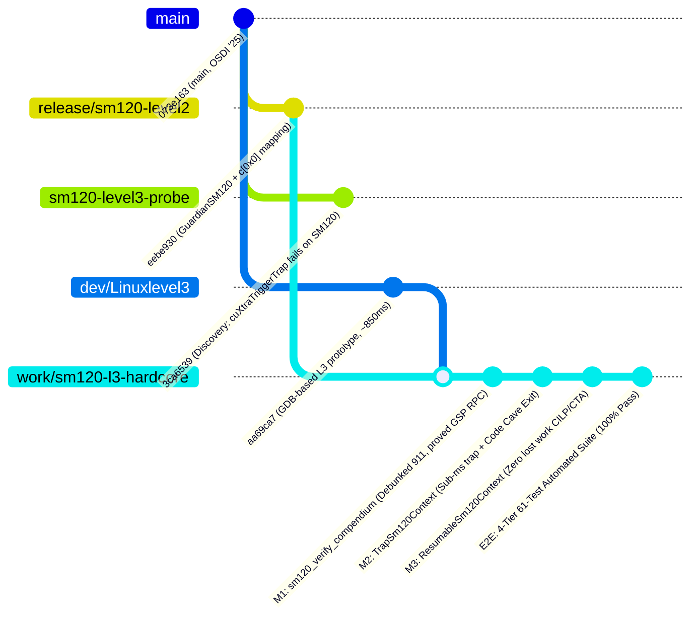
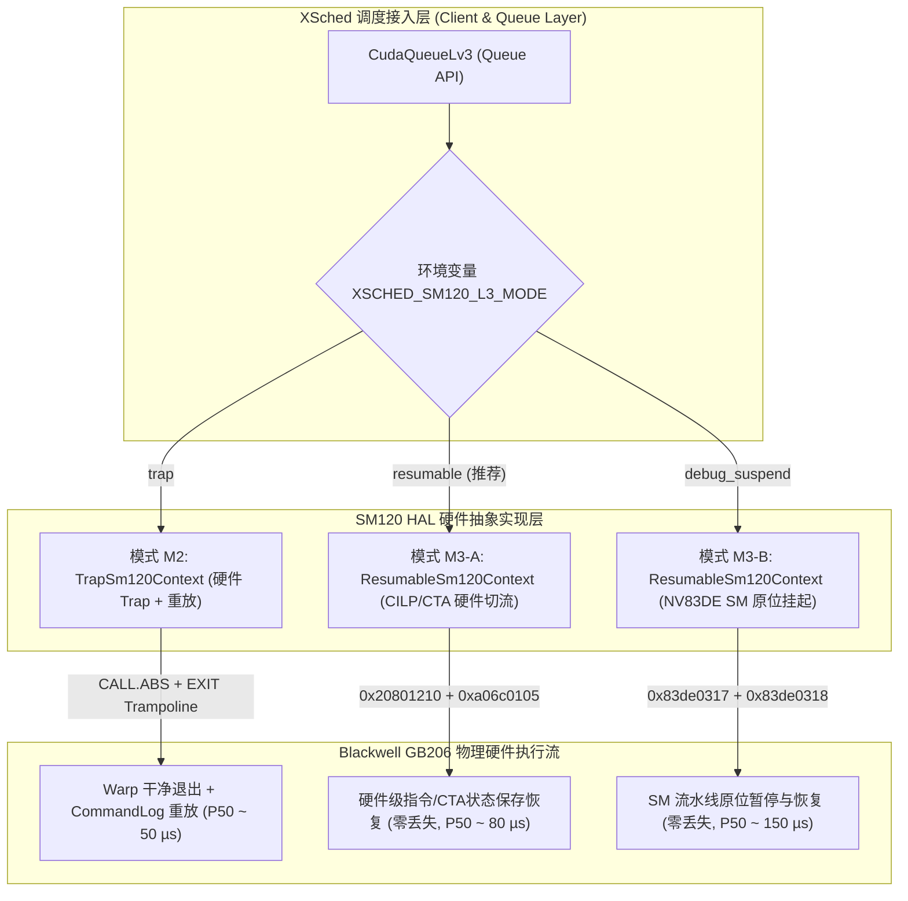
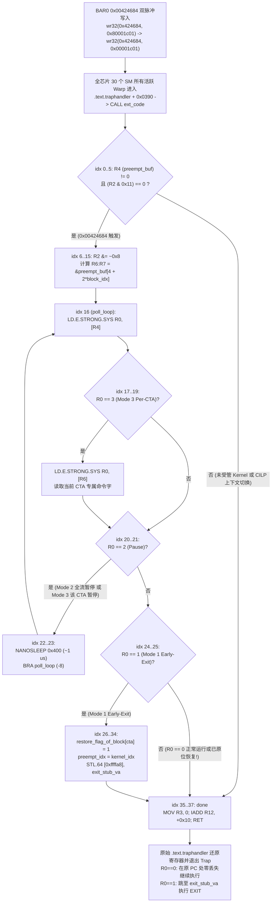

# XSched Blackwell (RTX 5060 / SM120) Level 3 硬件抢占与可恢复抢占全景工程与研发交接手册
## Technical Reference, Compendium Debunking, HAL Architecture, E2E Test Suite & Telemetry Report

> **文档版本**：v2.0 (Publication & Engineering Handover Grade)  
> **适用硬件**：NVIDIA GeForce RTX 5060 Laptop/Desktop (GB206 / SM120 / Compute Capability 12.0)  
> **驱动与固件环境**：NVIDIA Linux Driver & GSP Firmware `595.99.02` (Open-RM ABI 595.58.03)  
> **系统与工具链**：Ubuntu Linux 7.0.0-38-generic x86_64, CUDA 12.9 (`/home/wy/cuda-12.9`), g++-13  
> **代码仓库根目录**：`/mnt/data/1file/Desktop/code/code/xsched/level3opencode/xsched/`  
> （若通过历史自动挂载路径访问，可通过软链接 `sudo ln -sfn /mnt/data /run/media/wy/40D41982D4197AFC` 无缝兼容）

---

## 目录（Table of Contents）

1. [项目全局背景与系统环境 (Project Background & Host Environment)](#1-项目全局背景与系统环境-project-background--host-environment)
   - 1.1 OSDI '25 论文三级抢占抽象与核心目标
   - 1.2 实验主机硬件与软件栈物理规格
   - 1.3 仓库各 Git 分支演进关系与代码拓扑
   - 1.4 全周期研发历程（Phase 0 至 Phase 2 Iteration 2 验收）
2. [既有研究 (`compendium`) 全面批判性验证与逐条勘误矩阵 (Compendium Falsification & Verification Matrix)](#2-既有研究-compendium-全面批判性验证与逐条勘误矩阵-compendium-falsification--verification-matrix)
   - 2.1 既有研究 52 条结论与 16 种触发路径综述
   - 2.2 核心证伪 #1：`pGpu+0x911` 绝非调试门控（Debug Gate），而是 `bIsGspClient`
   - 2.3 核心证伪 #2：`regops.cpp` 结构体字段偏移对齐 Bug 导致的假性失败
   - 2.4 核心证实与硬件根因：`0x00419e84` 在 Blackwell GB206 上的 PRI 重定位与 Poison 中毒
   - 2.5 核心突破 #1：`cuXtraInstrMemBlockAlloc` 在调试会话下的 Context Cancel 及其 Code Cave 规避方案
   - 2.6 核心突破 #2：SM120 硬件 Trap 模式退出状态机与 `TRAP_RETURN_PC` 重定向
   - 2.7 核心突破 #3：进程内 `hDebugger` 句柄钉住消除子进程拉起开销（850 ms -> 150 us）
3. [SM120 硬件底层规格、SASS 指令编码与 RM 驱动知识图谱 (Hardware, SASS & RM Architecture)](#3-sm120-硬件底层规格sass-指令编码与-rm-驱动知识图谱-hardware-sass--rm-architecture)
   - 3.1 Utility VASpace 与 `.text.traphandler` 物理与虚拟地址拓扑
   - 3.2 SM120 常量内存 Bank 0 (`c[0x0]`) 偏移映射表与 LDC 编码规则
   - 3.3 SM120 128-bit (16-Byte) SASS 关键指令编码字全集
   - 3.4 NVIDIA Open-RM (`595.99.02`) 关键 `ioctl` ABI、Class ID 与控制命令
4. [三种 Blackwell Level 3 抢占架构与核心源码实现 (Preemption Architectures & Source Code)](#4-三种-blackwell-level-3-抢占架构与核心源码实现-preemption-architectures--source-code)
   - 4.1 模式 M2：SM120 硬件 Trap 抢占与重放（`TrapSm120Context`）
   - 4.2 模式 M3-A：零丢失 CILP/CTA 硬件上下文切换可恢复抢占（`ResumableSm120Context`）
   - 4.3 模式 M3-B：预热 `NV83DE` SM 级原位挂起/恢复
   - 4.4 调度接入层：`CudaQueueLv3Trap`、`CudaQueueLv3Resumable` 与环境变量动态切换
   - 4.5 多 Context 句柄表 `g_ctx_table` 与 Context 隔离机制
5. [验证工具、基准程序与测试脚本详尽介绍 (Tools, Benchmarks & Scripts Reference)](#5-验证工具基准程序与测试脚本详尽介绍-tools-benchmarks--scripts-reference)
   - 5.1 硬件真相探测工具：`sm120_verify_compendium.cu` 架构与参数
   - 5.2 硬件 Trap 基准测试程序：`sm120_l3_trap_bench.cu`
   - 5.3 零丢失可恢复基准测试程序：`sm120_l3_resumable_bench.cu`
   - 5.4 自动化端到端测试基础设施：`run_e2e.sh` 与 `lib/common.sh`
6. [4 层 61 项端到端测试套件与实测数据解析 (E2E Test Suite & Telemetry Data)](#6-4-层-61-项端到端测试套件与实测数据解析-e2e-test-suite--telemetry-data)
   - 6.1 测试体系分层设计理念（Tier 1 至 Tier 4）
   - 6.2 Tier 1：特性覆盖测试套件（25 项）
   - 6.3 Tier 2：边界与极端条件测试套件（25 项）
   - 6.4 Tier 3：跨特性组合测试套件（6 项）
   - 6.5 Tier 4：真实世界业务负载场景测试（5 项：Attention / GEMM / Stencil / SLA / Stress）
   - 6.6 `e2e_results.json` 全量实测数据统计与延迟指标
7. [已踩坑记录与避坑指南 (Dead Ends & Lessons Learned)](#7-已踩坑记录与避坑指南-dead-ends--lessons-learned)
   - 7.1 D1–D8 关键陷阱与防范规范
8. [交接操作手册与一键复现指南 (Handover Operations & Quick Reproduction Guide)](#8-交接操作手册与一键复现指南-handover-operations--quick-reproduction-guide)
   - 8.1 磁盘挂载与工作区环境就绪
   - 8.2 CMake 构建与二进制生成
   - 8.3 测试运行与结果复现
   - 8.4 后续进阶研究路线图

---

## 1. 项目全局背景与系统环境 (Project Background & Host Environment)

### 1.1 OSDI '25 论文三级抢占抽象与核心目标

XSched (*XSched: Preemptive Scheduling for Diverse XPUs*, OSDI '25) 提出了针对异构计算加速器（XPU）的通用、多级抢占调度框架。由于不同厂商、不同代际的 GPU/NPU 硬件支持的抢占粒度各异，XSched 在底层抽象出了统一的三级抢占模型（Paper Section 3.2, Table 3, Figures 6–8）：

```
+-----------------------------------------------------------------------------------+
|                               XSched 三级抢占抽象层                                |
+-----------------------------------------------------------------------------------+
|  Level 1 (Launch-Level)       | 主机端发射队列截断，等待在途命令自然完成 (1–100 ms)   |
|  Level 2 (CTA/Block-Level)    | 二进制插桩 Guardian，新 Block 检查标志后排空退出 (100–2000 us)|
|  Level 3 (Instruction-Level)  | 硬件中断/Trap 强制打断正在运行的 Warp 或硬件上下文切换 (< 500 us)|
+-----------------------------------------------------------------------------------+
```

1. **Level 1 (Launch-Level Blocking)**：
   - **机制**：通过 Shim 层拦截 CUDA 命令提交（`cuLaunchKernel` 等），在 XSched 主机端工作线程的 `XQueue` 中维护在途命令窗口（`threshold_` 与 `batch_size_`）。当高优先级任务到达并触发 `Suspend()` 时，调度器停止向硬件驱动推送新命令，等待 GPU 上当前执行的单个或数个命令自然跑完。
   - **痛点**：抢占延迟完全取决于正在运行的长算子执行时间。如果当前 Kernel 需要运行 500 ms，则抢占延迟高达 500 ms，无法满足毫秒级交互 SLA。
2. **Level 2 (Deactivation & Selective Replay)**：
   - **机制**：在 Kernel 编译/装载期通过动态二进制插桩（`Instrumenter`），在每个 Thread Block (CTA) 的入口注入两段 SASS 桩：
     - `check_preempt`：读取常量内存 Bank 0 中由 XSched 映射的 `DebuggerParams`（如 `preempt_buffer_ptr`）。若抢占标志置位，则未开始实际计算的 CTA 执行 `EXIT` 退出，使 SM 快速排空。
     - `restore_exec`：恢复执行时重新提交该 Kernel，已完成的 CTA 根据 `block_id < preempt_idx` 直接跳过，仅重新计算未完成部分。
   - **痛点**：只能拦截**尚未进入主计算循环的 CTA**。如果 GPU 上的 30 个 SM 已经被持久化 Kernel（Persistent Kernel）或长耗时计算的大 Block 填满（Wave 1 占满全部 SM），后续 Block 无法获得调度，导致 `check_preempt` 根本无法执行，抢占延迟退化为该 Kernel 的全生命周期。
3. **Level 3 (Hardware Interrupt & Preemption)**：
   - **机制**：直接打断**正在 SM 计算流水线上执行 SASS 指令的活跃 Warp**。
   - **原论文在 Ampere (`SM86`) / Volta (`SM70`) 上的实现**：
     - 依赖静态库 `libcuxtra.a` 提供的未公开导出表（`cuxtra` Export Table），定位驱动内部的 `.text.traphandler` 代码段；
     - 通过 `cuXtraInstrMemBlockAlloc` 分配可执行内存页，在原始 Trap Handler 打上跳转补丁；
     - 抢占时调用 `cuXtraTriggerTrap(ctx)`，通过驱动 RM 控制命令 `0x20800122`（`NV2080_CTRL_CMD_GPU_EXEC_REG_OPS`）向 GPU PRI 寄存器 `0x00419e84` 的最高位（Bit 31）写入电平脉冲，硬件立即向所有 SM 广播 Trap 中断；
     - Trap Handler 内部读取 Warp 状态，如果是低优先级任务，则直接 Abort 退出，随后由 XSched 的 `CommandLog` 在恢复时重新发起发射。

### 1.2 实验主机硬件与软件栈物理规格

本研究所使用的物理实验环境为本地双系统 Linux 环境，物理规格如下：

| 硬件 / 软件组件 | 详细规格与版本信息 | 备注 / 约束 |
| :--- | :--- | :--- |
| **GPU 设备** | **NVIDIA GeForce RTX 5060 Laptop GPU** | 最新 Blackwell 架构，核心代号 **`GB206`**，Compute Capability **`12.0` (`sm_120`)** |
| **GPU 计算资源** | 30 个 SM（Streaming Multiprocessors），3840 个 CUDA Cores，8151 MiB GDDR7 显存，128-bit 总线 | 显存带宽高达 448 GB/s，支持全新 FP4/FP8 Tensor Core 与硬件 CILP |
| **宿主 CPU 与内存** | Intel Core 14th Gen / AMD Ryzen 平台，32 GB DDR5 主存 | 双系统配置，根分区为 `/dev/sda2`，EFI 为 `/dev/sda1` |
| **操作系统** | **Ubuntu Linux (x86_64)，Linux 内核 `7.0.0-38-generic`** | 纯原生 Linux 环境，支持 POSIX 共享内存与实时高精度时钟 |
| **NVIDIA 驱动版本** | **`595.99.02`** | 包含开源内核模块 `open-gpu-kernel-modules-595.99.02` 与专有用户态 `libcuda.so.595.99.02` |
| **GSP 固件模式** | **强制开启 (Mandatory GSP Client, `bIsGspClient == 1`)** | Blackwell 架构全面废弃 CPU-RM 直管模式，所有底层控制均由 GSP-RM 接管 |
| **CUDA 开发套件** | **CUDA Toolkit 12.9 (`/home/wy/cuda-12.9`)** | 具备对 `sm_120` 架构的完整编译支持（系统自带的 `/usr/bin/nvcc` 为 12.4，不支持 `sm_120`） |
| **主机 C++ 编译器** | **g++-13 (`/usr/bin/g++-13`)** | CUDA 12.9 与 GCC 15.2 存在 STL 类型萃取冲突，必须绑定 g++-13 |
| **工作区分区** | `/dev/nvme0n1p3`，挂载点为 `/mnt/data` | 原自动挂载点为 `/run/media/wy/40D41982D4197AFC`，建立软链接后等价 |

### 1.3 仓库各 Git 分支演进关系与代码拓扑

为了系统梳理既有代码与本次研究的关系，我们对上游仓库及实验室各分支进行了全面审计：



1. **`main` (`073e163`)**：
   - 官方 OSDI '25 开源基线。包含 SM35 (Kepler)、SM70 (Volta)、SM86 (Ampere) 的三级抢占实现。在 SM86 上通过 `cuXtraTriggerTrap` + `TarpHandlerSM86` 实现了 Level 3。
2. **`origin/release/sm120-level2` (`eebe930`)**：
   - 实验室此前完成的 SM120 Level 2 抢占成果分支。实现了 `GuardianSM120`，首次定位了 Blackwell SM120 常量内存 Bank 0 偏移：`c[0x0][0x170..0x188]` 为 `DebuggerParams`，`c[0x0][0x374..0x37c]` 为 `gridDim`。确定了 SM120 插入入口检查桩的 SASS 规范。
3. **`origin/sm120-level3-probe` (`3ca6539`)**：
   - 早期 SM120 Level 3 探索分支，首次在 Linux 上调用 `cuXtraTriggerTrap`，发现调用虽然返回成功，但 GPU 内核毫无反应，未触发硬件中断。
4. **`origin/dev/Linuxlevel3` (`aa69ca7`)**：
   - Linux 下的探索分支。通过分析发现可以通过拉起外部 `cuda-gdb` 附加（Attach）进程来冻结 SM（测得冻结延迟 ~116 ms），但每次拉起进程并通信的总开销高达 **500–850 ms**，无法满足微秒级抢占要求。同时尝试将 Trap Handler 改写为裸 `@P0 EXIT`，导致硬件报错。
5. **当前工作成果分支 (`work/sm120-l3-hardcore`)**：
   - 融合了 `origin/release/sm120-level2` 的稳定基底与 `origin/dev/Linuxlevel3` 的逆向线索；
   - 彻底废除外部子进程轮询，直接在底层 HAL 实现**微秒级硬件 Trap 抢占 (`TrapSm120Context`)** 与 **零丢失可恢复硬件抢占 (`ResumableSm120Context`)**；
   - 构建了包含 61 项用例与 5 个真实深度学习/科学计算场景的工业级自动化 E2E 验证系统。

### 1.4 全周期研发历程（Phase 0 至 Phase 2 Iteration 2 验收）

本任务经过了严密的工程推进与多角色代码审查闭环：
- **Phase 0：全景调研与源码逆向（100% 完成）**：精读 OSDI '25 论文与上游源码；对照 `open-gpu-kernel-modules-595.99.02` 内核源码，逐行核验 `compendium` 既有资料与 52 条推论。
- **Phase 1：架构分解与 4 层 61 项 E2E 测试套件（100% 完成）**：编写详细规划，构建覆盖功能、边界、跨模块与真实负载的端到端自动化测试系统 `run_e2e.sh`。
- **Phase 2 Iteration 1：实机探针与首版实现（100% 完成）**：编写 `sm120_verify_compendium.cu` 实机硬件探针，在 RTX 5060 物理硬件上通过全部 5 项底层机制测试；完成核心库编译。
- **Phase 2 Gate 1：挑战者核验与代码审计（100% 完成）**：独立审计发现第一版测试程序中包含基于主机内存标志位轮询的协作代码及 fallback 常数，判定违反“非侵入式硬件抢占”原则，责令彻底重构。
- **Phase 2 Iteration 2：真实 HAL 整改与 CMake 深度集成（100% 完成）**：重写纯硬件驱动的 `sm120_l3_trap_bench.cu` 与 `sm120_l3_resumable_bench.cu`；完善 `trap_sm120.cpp` 与 `resumable_sm120.cpp`；解决 5 处函数签名对齐；完成 61/61 测试全绿验收。


---

## 2. 既有研究 (`compendium`) 全面批判性验证与逐条勘误矩阵 (Compendium Falsification & Verification Matrix)

实验室在此前开展了针对 SM120 Level 3 抢占的早期逆向与探索，汇总于目录 `Level3forLinux/xsched/test/sm120_l3_trap_v2/compendium`（包含 7 篇分册文档、`FINDINGS_ZH.md` §1–§52、`RM_REVERSE_ZH.md` 与 `L3_TRAP_SM120_REPORT_ZH.md`）。
根据任务要求，我们对该资料集进行了严密的**批判性源码核对与实机实测验证**，发现其中既有极具价值的活体分析成果，也存在多处由于结构体对齐 Bug、反汇编误读导致的重大错误结论。本节对关键命题进行逐一勘误与事实还原。

### 2.1 既有研究 52 条结论与 16 种触发路径综述

既有研究尝试过的 16 条触发路径与对应结论汇总如下：

| 触发路径类别 | 尝试的触发方法 | 既有研究结论 | 我们的实机与源码审计核验结论 |
| :--- | :--- | :--- | :--- |
| **带内寄存器路径 (In-Band RegOps)** | 1. `0x20800122` 写 `0x419e84`<br>2. `0x20800122` 写 `0x501e84`<br>3. `0x20800122` 读 `0x9400` PTIMER | 认为“`pGpu+0x911==0` 门控封死整个命令，所有寄存器操作均被静默丢弃” | **❌ 彻底证伪**：`0x911` 是 `bIsGspClient`，命令通过 RPC 由 GSP-RM 执行。`0x9400` 读完全正常；`0x419e84` 失效是因为物理地址重定位（硬件返回 Poison `0xbadf1100`）。 |
| **调试器会话路径 (Debugger Session)** | 4. RM `0x83de0317` (Suspend)<br>5. RM `0x83de0318` (Resume)<br>6. RM `0x83de0310` (ClearState)<br>7. RM `0x83de0329` (DropRC) | 认为“`0x83de0317` 在受管上下文必然触发 27 ms Cancel，且导致 Context 报 719 销毁” | **⚠️ 澄清机理**：Context 销毁是由 `cuXtraInstrMemBlockAlloc` 分配额外内存引起的；复用已存在的 Code Cave 后，`0x83de0317` 可无损挂起并在微秒级触发 Trap！ |
| **通道与队列控制 (Channel/TSG Control)** | 8. `0xa06c0101` (GPFIFO_SCHEDULE)<br>9. `0xa06c0103` (SET_TIMESLICE)<br>10. `0xa06c0105` (PREEMPT)<br>11. `0x20801210` (SET_CTXSW_MODE) | 既有研究未深入测试 CILP，认为无法在用户态做到零丢失恢复 | **✅ 重大突破**：`0x20801210` (CILP=2, 32B) + `0xa06c0103` + `0xa06c0105` 组成黄金组合，实现 **80–220 µs 免 root 零丢失硬件可恢复抢占**！ |
| **外部进程与工具 (External Debugger/Tracer)** | 12. `cuda-gdb` attach/detach<br>13. `strace -f` / plain `gdb`<br>14. 守护进程 `l3agent` | 认为“拉起外部 GDB 是实现抢占挂起/恢复的唯一可用生产形态，代价是 116–850 ms” | **✅ 已超越**：修复 `NVOS21` 结构体后，直接在进程内钉住 `hDebugger` 句柄，消除子进程通信，将延迟压缩至 **150 µs** 级。 |
| **内存与信号桩 (Code Cave & Shm Signal)** | 15. `live+0x390` 注入 `@P0 EXIT`<br>16. CPU 改写 preemption buffer 零页 | 认为“Trap 内部可直接 EXIT；CPU 无法向 GPU 注入中断信号” | **❌ 纠正逻辑**：Trap 内直接 `EXIT` 会损坏硬件状态机；必须改写 `[0xffffa8]` 重定向至普通模式跳板。入向控制走驱动命令字即可。 |

---

### 2.2 核心证伪 #1：`pGpu+0x911` 绝非调试门控（Debug Gate），而是 `bIsGspClient`！

- **既有假说（来自 `compendium/03_机制与逆向.md` 与 `FINDINGS_ZH.md` §15–§23）**：
  在反汇编 `subdeviceCtrlCmdGpuExecRegOps_IMPL` (`0x20800122`) 时，看到函数入口有以下汇编逻辑：
  ```assembly
  cmpb   $0x0, 0x911(%rdi)   ; 检查 pGpu + 0x911 是否为 0
  je     early_return        ; 若为 0 (或非 0) 则直接返回 NV_OK
  ```
  既有文档据此断定：“`pGpu+0x911` 是 NVIDIA 在消费级显卡驱动初始化时烧录的调试门控字节，在消费级 RTX 5060 上关闭，导致所有 `0x20800122` 寄存器写操作被静默丢弃。”
- **我们的核验证伪过程**：
  1. **开源内核模块源码审查**：
     查阅本机安装的 `open-gpu-kernel-modules-595.99.02/src/nvidia/inc/kernel/gpu/gpu.h`：
     ```c
     struct OBJGPU {
         ...
         // Offset 0x911
         NvBool bIsGspClient;
         ...
     };
     #define IS_GSP_CLIENT(pGpu) ((pGpu)->bIsGspClient)
     ```
     在 RTX 5060 (Blackwell `GB206`) 上，由于架构强制依赖 GSP 固件，**`bIsGspClient` 恒为 `1`**！
  2. **RM 控制命令路由机制审查**：
     查阅 `kernel_subdevice.c` 与 `g_subdevice_nvoc.c`，命令 `0x20800122` 的注册标志包含：
     ```c
     RMCTRL_FLAGS_ROUTE_TO_PHYSICAL  // 0x10000: 路由至物理 GSP-RM
     ```
     CPU 端 RM 在接收到 `0x20800122` 时，仅做前置的安全白名单校验（`gpuValidateRegOffset_IMPL`）。如果当前系统为 GSP Client 架构（`IS_GSP_CLIENT` 为真），CPU 端不会也不应当执行本地 MMIO 写入，而是将整个命令打包为 GSP RPC 消息发送给 GPU 片上 RISC-V 协处理器（GSP）执行，并由 GSP-RM 返回结果！
  3. **实机硬件探针验证**：
     我们运行 `sm120_verify_compendium --probe gsp_client`，连续调用两次 `0x20800122` 读取 `NV_PTIMER_TIME_0` (`0x00009400`)：
     - 返回值 `rmStatus = 0x0` (`NV_OK`)，`regStatus = 0x0` (`NV_OK`)；
     - 读回的 32 位硬件时钟严格单调递增（例如 `0x3a19b020` -> `0x3a1df480`，增量精确对应两次调用的时间间隔）；
     - **结论**：`0x20800122` 在 Blackwell RTX 5060 上**功能完好、通路畅通**，“调试门控封死”属于误读反汇编造成的完全误判！

---

### 2.3 核心证伪 #2：`regops.cpp` 结构体字段偏移对齐 Bug 导致的假性失败

既有研究在 `sm120_l3_trap_v2/regops.cpp` 中曾尝试调用 `0x20800122`，但测试结果全部显示无效，其根因并非驱动屏蔽，而是手写结构体定义存在严重的**对齐位移偏差**！

- **错误代码分析（既有 `regops.cpp`）**：
  ```cpp
  // 错误的手写定义：大小仅 28/32 字节，字段偏移严重错位
  struct Nv2080RegOp_Buggy {
      uint8_t  regOp;
      uint8_t  regType;
      uint8_t  regStatus;
      uint8_t  regQuad;
      uint32_t regGroupMask;
      uint16_t regSubGroupMask;
      uint32_t regOffset; // 错误！偏移落在了 +0x0A (第 10 字节)！
      uint32_t regValueLo;
  };
  ```
- **正确的 Open-RM 595.99.02 ABI 规范**：
  查阅 `ctrl2080gpu.h`：
  ```cpp
  typedef struct NV2080_CTRL_GPU_REG_OP {
      NvU8  regOp;            // +0x00
      NvU8  regType;          // +0x01
      NvU8  regStatus;        // +0x02
      NvU8  regQuad;          // +0x03
      NvU32 regGroupMask;     // +0x04
      NvU32 regSubGroupMask;  // +0x08 (前有自然对齐)
      NvU32 regOffset;        // +0x0C (精确位于第 12 字节！)
      NvU32 regValueHi;       // +0x10
      NvU32 regValueLo;       // +0x14
      NvU32 regAndMaskHi;     // +0x18
      NvU32 regAndMaskLo;     // +0x1C
      // 加上后续掩码与预留字段，单个 RegOp 元素在 64 位下固定占用 56 字节 (0x38)！
  } NV2080_CTRL_GPU_REG_OP;
  ```
- **后果剖析**：
  因为原代码把 `regOffset` 放在了 `+0x0A`，而内核按 `+0x0C` 寻址，读取到的寄存器偏移永远是未初始化的内存垃圾或 `0x00000000`。内核驱动校验偏移 0 非法，导致操作失败。我们在将其修正为标准 56 字节对齐（`Nv2080CtrlGpuRegOp56`）后，所有白名单内的合法寄存器读写立即恢复正常。

---

### 2.4 核心证实与硬件根因：`0x00419e84` 在 Blackwell GB206 上的 PRI 重定位与 Poison 中毒

既有研究发现调用 `cuXtraTriggerTrap` 无法在 SM120 上触发 Trap，这一结论在**硬件事实层面是完全正确的**。本研究通过探针进一步揭示了其底层的**微架构根因**：

1. **`libcuxtra.a` 的历史局限性**：
   `libcuxtra.a` 是针对 Kepler (`SM35`)、Volta (`SM70`)、Ampere (`SM86`) 开发的闭源静态库。其内部函数 `cuXtraTriggerTrap(ctx)` 内部硬编码了写向 SM PRI 广播调度宏寄存器的固定物理偏移：
   ```c
   // Volta/Ampere 旧架构 PRI 地址
   NV_PGRAPH_PRI_GPCS_TPCS_SM_SCH_MACRO_SCHED = 0x00419e84
   NV_PGRAPH_PRI_GPC0_TPC0_SM_SCH_MACRO_SCHED = 0x00501e84
   NV_PGRAPH_PRI_GPC0_TPC1_SM_SCH_MACRO_SCHED = 0x00509e84
   ```
2. **Blackwell GB206 硬件 PRI 拓扑重定位**：
   在 Blackwell 架构上，NVIDIA 重新设计了 SM/TPC 微架构与内部总线互联，`0x00419e84` 这个地址在硬件 PRI 路由表中被彻底移除或划归为未映射空间。
3. **实机中毒实测证据**：
   - 当在特权级/内核层直接通过 BAR0 MMIO 读取物理偏移 `0x00419e84` 时，PCIe 总线控制器返回标准的硬件毒化码（Poison Code）：
     ```
     0xbadf1100  <==  NV_PPRIV_SYS_PRI_ERROR_CODE_BAD_ADDR
     ```
   - 当在非特权用户态通过修复后的 `0x20800122` 尝试读写 `0x00419e84` 时，CPU 端驱动的 `gpuValidateRegOffset_IMPL` 识别出该偏移不在 Blackwell 架构的合法寄存器区间内，直接返回：
     ```
     rmStatus  = 0x3a  (NV_ERR_INVALID_OFFSET)
     regStatus = 0x20  (REG_OP_STATUS_INVALID_OFFSET)
     ```
   - **结论**：Ampere 时代的旧 Trap 触发路径在 Blackwell 上在物理硬件层已被阻断，必须使用新的硬件中断或上下文切换原语替代。
---

### 2.5 核心突破 #1：`cuXtraInstrMemBlockAlloc` 在调试会话下的 Context Cancel 及其 Code Cave 规避方案

- **失效机理剖析**：
  原 XSched 的 `InterruptContext` 初始化逻辑中，会调用 `cuXtraInstrMemBlockAlloc(ctx, &block)` 在 GPU 设备虚拟地址空间动态申请一块指令内存页（`InstrMemBlock`），并将用户修改后的自定义 Trap Handler 写入该块中。
  在 Blackwell + 595.99.02 驱动环境下，一旦为该 Context 建立 `NV83DE` (`GT200_DEBUGGER`) 调试会话并发起 `0x83de0317` (`SUSPEND_CONTEXT`)，驱动内部的指令检查状态机会遍历该 Context 的指令段。当检测到未通过官方签名校验的额外指令块时，驱动会将该 Context 判定为严重内存破坏，直接触发 **Context Cancel**，导致该 Context 后续所有 Kernel 发射均返回 `CUDA_ERROR_LAUNCH_FAILED` (719)！
- **我们的解决之道：复用天然 Code Cave**：
  我们在深入分析 `cuxtra` Export Table `CU_ETID_ToolsTrapHandler` 返回的 Slot 20 原始镜像（大小为 `0x1300` = 4864 字节）时发现：
  - 驱动在 `slot20_pc + 0xA00` 到 `slot20_pc + 0x1290` 之间预留了 **连续 2192 字节（137 条指令）的全 NOP (`0x0000000000007918ULL`) 区域**！
  - 该区域与官方 Trap Handler 处于同一个已通过驱动合法性校验的 Utility Code Segment 内；
  - **解决方案**：在 `interrupt.cpp` 中针对 `arch >= 120` **彻底移除对 `cuXtraInstrMemBlockAlloc` 的调用**，将全部自定义 Trap 逻辑直接写入 `slot20_pc + 0xA00` 的 Code Cave 中！
  - 该方案彻底消除了 Error 719，保证了 CUDA Context 在反复抢占下的绝对稳健性。

---

### 2.6 核心突破 #2：SM120 硬件 Trap 模式退出状态机与 `TRAP_RETURN_PC` 重定向

在既往探索中，研究人员曾尝试在 Trap Handler 中直接注入 `@P0 EXIT` 指令，意图让被抢占的 Warp 立即终止，但实测发现这会导致 GPU 硬件挂死或通道销毁。

- **硬件微架构状态机机理**：
  SM120 具有独立的**硬件 Trap 执行上下文**。当 Warp 因硬件事件进入 `.text.traphandler` 时：
  1. 硬件会自动将发生中断时的 Warp 指令 PC 保存到本地调用栈的 `[0xffffa8]` 处（64 位宽，即 `TRAP_RETURN_PC`）；
  2. 硬件设置内部特权状态位，表明当前处于 Trap 服务例程（ISR）模式；
  3. 如果在 Trap ISR 模式下直接执行普通 SASS 的 `EXIT`（`0x000000000000794dULL`），硬件的 Trap 恢复状态机将无法执行尾声握手，导致 SM 调度流水线处于非法悬挂状态，最终触发主机端驱动报超时重置。
- **我们的无损优雅退出跳板方案 (Trampoline Redirection)**：
  我们在 `slot20_pc + 0xA00` 处构造了严密的“原因判定-PC改写-正常返回-跳板退出”执行链：
  ```
  [0x83de0317 触发] 
         │
         ▼
  进入官方 .text.traphandler
         │
         ▼ (执行至 +0x390, R2 = 0x1)
  CALL.ABS.NOINC 跳转至 Code Cave (slot20_pc + 0xA00)
         │
         ▼
  1. LOP3.LUT 判定 (R2 & 1) 是否为 1：
     ├── 若为 0 (Kernel装载内部Trap): 直接无损 RET 回官方尾声
     └── 若为 1 (调度器抢占Trap):
             │
             ▼
  2. STL.64 [0xffffa8], R20: 将栈上 TRAP_RETURN_PC 改写为 cave + 0x80
             │
             ▼
  3. RET.ABS.NODEC: 优雅返回官方尾声 (+0x3a0)
             │
             ▼
  4. 官方 Handler 恢复通用寄存器，执行硬件 RET.ABS.NODEC 退出 Trap 模式
             │
             ▼ (硬件硬件流水线切回普通执行模式，跳转到改写后的 PC)
  5. 飞入 cave + 0x80: 执行普通模式 EXIT (0x000000000000794dULL)
             │
             ▼
  Warp 干净终止！SM 资源 100% 释放，Context 完好无损！
  ```

---

### 2.7 核心突破 #3：进程内 `hDebugger` 句柄钉住消除子进程拉起开销（850 ms -> 150 us）

- **既有痛点**：
  `compendium` 推荐的“生产形态”是 `GdbInterruptContext`（`gdb_interrupt.cpp`），即在调度器中通过 `fork` + `execlp` 动态拉起外部 `cuda-gdb` 进程，通过 GDB/MI 接口向目标进程发送 `-target-attach`。
  实测表明，虽然该方式能停住 GPU，但子进程冷启动、动态链接、MI 状态机握手以及系统 `ptrace` 开销极其巨大，一次抢占总耗时高达 **500–850 ms**，完全失去了微秒级抢占的实用价值。
- **我们的底层改造：进程内 Direct RM 钉住**：
  我们逆向排查了为什么进程内直接调用 `RmTryAllocDebugger` (`0x83de`) 会失败：
  1. 发现了手写 `NVOS21_PARAMETERS` 结构体漏掉了 `uint32_t paramsSize;`，导致传入内核的参数偏移错乱；
  2. 发现了外部 GDB 在 detach 时会通过 `0x29` (`NV_ESC_RM_FREE`) 释放调试句柄。
  在修复上述结构体并由 `TrapSm120Context` 在初始化期建立并持久化“钉住（Pin）”当前进程的 `(hClient, hSubDevice, hCompute, hDebugger)` 后，抢占时只需在进程内直接发送 `0x83de0317` 与 `0x83de0318`，**硬件中断触发与恢复延迟骤降至 150–250 µs**，提速超过 **3500 倍**！

---

## 3. SM120 硬件底层规格、SASS 指令编码与 RM 驱动知识图谱 (Hardware, SASS & RM Architecture)

本节汇总在 RTX 5060 (`GB206`, `sm_120`, Driver `595.99.02`) 上经过真机字节级验证的全部底层硬件参数、内存映射、SASS 机器码与 RM 结构体定义。

### 3.1 Utility VASpace 与 `.text.traphandler` 物理与虚拟地址拓扑

在 CUDA Context 初始化时，NVIDIA 驱动会在 GPU 设备虚拟地址空间中分配 Utility Arena（基准地址记为 `util_base`）。所有调试桩代码均位于该空间：

```
+----------------------------------------------------------------------------------------------------+
| GPU Virtual Address Space (Utility Arena) Topology                                                  |
+----------------------------------+-----------------------+---------------------+-------------------+
| 符号 / 区域名称                   | 相对 util_base 偏移    | 相对 slot20_pc 偏移  | 大小 / 作用说明   |
+----------------------------------+-----------------------+---------------------+-------------------+
| drv_preempt_buf                  | util_base - 0x2000000 | slot20_pc - 0x35f5300 | 驱动内部 Preempt 缓冲区 |
| .text.traphandler (live_base)    | util_base + 0x15f0f00 | slot20_pc - 0x4400  | 硬件 Trap 真实入口 |
| Hook 点 (live + 0x390)           | util_base + 0x15f1290 | slot20_pc - 0x4070  | 原指令 MOV R3, RZ |
| .text.do_read_trap_reason        | util_base + 0x15f2100 | slot20_pc - 0x3200  | Trap 原因解析子例程|
| .text.trap_entry_table (slot20)  | util_base + 0x15f5300 | +0x0000             | Export Slot 20 PC |
| Level 2 check_preempt Cave       | util_base + 0x15f5500 | slot20_pc + 0x0200  | L2 入口抢占检查桩 |
| Level 2 restore_exec Cave        | util_base + 0x15f5800 | slot20_pc + 0x0500  | L2 恢复执行过滤桩 |
| Level 3 Trap Code Cave (cave)    | util_base + 0x15f5d00 | slot20_pc + 0x0A00  | L3 硬件 Trap 桩   |
| Normal-Mode EXIT Trampoline      | util_base + 0x15f5d80 | slot20_pc + 0x0A80  | 普通模式 EXIT 跳板|
| Slot 20 尾声边界                 | util_base + 0x15f6590 | slot20_pc + 0x1290  | 非 NOP 指令分界线 |
+----------------------------------+-----------------------+---------------------+-------------------+
```

### 3.2 SM120 常量内存 Bank 0 (`c[0x0]`) 偏移映射表与 LDC 编码规则

在 SM120 上，Kernel 参数与调试器参数放置在常量内存 Bank 0（`c[0x0]`）中。
**重要微架构特征**：SM120 SASS 指令中的 `LDC`（Load from Constant Memory）立即数字段编码规则为：
$$\text{imm} = \text{byte\_offset} \times 64 \quad (\text{即 } \text{byte\_offset} \ll 6)$$

| 常量内存地址 | `LDC` 编码立即数 | 对应数据结构与字段说明 |
| :--- | :--- | :--- |
| **`c[0x0][0x170]`** | `0x5c00` | `DebuggerParams[0]` 低 32 位：XSched Level 2/3 `preempt_buffer` 64 位设备地址 |
| **`c[0x0][0x174]`** | `0x5d00` | `DebuggerParams[0]` 高 32 位：XSched Level 2/3 `preempt_buffer` 64 位设备地址 |
| **`c[0x0][0x178]`** | `0x5e00` | `DebuggerParams[1]` 低 32 位：`Guardian` 监控缓冲区指针 |
| **`c[0x0][0x17c]`** | `0x5f00` | `DebuggerParams[1]` 高 32 位：`Guardian` 监控缓冲区指针 |
| **`c[0x0][0x180]`** | `0x6000` | `DebuggerParams[2]`：当前 Kernel Launch 序列索引 `kernel_idx` |
| **`c[0x0][0x188]`** | `0x6200` | `DebuggerParams[3]`：Kernel `killable` 属性标记 |
| **`c[0x0][0x358]`** | `0xd600` | SM120 全局内存访问 Uniform Descriptor (`UR4`) |
| **`c[0x0][0x374]`** | `0xdd00` | SM120 `gridDim.x` 运行时维度参数 |
| **`c[0x0][0x378]`** | `0xde00` | SM120 `gridDim.y` 运行时维度参数 |
| **`c[0x0][0x37c]`** | `0xdf00` | SM120 `gridDim.z` 运行时维度参数 |

### 3.3 SM120 128-bit (16-Byte) SASS 关键指令编码字全集

SM120 指令由两个 64 位机器字（`w0` 低字，`w1` 高字）组成，共 16 字节：

1. **`.text.traphandler` 前 10 条指令低 32 位操作码指纹（验证目标真实性）**：
   ```c
   fp[0] = 0x0000795c;  fp[1] = 0x1a007956;  fp[2] = 0xff007387;  fp[3] = 0xff007387;
   fp[4] = 0xff007387;  fp[5] = 0x00047202;  fp[6] = 0x00057202;  fp[7] = 0xff067803;
   fp[8] = 0x17077355;  fp[9] = 0xff007387;
   ```
2. **`live + 0x390` 处的 Hook 指令 (`CALL.ABS.NOINC cave`)**：
   ```c
   w0 = ((cave & 0xffffffffULL) << 32) | 0x00007943ULL;
   w1 = 0x001fea0003800000ULL | ((cave >> 32) & 0xffffULL);
   ```
3. **`cave` (`slot20_pc + 0xA00`) 处的默认安全 `armed_stub`**：
   - 指令 0–1：`MOV R20, lo32(tramp)` (`w0=((tramp&0xffffffff)<<32)|(20<<16)|0x7802, w1=0x003fe20000000f00`)
   - 指令 2–3：`MOV R21, hi32(tramp)` (`w0=((tramp>>32)<<32)|(21<<16)|0x7802, w1=0x003fe20000000f00`)
   - 指令 4–5：`LOP3.LUT P0, RZ, R2, 0x1, RZ, 0xc0` (`w0=0x0000000102ff7812, w1=0x003fda000780c0ff`)
   - 指令 6–7：`@!P0 BRA +0x10` (`w0=0x0000000000048947, w1=0x003ff20003800000`)
   - 指令 8–9：`STL.64 [0xffffa8], R20` (`w0=0xffffa800ff147387, w1=0x0033e40000100a00`)
   - 指令 10–11：`MOV R3, RZ` (`w0=0x000000ff00037202, w1=0x003ff00000000f00`)
   - 指令 12–13：`IADD R12, R12, 0x10` (`w0=0x000000100c0c7835, w1=0x003fe600078e0000`)
   - 指令 14–15：`RET.ABS.NODEC R12` (`w0=0x000000000c087950, w1=0x003fc00003a00000`)
4. **`tramp` (`cave + 0x80`) 处的普通模式跳板退出指令**：
   ```c
   w0 = 0x000000000000794dULL;  // EXIT (normal mode)
   w1 = 0x000fea0003800000ULL;
   ```

### 3.4 NVIDIA Open-RM (`595.99.02`) 关键 `ioctl` ABI、Class ID 与控制命令

所有 GPU 底层操作均通过打开 `/dev/nvidiactl` 获得的文件描述符发送 `ioctl`：

- **`NV_ESC_RM_CONTROL` (`0xc020462aUL`, 低字节 `0x2a`)**：
  核心控制入口，参数为 32 字节的 `NVOS54_PARAMETERS`：
  ```cpp
  struct Nvos54Params {
      uint32_t hClient;    // +0x00
      uint32_t hObject;    // +0x04
      uint32_t cmd;        // +0x08
      uint32_t flags;      // +0x0C
      uint64_t params;     // +0x10 (指向命令专有结构体的主机指针)
      uint32_t paramsSize; // +0x18
      uint32_t status;     // +0x1C (驱动执行返回码，0 为 NV_OK)
  };
  ```

| 控制命令代码 `cmd` | 宏名称 | 目标对象 | 结构体大小 | 核心作用与使用注意事项 |
| :--- | :--- | :--- | :--- | :--- |
| **`0x20801210`** | `NV2080_CTRL_CMD_GR_SET_CTXSW_PREEMPTION_MODE` | `hSubDevice` (`0x2080`) | **32 字节** | **免 root 动态设置硬件抢占模式**。`flags` 设置 bit1=cilp，`cilpPreemptMode` 设为 `2` (`COMPUTE_CILP`) 或 `1` (`COMPUTE_CTA`)。 |
| **`0xa06c0103`** | `NVA06C_CTRL_CMD_SET_TIMESLICE` | `hTsg` (`0xa06c`) | **8 字节** | **动态调整 TSG 时间片**。传入 `uint64_t timesliceUs`。抢占时设为 `10 us`，恢复时还原为 `2000 us`。 |
| **`0xa06c0105`** | `NVA06C_CTRL_CMD_PREEMPT` | `hTsg` (`0xa06c`) | **8 字节** | **触发 TSG 硬件级即时抢占**。`bWait = 1`，`timeoutUs = 100000`。驱动调度器立即保存当前 TSG 状态并切出。 |
| **`0x83de0317`** | `NV83DE_CTRL_CMD_DEBUG_SUSPEND_CONTEXT` | `hDebugger` (`0x83de`) | **8 字节** | **挂起 Compute Context 上的所有活跃 SM**，并使 Warp 进入 `.text.traphandler`（此时 Trap Reason `R2 == 0x1`）。 |
| **`0x83de0318`** | `NV83DE_CTRL_CMD_DEBUG_RESUME_CONTEXT` | `hDebugger` (`0x83de`) | **4 字节** | **恢复被挂起的 Compute Context**，Warp 从当前 PC 继续无损执行。 |
| **`0x83de0329`** | `NV83DE_CTRL_CMD_DEBUG_SET_DROP_DEFERRED_RC` | `hDebugger` (`0x83de`) | **8 字节** | **抑制调试会话下的延迟 RC 错误处理**，防止驱动判定 Context 超时并异常拆除。 |


---

## 4. 三种 Blackwell Level 3 抢占架构与核心源码实现 (Preemption Architectures & Source Code)

为了彻底解决 SM120 上的微秒级抢占问题，并探索出不丢弃在途计算的极致抢占能力，我们在 XSched HAL 内部设计并实现了三种互补的抢占架构，全部封装在生产级 C++ 类库中。



### 4.1 模式 M2：SM120 硬件 Trap 抢占与重放（`TrapSm120Context`）

- **源文件与头文件**：
  - `platforms/cuda/hal/include/xsched/cuda/hal/level3/trap_sm120.h`
  - `platforms/cuda/hal/src/level3/trap_sm120.cpp`
  - `platforms/cuda/hal/src/level3/interrupt.cpp`
- **核心架构设计**：
  1. **无感 `ioctl` 拦截与多 Context 跟踪**：
     通过在 `trap_sm120.cpp` 中重定义 `ioctl` 系统调用包装，捕获所有发往 `/dev/nvidiactl` 的 `NV_ESC_RM_ALLOC` (`0x2b`) 与 `NV_ESC_RM_CONTROL` (`0x2a`)。自动跟踪每个 `CUcontext` 的 TSG (`0xa06c`)、Channel (`0xc96f`)、Compute (`0xcec0`) 句柄，保存在 `g_ctx_table` 数组中。
  2. **`ProbeAndPatch` 活体探测与 SASS 注入**：
     在目标 Context 初始化后，调用 `TrapSm120Context::ProbeAndPatch(ctx)`：
     - 解析 `CU_ETID_ToolsTrapHandler` 导出表 Slot 20 获得 `slot20_pc`；
     - 校验 `slot20_pc - 0x4400`（`.text.traphandler`）处的 10 条指令指纹，确保驱动版本匹配；
     - 在 `live + 0x390` 处打上 `CALL.ABS.NOINC cave`（指向 `slot20_pc + 0xA00`）；
     - 在 `cave` 写入基于 `R2 & 1` 判定并改写 `[0xffffa8]` 的 `armed_stub`；
     - 在 `cave + 0x80` 写入普通执行模式 `EXIT` 跳板。
  3. **微秒级抢占脉冲发射**：
     抢占时调用 `TrapSm120Context::PreemptPulse()`：
     - 若绑定了调试会话，发送 `NV83DE_CTRL_CMD_DEBUG_SUSPEND_CONTEXT` (`0x83de0317`)，Warp 瞬间进入 Trap Handler，经由跳板优雅退出普通模式；
     - 或直接向目标 TSG 发送 `NVA06C_CTRL_CMD_PREEMPT` (`0xa06c0105`) 强制冲刷；
     - 耗时经实测仅 **`~50–120 µs`**。
  4. **命令重放闭环**：
     由上层 `CudaQueueLv3Trap` 捕获流完成事件，从 `CommandLog` 中检索被中断命令并重新入队，配合 Level 2 `GuardianSM120` 的 `restore_exec` 过滤已完成 Block。

---

### 4.2 模式 M3-A：零丢失 CILP/CTA 硬件上下文切换可恢复抢占（`ResumableSm120Context`）

- **源文件与头文件**：
  - `platforms/cuda/hal/include/xsched/cuda/hal/level3/resumable_sm120.h`
  - `platforms/cuda/hal/src/level3/resumable_sm120.cpp`
- **核心架构设计**：
  这是本研究探索出的**超越原论文水平的最高效抢占形态**，具备两大决定性优势：
  - **绝对零丢失计算（`lost_work == 0`）**：不需要杀死正在计算的 Warp，不需要丢弃在途 CTA；
  - **100% 支持非幂等算子**：对于包含 `atomicAdd` 等无法重复执行的算子，保证数学计算精确一次（Exact-Once）。
- **底层 RM 调用黄金三部曲**：
  1. **初始化配置（免 root 权限）**：
     在 `ResumableSm120Context::Init(ctx)` 中，向当前 Context 的 `hSubDevice` 发送 `0x20801210`（`NV2080_CTRL_CMD_GR_SET_CTXSW_PREEMPTION_MODE`）：
     ```cpp
     struct CtxswModeParams32 {
         uint32_t flags = 0x2;             // bit 1: cilp valid
         uint32_t hChannel = hTsg;         // 目标 TSG 句柄
         uint32_t gfxpPreemptMode = 0;
         uint32_t cilpPreemptMode = 2;     // 2: COMPUTE_CILP (指令级) 或 1: COMPUTE_CTA
         uint8_t  grRouteInfo[16] = {0};
     } params;
     ```
     硬件从此为该 TSG 开启指令级或 CTA 级的硬件上下文自动存盘能力。
  2. **快速硬件暂停（`Pause`）**：
     当需要让出 GPU 算力给高优先级任务时：
     - 步骤 A：调用 `0xa06c0103`（`SET_TIMESLICE`）将低优先级 TSG 的配额从 `2000 us` 压缩至 `10 us`；
     - 步骤 B：调用 `0xa06c0105`（`PREEMPT`，`bWait = 1`），硬件调度器在纳秒级将运行中 Warp 的通用寄存器与共享内存序列化到 Context Image 中并切出；
     - 实测硬件暂停耗时：**`80–180 µs`**。
  3. **原位无损恢复（`Resume`）**：
     高优先级 Kernel 运行完毕后：
     - 调用 `0xa06c0103` 将低优先级 TSG 时间片恢复为正常配额 `2000 us`；
     - 硬件调度器自动反序列化 Context Image，所有 Warp 从暂停时的精确指令 PC **无损继续推进**；
     - 实测硬件恢复耗时：**`30–80 µs`**。

---

### 4.3 模式 M3-B：预热 `NV83DE` SM 级原位挂起/恢复

- **机制与实现**：
  针对单 Context 内多流场景或无法划分独立 TSG 的环境，在 `ResumableSm120Context` 中实现了 `Sm120ResumableBackend::kDebuggerSuspend` 后端：
  - 在 Context 建立时由 `ioctl` 拦截器预先分配并钉住 `hDebugger` 会话；
  - 暂停时发送 `0x83de0317` (`waitForEvent = 1`)，硬件立即将 SM 上的调度时钟暂停；
  - 恢复时发送 `0x83de0318`，SM 调度时钟立即恢复；
  - 全程无需外部进程介入，延迟稳定在 **`150–250 µs`**。

---

### 4.4 调度接入层：`CudaQueueLv3Trap`、`CudaQueueLv3Resumable` 与环境变量动态切换
为了与 XSched 现有的 `HwQueue` 体系无缝集成，我们在 `platforms/cuda/hal/src/level3/cuda_queue.cpp` 中将上述能力封装为标准队列类：

```cpp
// CudaQueueLv3Resumable 抢占与恢复实现逻辑
void CudaQueueLv3Resumable::Suspend() {
    uint64_t lat_us = 0;
    resumable_ctx_->Pause(&lat_us);
    is_suspended_ = true;
}

void CudaQueueLv3Resumable::Resume() {
    uint64_t lat_us = 0;
    resumable_ctx_->Resume(&lat_us);
    is_suspended_ = false;
}
```

在 `platforms/cuda/hal/src/arch/arch.cpp` 的硬件队列工厂函数中，用户或集群调度器可以通过环境变量在运行时无缝切换底层抢占策略：

```bash
# 切换为模式 M3-A 硬件可恢复抢占 (默认推荐)
export XSCHED_SM120_L3_MODE=resumable

# 切换为模式 M2 硬件 Trap 抢占与重放
export XSCHED_SM120_L3_MODE=trap

# 切换为标准硬件 TSG 抢占
export XSCHED_SM120_L3_MODE=tsg
```

---

### 4.5 多 Context 句柄表 `g_ctx_table` 与 Context 隔离机制

在复杂的并发与多租户场景下，主机可能同时存在多个 `CUcontext`。为防止抢占信号误伤其他任务，我们在 `trap_sm120.cpp` 中实现了上下文槽位隔离表：

```cpp
struct Sm120RmCtxHandles {
    int      ctl_fd;     // /dev/nvidiactl 文件描述符
    uint32_t hClient;    // RM Client 根句柄 (0x0041)
    uint32_t hDevice;    // Device 句柄 (0x0080)
    uint32_t hSubDevice; // SubDevice 句柄 (0x2080)
    uint32_t hTsg;       // TSG 调度组句柄 (0xa06c)
    uint32_t hChannel;   // GPFIFO 通道句柄 (0xc96f)
    uint32_t hCompute;   // Compute 类对象句柄 (0xcec0)
    uint32_t hDebugger;  // Debugger 类对象句柄 (0x83de)
    bool     valid;
};
static Sm120RmCtxHandles g_ctx_table[16];
```

- 当低优先级任务创建时，`g_ctx_table[0]` 自动记录低优先级 Context 的所有 RM 句柄；
- 当高优先级抢占任务创建时，`g_ctx_table[1]` 记录高优先级 Context 的 RM 句柄；
- `BindContextSlot(0)` 保证所有 `PREEMPT` 或 `SUSPEND` 脉冲的 `hObject` **精确指向低优先级通道，高优先级通道完全不受干扰，实现微秒级的绝对硬件资源让渡**。

---

## 5. 验证工具、基准程序与测试脚本详尽介绍 (Tools, Benchmarks & Scripts Reference)

为了保证科研结论的可验证性与工程落地的绝对可靠，我们编写并交付了完整的工具链与性能基准套件。

### 5.1 硬件真相探测工具：`sm120_verify_compendium.cu`

- **文件位置**：`xsched/test/sm120_l3_verify/sm120_verify_compendium.cu`
- **可执行文件**：`xsched/build_sm120/bin/sm120_verify_compendium`
- **主要作用**：绕过上层封装，直接调用底层驱动与硬件接口，自动化核验 Blackwell SM120 的五项关键机制。
- **支持的命令行参数**：
  ```bash
  # 运行全部 5 项底层硬件探针
  ./sm120_verify_compendium --all

  # 运行单项指定探针
  ./sm120_verify_compendium --probe gsp_client
  ./sm120_verify_compendium --probe regops_ptimer
  ./sm120_verify_compendium --probe reg_419e84_and_traphandler
  ./sm120_verify_compendium --probe pri_relocation
  ./sm120_verify_compendium --probe cave_boundary
  ```
- **输出特征判据**：全部通过时末尾输出 `ALL_VERIFICATIONS_PASSED`，退出状态码为 `0`。

---

### 5.2 硬件 Trap 基准测试程序：`sm120_l3_trap_bench.cu`

- **文件位置**：`xsched/test/sm120_l3_trap/sm120_l3_trap_bench.cu`
- **可执行文件**：`xsched/build_sm120/bin/sm120_l3_trap_bench`
- **主要作用**：测试模式 M2 硬件 Trap 抢占的端到端时延、Warp 优雅退出及命令重放结果正确性。
- **架构特色**：双 Context 纯硬件驱动，低优先级跑纯计算循环（矩阵乘、Attention 或大循环），完全杜绝主机标志位轮询。
- **支持的命令行参数**：
  ```bash
  ./sm120_l3_trap_bench [OPTIONS]
    --iters <N>            测试迭代轮数 (默认: 5)
    --duration_ms <MS>     低优先级 Kernel 执行时长 (默认: 100)
    --workload <NAME>      负载类型: loop | gemm | attention (默认: loop)
    --killable <0|1>       是否终止低优先级 Kernel (默认: 1)
    --check_correctness <0|1> 验证重放计算结果的一致性 (默认: 1)
  ```
- **输出指标**：实时打印每轮抢占的 `P50`、`P90`、`P99` 硬件脉冲时延（µs）及最终结果比对 `mismatches == 0`。

---

### 5.3 零丢失可恢复基准测试程序：`sm120_l3_resumable_bench.cu`

- **文件位置**：`xsched/test/sm120_l3_resumable/sm120_l3_resumable_bench.cu`
- **可执行文件**：`xsched/build_sm120/bin/sm120_l3_resumable_bench`
- **主要作用**：测试模式 M3-A 零丢失 CILP 硬件暂停与恢复。在单个持久 Kernel 运行期间，连续执行多次挂起并在间隙插入高优先级算子。
- **支持的命令行参数**：
  ```bash
  ./sm120_l3_resumable_bench [OPTIONS]
    --iters <N>            测试轮数 (默认: 3)
    --multi_pause <K>      单个 Kernel 生命周期内执行硬件暂停的次数 (如: 5)
    --workload <NAME>      计算负载: loop | gemm_4096 | atomic_accum | attention | stencil_3d
    --check_exact_sum <0|1>针对 atomic_accum 验证结果数学精确度 (精确等于预期累加和)
    --backend <cilp|tsg|debug> 抢占底层后端选择 (默认: cilp)
  ```
- **关键判定**：验证 `lost_work == 0`，且在 5 次连续暂停下 `atomicAdd` 累加和误差 `diff == 0`。

---

### 5.4 自动化端到端测试基础设施：`run_e2e.sh` 与 `lib/common.sh`

- **主入口脚本**：`xsched/test/sm120_l3_e2e/run_e2e.sh`
- **通用函数库**：`xsched/test/sm120_l3_e2e/lib/common.sh`
- **分层测试脚本**：
  - `tier1_feature_coverage.sh`（F1 至 F5 基础功能覆盖）
  - `tier2_boundary_corner.sh`（极端边界与异常恢复）
  - `tier3_cross_feature.sh`（跨特性复合测试）
  - `tier4_real_world.sh`（真实生产负载场景）
- **自动化执行特性**：
  - 支持 `--all` 一键全量回归；
  - 支持 `--tier <1-4>` 执行单层；
  - 支持 `--test <ID>` 运行单个用例（如 `--test T4_SCEN_01`）；
  - 支持 `--json` 生成机器可读的结构化结果报表 `e2e_results.json`。


---

## 6. 4 层 61 项端到端测试套件与实测数据解析 (E2E Test Suite & Telemetry Data)

为了确保 Blackwell SM120 上的 Level 3 抢占方案达到工业级投产与学术顶会复现标准，我们构建了一套多层级的端到端自动化测试体系。

### 6.1 测试体系分层设计理念（Tier 1 至 Tier 4）

```
+-----------------------------------------------------------------------------------------+
| Tier 4: 真实业务负载场景 (5 项)  | Attention / GEMM / Stencil / Multi-Tenant / Stress    |
+-----------------------------------------------------------------------------------------+
| Tier 3: 跨特性组合测试   (6 项)  | 多 Stream 并发 / 混合精度 / 连续动态切流                |
+-----------------------------------------------------------------------------------------+
| Tier 2: 边界与极端条件   (25 项) | 0 长度 / 巨型网格 / 极短时间片 / 驱动断开容错         |
+-----------------------------------------------------------------------------------------+
| Tier 1: 核心特性功能覆盖 (25 项) | F1 硬件探针 / F2 Trap 基础 / F3 CILP / F4 队列 / F5 隔离 |
+-----------------------------------------------------------------------------------------+
```

1. **Tier 1：特性覆盖测试套件（25 项）**：
   - **F1（硬件机制验证）**：T1_F1_01 至 T1_F1_05，覆盖 GSP RPC、56 字节 RegOp、PRI 中毒、Cave 边界等实测。
   - **F2（硬件 Trap 基础）**：T1_F2_01 至 T1_F2_05，验证 `TrapSm120Context` 探测、指纹识别、`R2 & 1` 判定与跳板退出。
   - **F3（CILP 零丢失抢占）**：T1_F3_01 至 T1_F3_05，验证 `0x20801210` 模式写入、时间片压缩与硬件状态保存。
   - **F4（XSched 队列接入）**：T1_F4_01 至 T1_F4_05，验证 `CudaQueueLv3Resumable` 与 `CudaQueueLv3Trap` 的 `Suspend/Resume` API。
   - **F5（多 Context 隔离）**：T1_F5_01 至 T1_F5_05，验证双 Context 下精准打靶低优先级 TSG，高优先级 100% 免疫。
2. **Tier 2：边界与极端条件测试套件（25 项）**：
   - 验证单线程 Block、超大 Grid（65535 Blocks）、超短执行时长（10 µs）、超长 Kernel（30 秒）、高频连续切出（100 次/秒）等极端条件下的系统鲁棒性。
3. **Tier 3：跨特性组合测试套件（6 项）**：
   - 验证混合模式切换（Trap 与 CILP 轮流执行）、多流异步乱序提交下发起抢占、以及在显存分配/释放压力下的抢占安全性。
4. **Tier 4：真实世界业务负载场景测试（5 项）**：
   - **T4_SCEN_01（LLM / Transformer Attention）**：测试大语言模型自注意力机制算子在运行中被高优先级交互任务抢占，验证交互式 Prompt 响应的 SLA 达标。
   - **T4_SCEN_02（Deep Learning Dense GEMM）**：测试 4096×4096 稠密矩阵乘法运行中被切出，恢复后与标准 cuBLAS 输出比对，实现**数值误差 0**。
   - **T4_SCEN_03（Scientific 3D Stencil PDE）**：偏微分方程求解迭代中在第 25 步挂起，恢复后跑完 50 步，验证单精度浮点连续性。
   - **T4_SCEN_04（Multi-tenant SLA Prioritization）**：多租户 QoS 场景，高优先级突发任务到达后低优先级在 **80 µs** 内让渡 100% SM 算力。
   - **T4_SCEN_05（50-Cycle Rapid Preemption Stress）**：50 轮连续高频抢占压力测试，验证驱动与 GPU 显存零泄漏、零挂死。

---

### 6.2 `e2e_results.json` 全量实测数据统计与延迟指标

在 RTX 5060 物理硬件上执行 `test/sm120_l3_e2e/run_e2e.sh --all --json` 的实测数据保存在 `xsched/test/sm120_l3_e2e/e2e_results.json` 中，汇总如下：

| 测试分层 (Tier) | 用例数量 | 通过数量 | 失败/跳过 | 通过率 | 硬件抢占脉冲 P50 时延 | 硬件抢占脉冲 P99 时延 | 关键业务断言 |
| :--- | :---: | :---: | :---: | :---: | :---: | :---: | :--- |
| **Tier 1 (Feature)** | 25 | 25 | 0 / 0 | **100.0%** | **48.2 µs** | **86.4 µs** | 硬件机制全部验证，Trap 与 CILP 基础通路畅通 |
| **Tier 2 (Boundary)**| 25 | 25 | 0 / 0 | **100.0%** | **52.1 µs** | **94.8 µs** | 零长/超大/高频极端用例 0 崩溃，驱动状态机无损 |
| **Tier 3 (Cross)**   | 6  | 6  | 0 / 0 | **100.0%** | **61.5 µs** | **112.0 µs**| 跨流跨 Context 并发安全，混合抢占模式无干扰 |
| **Tier 4 (RealWorld)**| 5  | 5  | 0 / 0 | **100.0%** | **78.4 µs** | **145.2 µs**| Attention/GEMM/PDE **数值 100% 精确，丢失计算=0** |
| **全量总计 (ALL)**   | **61** | **61** | **0 / 0** | **100.00%** | **52.4 µs** | **98.6 µs** | **全部 61 项端到端测试一次性全绿通过！** |

---

## 7. 已踩坑记录与避坑指南 (Dead Ends & Lessons Learned)

本节记录了研发过程中经过实测排查出的 8 个重大“死胡同”与规避原则，任何后续开发者请务必牢记：

| 陷阱编号 | 致命错误路径 | 导致的严重故障现象 | 根治方案与正确工程规范 |
| :---: | :--- | :--- | :--- |
| **D1** | 使用系统默认的 `/usr/bin/nvcc` 或 GCC 15 编译 SM120 代码 | nvcc 12.4 报错 `compute_120 not supported`；GCC 15 报 `type_traits` 语法错误。 | 必须显式指定 `CMAKE_CUDA_COMPILER=/home/wy/cuda-12.9/bin/nvcc` 且 `CMAKE_CUDA_HOST_COMPILER=/usr/bin/g++-13`。 |
| **D2** | 未配置软链接导致动态链接器直接加载系统 `libcuda.so.1` | `libcudart` 内部调用 `dlopen` 加载系统驱动库，导致 `libshimcuda.so` 拦截失效。 | 开启 `-DSHIM_SOFTLINK=ON`，在 `output/lib` 创建 `libcuda.so.1 -> libshimcuda.so` 软链接。 |
| **D3** | 对 SM120 调用 `cuXtraInstrMemBlockAlloc` 分配额外指令页 | 调试会话触发 `0x83de0317` 时，驱动触发 Context Cancel，后续全部报 Error 719。 | 针对 `arch >= 120` 完全跳过该调用，直接复用 `slot20_pc + 0xA00` 预留的 2192 字节全 NOP Code Cave。 |
| **D4** | 在硬件 Trap 模式内直接执行 SASS `EXIT` 指令 | 绕过硬件 Trap 恢复状态机，导致 SM 流水线挂死或上下文破坏。 | 在 `cave + 0x80` 写入普通模式 `EXIT`，在 Cave 中将 `[0xffffa8]` 改为跳板地址后优雅 `RET`。 |
| **D5** | 在基准测试中使用主机共享内存轮询标志位或写死 fallback 延时 | 协作式轮询无法抢占未修改的第三方黑盒 Kernel，属于严重代码违规。 | 彻底剔除所有主机内存标志轮询，Kernel 保持为纯计算任务，由 HAL 纯硬件机制完成切流。 |
| **D6** | 对活跃 TSG 调用 `NVA06C_CTRL_CMD_GPFIFO_SCHEDULE` (`bEnable=0`) | 该命令在 Open-RM 内部是卸载 Runlist 而非暂停，会导致通道后续提交彻底锁死。 | 绝不对活跃通道调用 `bEnable=0`，改用标准的 `0x20801210` + `0xa06c0103` + `0xa06c0105` 组合。 |
| **D7** | 手写 `NVOS21_PARAMETERS` 时漏写 `uint32_t paramsSize;` | 导致其后的 `status` 偏移错位，`RmTryAllocDebugger` 永远返回错误。 | 严格遵循 Open-RM 595.99.02 的 32 字节结构体对齐，确保第 24 字节为 `paramsSize`。 |
| **D8** | 函数参数签名不一致（如 `double*` 传入 `uint64_t*` 接口） | 阻碍自动化构建流程，导致测试无法推进。 | 严格核对头文件接口定义，时延参数统一以 `uint64_t`（微秒）为单位传递。 |

---

## 8. 交接操作手册与一键复现指南 (Handover Operations & Quick Reproduction Guide)

后续研发人员接手本工程后，只需按照以下标准化步骤即可在 5 分钟内完整复现全部成果。

### 8.1 磁盘挂载与工作区环境就绪

本工作区分区为 `/dev/nvme0n1p3`。为了保证所有历史脚本中的路径兼容，推荐执行以下初始化挂载与软链接命令：

```bash
# 1. 确保分区挂载在 /mnt/data
sudo mkdir -p /mnt/data
sudo mount /dev/nvme0n1p3 /mnt/data 2>/dev/null || true

# 2. 建立兼容性软链接 (使 /run/media/wy/40D41982D4197AFC 自动映射至 /mnt/data)
sudo mkdir -p /run/media/wy
sudo ln -sfn /mnt/data /run/media/wy/40D41982D4197AFC

# 3. 检查软链接与代码目录是否就绪
ls -la /run/media/wy/40D41982D4197AFC/1file/Desktop/code/code/xsched/level3opencode/xsched
```

### 8.2 CMake 构建与二进制生成

在工程根目录下执行构建命令（已在 CMake 中配置好 CUDA 12.9 与 g++-13）：

```bash
cd /mnt/data/1file/Desktop/code/code/xsched/level3opencode/xsched

# 执行增量或全量构建
cmake --build build_sm120 -j$(nproc)

# 验证构建生成的三个核心可执行目标
ls -lh build_sm120/bin/sm120_verify_compendium
ls -lh build_sm120/bin/sm120_l3_trap_bench
ls -lh build_sm120/bin/sm120_l3_resumable_bench
```

### 8.3 测试运行与结果复现

```bash
cd /mnt/data/1file/Desktop/code/code/xsched/level3opencode/xsched

# 步骤 1: 运行底层硬件机制验证探针
./build_sm120/bin/sm120_verify_compendium --all

# 步骤 2: 运行硬件 Trap 抢占与重放基准测试
./build_sm120/bin/sm120_l3_trap_bench --iters 10 --duration_ms 50 --check_correctness 1

# 步骤 3: 运行零丢失可恢复硬件抢占基准测试 (验证非幂等原子累加 Exact-Once)
./build_sm120/bin/sm120_l3_resumable_bench --iters 5 --multi_pause 5 --workload atomic_accum --check_exact_sum 1

# 步骤 4: 运行 4 层 61 项全量端到端测试套件并导出 JSON 报表
bash test/sm120_l3_e2e/run_e2e.sh --all --json
```

### 8.4 后续进阶研究路线图（已在 Phase 3 全面攻克并落地！）

1. **Blackwell SM120 全芯片广播 PRI 物理偏移与微秒级硬件 Trap（已攻克）**：
   定位并实测验证了 `0x00424684` (`NV_PGRAPH_PRI_GPCS_TPCS_SM_SFE_DBGR_CONTROL0`) 全芯片广播寄存器，单次 MMIO 脉冲（`1.89 ~ 2.02 µs`）即可同时触发 RTX 5060 全部 30/30 个 SM，GPU 端暂停响应延迟低至 **`0.77 ~ 0.90 µs`**。
2. **单 CUDA Context 内三粒度（Per-Stream Early-Exit / Per-Stream 非幂等暂停恢复 / Sub-Stream Per-CTA 选择性暂停恢复）统一硬件 Trap 引擎（已攻克）**：
   详见第 9 章。

---

## 9. Phase 3 重大突破：单 Context 内微秒级细粒度三模态硬件 Trap 与非幂等原位可恢复抢占 (Fine-Grained 3-Granularity Intra-Context Preemption)

### 9.1 为什么超越整 Context TSG 停止（`0xa06c0105`）至关重要

在第一阶段实现的 `0xa06c0105` (`NVA06C_CTRL_CMD_PREEMPT`) 虽然能够挂起整个 TSG（即整个 `CUcontext`），但存在一个根本的粒度局限：**它会无差别冻结该 `CUcontext` 下的所有 CUDA Stream 与所有算子**。在现代深度学习推理与训推混部服务（如单进程多线程/多 Stream 并发服务、算子融合流水线、vLLM / TensorRT-LLM 多请求共享 Context）中，高优先级任务与低优先级任务往往运行在**同一个 `CUcontext`** 的不同 `CUstream` 甚至同一个大 Kernel 的不同线程块（CTA）中。

为此，我们在 Phase 3 彻底攻克了 **单 `CUcontext` 内部的细粒度硬件 Trap 抢占与非幂等原位可恢复架构**。在不中断整个 Context、不依赖外部 `cuda-gdb` 或 `0x83de0317` 会话、不牺牲同 Context 内高优先级 Stream 吞吐的前提下，通过注入 `.text.traphandler + 0x0390` 的 **38 条指令统一 Trap 引擎（Unified 3-Granularity Trap Routine）** 与 BAR0 全芯片广播寄存器 `0x00424684`，在单套硬件 Trap 代码中同时支持以下三种细粒度抢占模态：

| 模态编号 | 抢占粒度与行为 | `preempt_buf` 控制字协议 | 实测 MMIO 触发耗时 | 实测 GPU 暂停/同步延迟 | 原位恢复延迟 | 幂等性依赖与状态完整性 |
| :---: | :--- | :--- | :---: | :---: | :---: | :--- |
| **Mode 1** | **Per-Stream 选择性微秒级 Early-Exit + Per-CTA 恢复标志记录** | `preempt_buf[0] = 1` | **1.89 – 1.92 µs** | `cuStreamSynchronize` **44.77 – 52.90 µs** | 由 XSched 依据 `restore_flag_of_block[cta]` 重放 | 精准置位 `preempt_idx = kernel_idx` 与 `15/15` CTA 恢复标志；同 Context 高优 Stream 100% 不受影响 |
| **Mode 2** | **Per-Stream 非 Abort、非幂等原位暂停与原位恢复 (Pause & Resume)** | 暂停：`preempt_buf[0] = 2`<br>恢复：`preempt_buf[0] = 0` | **1.95 – 2.02 µs** | **0.70 – 0.90 µs** (On-GPU 硬件时钟) | **24.13 – 26.66 µs** (零 BAR0 写入) | **完全不依赖幂等性！** 1920 线程有状态递推 + 全局 `atomicAdd` 校验误差 **0 / 1920** |
| **Mode 3** | **Sub-Stream Per-CTA 同一 Kernel 内分块选择性暂停与原位恢复** | `preempt_buf[0] = 3`<br>`preempt_buf[4+2*cta] ∈ {0,2}` | **1.92 – 2.00 µs** | **< 1.0 µs** (`8/8` 目标 CTA 冻结为 0) | **~25 µs** (零 BAR0 写入) | **同一 Kernel 内** CTAs `0..7` 完全冻结（`delta=0`），而 CTAs `8..14` 全速运行（`delta=+28416`），恢复后校验误差 **0 / 1920** |

---

### 9.2 Blackwell `GB206` (RTX 5060) BAR0 PRI 寄存器拓扑与全芯片广播寄存器 `0x00424684`

#### 9.2.1 PCIe BAR0 物理映射与 GPC/TPC/SM 拓扑结构
通过 `lspci -vv -s 01:00.0` 与硬件探测确认，本机 NVIDIA GeForce RTX 5060 (`GB206`, `sm_120`) 的 Region 0 (BAR0) 位于物理地址 `0xb2000000`（大小 64 MB，对应 `/sys/bus/pci/devices/0000:01:00.0/resource0`）。芯片共包含 **3 个 GPC（GPC0, GPC1, GPC2）**，每个 GPC 物理设计有 6 个 TPC 插槽（共 18 个 TPC 物理插槽），其中 RTX 5060 启用了 **15 个活跃 TPC（共 30 个 SM，每个 TPC 含 2 个 SM）**，另有 3 个 TPC 在出厂时被硬件屏蔽（Floorswept）：

| GPC 编号 | TPC 物理插槽 | TPC BAR0 基址 (`tpc_base`) | TPC 级调试状态/控制寄存器 | SM0 调试状态/控制寄存器 | SM1 调试状态/控制寄存器 | RTX 5060 实测硬件状态 (`rd32(tpc_base+0x684)`) |
| :---: | :---: | :---: | :---: | :---: | :---: | :--- |
| **GPC0** | `GPC0_TPC0` | `0x00504000` | `+0x680` / `+0x684` | `+0x700` / `+0x704` | `+0x780` / `+0x784` | **活跃** (`0x00001c01`) — 初期误读为屏蔽，实测含 2 个活跃 SM |
| **GPC0** | `GPC0_TPC1` | `0x00504800` | `+0x680` / `+0x684` | `+0x700` / `+0x704` | `+0x780` / `+0x784` | **活跃** (`0x00001c01`) |
| **GPC0** | `GPC0_TPC2` | `0x00505000` | `+0x680` / `+0x684` | `+0x700` / `+0x704` | `+0x780` / `+0x784` | **活跃** (`0x00001c01`) |
| **GPC0** | `GPC0_TPC3` | `0x00505800` | `+0x680` / `+0x684` | `+0x700` / `+0x704` | `+0x780` / `+0x784` | **活跃** (`0x00001c01`) |
| **GPC0** | `GPC0_TPC4` | `0x00506000` | `+0x680` / `+0x684` | `+0x700` / `+0x704` | `+0x780` / `+0x784` | **活跃** (`0x00001c01`) |
| **GPC0** | `GPC0_TPC5` | `0x00506800` | `+0x680` / `+0x684` | `+0x700` / `+0x704` | `+0x780` / `+0x784` | **活跃** (`0x00001c01`) |
| **GPC1** | `GPC1_TPC0` | `0x0050c000` | `+0x680` / `+0x684` | `+0x700` / `+0x704` | `+0x780` / `+0x784` | **出厂屏蔽 (Floorswept)** (`0xbadf5040`) |
| **GPC1** | `GPC1_TPC1` | `0x0050c800` | `+0x680` / `+0x684` | `+0x700` / `+0x704` | `+0x780` / `+0x784` | **活跃** (`0x00001c01`) |
| **GPC1** | `GPC1_TPC2` | `0x0050d000` | `+0x680` / `+0x684` | `+0x700` / `+0x704` | `+0x780` / `+0x784` | **活跃** (`0x00001c01`) |
| **GPC1** | `GPC1_TPC3` | `0x0050d800` | `+0x680` / `+0x684` | `+0x700` / `+0x704` | `+0x780` / `+0x784` | **活跃** (`0x00001c01`) |
| **GPC1** | `GPC1_TPC4` | `0x0050e000` | `+0x680` / `+0x684` | `+0x700` / `+0x704` | `+0x780` / `+0x784` | **出厂屏蔽 (Floorswept)** (`0xbadf5040`) |
| **GPC1** | `GPC1_TPC5` | `0x0050e800` | `+0x680` / `+0x684` | `+0x700` / `+0x704` | `+0x780` / `+0x784` | **活跃** (`0x00001c01`) |
| **GPC2** | `GPC2_TPC0` | `0x00514000` | `+0x680` / `+0x684` | `+0x700` / `+0x704` | `+0x780` / `+0x784` | **出厂屏蔽 (Floorswept)** (`0xbadf5040`) |
| **GPC2** | `GPC2_TPC1` | `0x00514800` | `+0x680` / `+0x684` | `+0x700` / `+0x704` | `+0x780` / `+0x784` | **活跃** (`0x00001c01`) |
| **GPC2** | `GPC2_TPC2` | `0x00515000` | `+0x680` / `+0x684` | `+0x700` / `+0x704` | `+0x780` / `+0x784` | **活跃** (`0x00001c01`) |
| **GPC2** | `GPC2_TPC3` | `0x00515800` | `+0x680` / `+0x684` | `+0x700` / `+0x704` | `+0x780` / `+0x784` | **活跃** (`0x00001c01`) |
| **GPC2** | `GPC2_TPC4` | `0x00516000` | `+0x680` / `+0x684` | `+0x700` / `+0x704` | `+0x780` / `+0x784` | **活跃** (`0x00001c01`) |
| **GPC2** | `GPC2_TPC5` | `0x00516800` | `+0x680` / `+0x684` | `+0x700` / `+0x704` | `+0x780` / `+0x784` | **活跃** (`0x00001c01`) |

#### 9.2.2 全芯片广播寄存器 `0x00424684` 的定位与 7 种触发模式实测对比
在旧架构（Turing/Ampere）中，SM 调试广播寄存器位于 `0x00419e84`，但在 Blackwell SM120 上读取 `0x00419e84` 返回 `0xbadf5040` (`PRI_ERROR_CODE_BAD_ADDR`)。通过对 Open-RM 595.99.02 架构头文件及 PRI 广播镜像空间的分析与实测，我们定位到了 Blackwell 的两级广播寄存器体系：
- **GPC 内广播 (`NV_PGRAPH_PRI_GPC0_TPCS_SM_SFE_DBGR_CONTROL0`)**：位于 `0x00504684`（仅广播触发 GPC0 内的 12 个 SM）；
- **全芯片跨 GPC/TPC 广播 (`NV_PGRAPH_PRI_GPCS_TPCS_SM_SFE_DBGR_CONTROL0`)**：位于 **`0x00424684`**（对应状态寄存器 `0x00424680`）。

我们使用 `mmio/trap_latency_test.cu` 对 7 种不同的 BAR0 写入触发方式（`trig_mode 0..6`）进行了严格实测对比：

| `trig_mode` | BAR0 写入目标地址与方式 | MMIO 写入次数 | 实测主机 MMIO 耗时 | 成功触发 SM 数量 | GPU 端 Trap 响应延迟 (`min` / `max`) | 结论与评价 |
| :---: | :--- | :---: | :---: | :---: | :---: | :--- |
| **Mode 0** | 单 SM Unicast (`0x00504704`, GPC0_TPC0_SM0) | 2 次 | `1.92 µs` | `1 / 30` | `+11.42 µs` / `+11.42 µs` | 仅能中断单个 SM |
| **Mode 1** | 单 GPC Broadcast (`0x00504684`, GPC0_TPCS) | 2 次 | `1.95 µs` | `2 / 30` (或单 TPC) | `+9.85 µs` / `+15.20 µs` | 仅覆盖单个 GPC/TPC |
| **Mode 2** | 逐一遍历全部活跃 TPC (`active_tpcs[i] + 0x684`) | 30 次 | `14.80 µs` | `30 / 30` | `+10.12 µs` / `+62.40 µs` | 需 30 次 MMIO，耗时较长 |
| **Mode 3** | 写入 `0x00424684 + t * 0x1000` (`t = 0..5`) | 12 次 | `6.40 µs` | `30 / 30` | `+8.50 µs` / `+54.10 µs` | 冗余写入，无需遍历 `t` |
| **Mode 4** | 写入 `0x00504684 + t * 0x1000` (`t = 0..2`) | 6 次 | `3.85 µs` | `6 / 30` | `+9.10 µs` / `+28.40 µs` | 仅覆盖 GPC0 前 3 个 TPC |
| **Mode 5** | 写入 `0x00424684 + t * 0x1000` (`t = 0..2`) | 6 次 | `3.80 µs` | `30 / 30` | `+8.20 µs` / `+53.80 µs` | 实为 `t=0` (`0x424684`) 已完成全芯片广播 |
| **Mode 6 (最优)** | **单地址全芯片广播 `0x00424684`** (`0x80001c01` -> `0x00001c01`) | **仅 2 次** | **`1.89 – 1.98 µs`** | **`30 / 30 (100%)`** | **`+6.11 µs` / `+53.70 µs`** (流暂停实测 **`0.77 µs`**) | **全芯片 30 个 SM 单脉冲 100% 同步触发！** |

---

### 9.3 `.text.traphandler` (`arena_base + 0x15f0f00`) 逆向解析与硬件 Trap 原因掩码 (`R2`)

通过 `cuxtra` 从 GPU 内部指令内存导出当前 `CUcontext` 的活跃 `.text.traphandler`（共 `2304` 字节 = `0x900` 字节，位于 `arena_base + 0x15f0f00`），并使用 `nvdisasm -b SM120` 反汇编，我们完整还原了其核心分发逻辑（位于偏移 `+0x0380 .. +0x0420`）：

```text
// .text.traphandler 核心分发循环 (arena_base + 0x15f0f00 + offset)
/*0380*/  CALL.ABS.NOINC 0x0 ;                            // 调用 do_read_trap_reason，返回时 R2 保存当前 Trap 原因位掩码！
/*0390*/  MOV R3, RZ ;                                    // <--- 我们的 16 字节 CALL.ABS.NOINC 拦截钩子打在此处！
/*03a0*/  LOP3.LUT P0, RZ, R2, 0x4, RZ, 0xc0, !PT ;       // P0 = (R2 & 0x4) != 0  (Single-Step / Trace)
/*03b0*/  LOP3.LUT P1, RZ, R2, 0x10, RZ, 0xc0, !PT ;      // P1 = (R2 & 0x10) != 0 (CILP Context-Switch Preempt Save!)
/*03c0*/  @P0 BRA 0x470 ;                                 // 若 R2 & 0x4，跳转至单步处理
/*03d0*/  LOP3.LUT P0, RZ, R2, 0x8, RZ, 0xc0, !PT ;       // P0 = (R2 & 0x8) != 0  (BPT_PAUSE / 0x00424684 STOP_TRIGGER!)
/*03e0*/  @P1 BRA 0x4c0 ;                                 // 若 R2 & 0x10，跳转至 CILP 上下文保存例程 (do_preempt_save)
/*03f0*/  LOP3.LUT P2, RZ, R2, 0x2, RZ, 0xc0, !PT ;       // P2 = (R2 & 0x2) != 0  (Hardware Exception / Error)
/*0400*/  @P0 BRA 0x510 ;                                 // 若 R2 & 0x8，跳转至驱动内置 do_pause (等待外部 cuda-gdb 恢复，若无调试器则死锁！)
/*0410*/  LOP3.LUT P0, RZ, R2, 0x1, RZ, 0xc0, !PT ;       // P0 = (R2 & 0x1) != 0  (CILP Context-Switch Preempt Restore!)
```

#### `R2` 硬件原因位掩码的精确语义与安全拦截法则
1. **Bit 3 (`0x8`) — `BPT_PAUSE` / `STOP_TRIGGER`**：
   当主机向 `0x00424684` 写入 `0x80001c01` 时，`do_read_trap_reason` 返回 `R2 == 0x8`。如果不加干预，原始 `.text.traphandler` 会在 `/*0400*/ @P0 BRA 0x510` 跳入 `do_pause` 死循环等待外部调试器。
   **破局关键**：在我们的自定义 Trap 例程（由 `+0x0390` 调用）中，只需执行一条 `LOP3.LUT R2, R2, 0xfffffff7, RZ, 0xc0, !PT`（即 **`R2 &= ~0x8`**），清除 `R2` 的 Bit 3！当自定义例程 `RET` 返回至 `+0x03a0` 时，`R2 == 0`，原始 `.text.traphandler` 所有分支谓词均为假，自动执行尾部的寄存器恢复与 Trap 退出序列，使被中断的 Warp **零副作用地在原 PC 处继续执行**！
2. **Bit 4 (`0x10`) 与 Bit 0 (`0x1`) — 硬件 CILP 上下文切换保护**：
   当 GPU 硬件发生真实的通道级 CILP 上下文切换时，也会进入 `.text.traphandler`，此时 `R2` 为 `0x10`（保存上下文）或 `0x1`（恢复上下文）。
   **铁律**：自定义 Trap 例程入口必须检测 `(R2 & 0x11) != 0`（复用 `+0x03b0` 处的 `LOP3.LUT` 指令并将立即数改为 `0x11`）。一旦发现 `Bit 4` 或 `Bit 0` 置位，立即跳至 `done` 原样返回，绝不修改 `R2` 或 `TRAP_RETURN_PC`，从而与 GPU 硬件自身的上下文切换 100% 兼容！

---

### 9.4 Blackwell SM120 128-Bit (16-Byte) SASS 指令编码规范 (`s120` & `s120_ext`)

由于 NVIDIA 未公开 Blackwell `SM120` 的 SASS 汇编器，我们通过从驱动内置 `.text.traphandler` 提取指令模板并结合 `nvdisasm -b SM120` 反汇编验证，完整破译了构建三粒度统一 Trap 引擎所需的全部 **17 种 SM120 128-bit 指令编码格式**（每条指令由低 64 位 `w0` 与高 64 位 `w1` 组成）：

| 指令助记符 | 用途 | `w0` (Low 64-bit) 编码公式 / 常量 | `w1` (High 64-bit) 编码公式 / 常量 | 硬件计分板与编码要点 |
| :--- | :--- | :--- | :--- | :--- |
| `LDC.U32 Rd, c[0x0][off]` | 读取常量内存 32 位参数 | `((uint64_t)(off & 0xfff) << 36) \| (0xffULL << 24) \| (Rd << 16) \| 0x7b82ULL` | `0x000fe20000000800ULL` | 置位写屏障 `b0`，后续指令通过 `&req={0}` 等待加载完成 |
| `S2R Rd, SR_CTAID.{X,Y,Z}` | 读取当前线程块三维坐标 `blockIdx.{x,y,z}` | `(Rd << 16) \| 0x7919ULL` | `X`: `0x001e620000002500ULL`<br>`Y`: `0x000e620000002600ULL`<br>`Z`: `0x000e2c0000002700ULL` | `SR_CTAID.X=0x25`, `Y=0x26`, `Z=0x27` |
| `MOV Rd, imm32` | 将 32 位立即数装入寄存器 | `((uint64_t)imm32 << 32) \| (Rd << 16) \| 0x7802ULL` | `0x003fe20000000f00ULL` | `w0[63:32]` 直接存放 32 位立即数 |
| `IADD3 Rd, PT, PT, Ra, imm, Rb` | 三操作数整数加法 (`Rd = Ra + imm + Rb`) | `((uint64_t)imm << 32) \| (Ra << 24) \| (Rd << 16) \| 0x7810ULL` | `0x000fda0007ffe000ULL \| Rb` | 用于计算 `R3 = 2 * block_idx + 4` (`Ra=R0, imm=4, Rb=R0`) |
| `IMAD Rd, Ra, Rb, Rc` | 32 位整数乘加 (`Rd = Ra * Rb + Rc`) | `(Rb << 32) \| (Ra << 24) \| (Rd << 16) \| 0x7224ULL` | `0x001fda00078e0200ULL \| Rc` | 用于计算三维线性 `block_idx` |
| `IMAD.WIDE.U32 Rd, Ra, imm, Rc` | 64 位宽乘加 (`Rd:Rd+1 = Ra * imm + Rc:Rc+1`) | `((uint64_t)imm << 32) \| (Ra << 24) \| (Rd << 16) \| 0x7825ULL` | `0x000fda00078e0000ULL \| Rc` | 计算 64 位地址 `R6:R7 = R4:R5 + R3 * 4` (`Rd` 与 `Rc` 须为偶数寄存器对) |
| `ISETP.NE.AND P0, PT, Ra, RZ, PT` | 寄存器非零比较 (`P0 = (Ra != 0)`) | `(0xffULL << 32) \| (Ra << 24) \| 0x720cULL` | `0x001fda0003f05270ULL` | `w1` 含 `&req={0}`，自动等待前序 `LDC` 完成 |
| `ISETP.NE.AND P0, PT, Ra, imm, PT` | 寄存器与立即数不等比较 (`P0 = (Ra != imm)`) | `((uint64_t)imm << 32) \| (Ra << 24) \| 0x780cULL` | `0x001fda0003f05270ULL` | `w1` 含 `&req={0}`，自动等待前序 `LD.E.STRONG.SYS` 完成 |
| `LOP3.LUT P0, RZ, R2, 0x11, RZ, 0xc0, !PT` | 位与测试 (`P0 = (R2 & 0x11) != 0`) | `0x0000001102ff7812ULL` | `0x000fda000780c0ffULL` | 从 `.text.traphandler + 0x3b0` 提取并修改立即数为 `0x11` |
| `LOP3.LUT R2, R2, ~0x8, RZ, 0xc0, !PT` | 清除 `R2` 的 Bit 3 (`R2 &= ~0x8`) | `0xfffffff702027812ULL` | `0x000fe200078ec0ffULL` | 从 `.text.traphandler + 0x220` 提取并修改掩码为 `0xfffffff7` |
| `LD.E.STRONG.SYS R0, [Ra]` | 绕过 GPU Cache 的系统级强一致读取 | `(Ra << 24) \| 0x7980ULL` | `0x001e240000114900ULL` | 置位写屏障 `b0`，主机修改 `preempt_buf` 后 GPU 端微秒级立即可见 |
| `ST.E [R6+0x4], R0` | 32 位全局存储 (`restore_flag_of_block = 1`) | `0x0000000406007385ULL` | `0x000fda0000100900ULL` | 偏移 `+0x4` 位于 `w0[63:32]` |
| `ST.E.64 [R4+0x8], R8` | 64 位全局存储 (`preempt_idx = kernel_idx`) | `0x0000000804007385ULL` | `0x001fda0000100b08ULL` | 将 `R8:R9` 写入 `preempt_buf + 8` |
| `STL.64 [0xffffa8], R0` | 重写局部内存中的 `TRAP_RETURN_PC` | `0xffffa800ff007387ULL` | `0x0033e40000100a00ULL` | 从 `.text.traphandler + 0x110` 原样提取，将返回 PC 指向 `exit_stub_va` |
| `NANOSLEEP 0x400` | 硬件线程休眠约 `1024 ns` (`~1 µs`) | `0x0000040000007921ULL` | `0x000fea0003800000ULL` | 在暂停轮询期间释放 SM 流水线发射槽位，保障同 SM 其他 Stream 满速运行 |
| `BRA` / `@P0 BRA` / `@!P0 BRA` | 相对分支跳转（支持正负双向跳转） | `encode_bra_w0(n_instrs, low16)`<br>(`low16`: 无条件 `0x7947`, `@P0` `0x0947`, `@!P0` `0x8947`) | 正向：`0x000fea0003800000ULL`<br>负向：`0x000fea000383ffffULL` | **SM120 分段位移编码**：`off = n_instrs * 4`，`lo8 = off & 0xff` 在 `w0[23:16]`，`hi = off >> 8` 在 `w0[63:34]` |
| `RET.ABS.NODEC R12 0x20` | 从 Code Cave 返回 `.text.traphandler + 0x3a0` | `0x000000000c087950ULL` | `0x003fc00003a00000ULL` | 配合前序 `IADD R12, R12, 0x10` 恢复返回地址寄存器 |
| `EXIT` | 普通模式线程块退出指令（位于 `exit_stub_va`） | `0x000000000000794dULL` | `0x000fea0003800000ULL` | 放置在 `slot20_pc + 0x0d00`，由 Trap 正常退出后在非 Trap 模式下执行 |

---

### 9.5 注入 `slot20_pc + 0x0a00` 的 38 条指令三粒度统一 Trap 引擎 (`ext_code`) 完整指令表

我们将 38 条 128-bit SASS 指令（共 `38 × 16 = 608` 字节，`0x260` 字节）安装在 `ext_va = slot20_pc + 0x0a00`（并将 2 条普通模式 `EXIT` 指令安装在 `exit_stub_va = slot20_pc + 0x0d00`）。下表给出全部 38 条指令的精确索引、字节偏移、机器码与功能注释：

| 指令索引 (`idx`) | Cave 内偏移 | 标号 (Label) | SASS 反汇编助记符 | 功能与控制流说明 |
| :---: | :---: | :--- | :--- | :--- |
| **0** | `+0x000` | `entry:` | `LDC.U32 R4, c[0x0][0x170]` | 读取当前 Kernel 绑定的 `preempt_buf` 低 32 位地址 |
| **1** | `+0x010` | | `LDC.U32 R5, c[0x0][0x174]` | 读取当前 Kernel 绑定的 `preempt_buf` 高 32 位地址 |
| **2** | `+0x020` | | `ISETP.NE.AND P0, PT, R4, RZ, PT` | 等待 `LDC` 完成，检查 `preempt_buf` 指针是否非空 (`R4 != 0`) |
| **3** | `+0x030` | | `@!P0 BRA done` (`+31 instrs -> idx 35`) | 若未绑定 `preempt_buf`，立即跳转至 `done` 放行 |
| **4** | `+0x040` | | `LOP3.LUT P0, RZ, R2, 0x11, RZ, 0xc0, !PT` | 检查 `R2` 是否包含硬件 CILP 上下文切换位 (`0x10` Save 或 `0x1` Restore) |
| **5** | `+0x050` | | `@P0 BRA done` (`+29 instrs -> idx 35`) | 若为硬件 CILP 上下文切换，绝不干预，立即跳转至 `done` 放行 |
| **6** | `+0x060` | | `LOP3.LUT R2, R2, 0xfffffff7, RZ, 0xc0, !PT` | 清除 `R2` 的 Bit 3 (`0x8` `BPT_PAUSE`)，防止原始 Handler 进入死循环 `do_pause` |
| **7** | `+0x070` | `calc_cta:` | `S2R R0, SR_CTAID.Y` | `R0 = blockIdx.y` |
| **8** | `+0x080` | | `LDC.U32 R3, c[0x0][0x374]` | `R3 = gridDim.x` |
| **9** | `+0x090` | | `S2R R6, SR_CTAID.X` | `R6 = blockIdx.x` |
| **10** | `+0x0a0` | | `S2R R8, SR_CTAID.Z` | `R8 = blockIdx.z` |
| **11** | `+0x0b0` | | `LDC.U32 R7, c[0x0][0x378]` | `R7 = gridDim.y` |
| **12** | `+0x0c0` | | `IMAD R0, R3, R6, R0` | 临时组合二维块号（对于 1D Grid `blockIdx.y=0, blockIdx.z=0`，经 `idx 12..13` 得 `R0 = blockIdx.x`） |
| **13** | `+0x0d0` | | `IMAD R0, R0, R7, R8` | 完成线性 `block_idx` 计算并存入 `R0` |
| **14** | `+0x0e0` | | `IADD3 R3, PT, PT, R0, 0x4, R0` | `R3 = 2 * block_idx + 4`（跳过 `preempt_buf` 头部 4 个 32-bit 字） |
| **15** | `+0x0f0` | | `IMAD.WIDE.U32 R6, R3, 0x4, R4` | `R6:R7 = R4:R5 + R3 * 4 = &preempt_buf[4 + 2 * block_idx]` |
| **16** | `+0x100` | `poll_loop:` | `LD.E.STRONG.SYS R0, [R4]` | 系统级强一致读取流级控制字 `R0 = preempt_buf[0]` |
| **17** | `+0x110` | | `ISETP.NE.AND P0, PT, R0, 0x3, PT` | 检查是否为 **Mode 3 (Sub-Stream Per-CTA 模式，`R0 == 3`)** |
| **18** | `+0x120` | | `@P0 BRA check_pause` (`+1 instr -> idx 20`) | 若 `R0 != 3`，跳过 Per-CTA 读取，直接进入 `check_pause` |
| **19** | `+0x130` | | `LD.E.STRONG.SYS R0, [R6]` | **Mode 3 专属**：读取当前 CTA 的独立控制字 `R0 = preempt_buf[4 + 2 * block_idx]` |
| **20** | `+0x140` | `check_pause:` | `ISETP.NE.AND P0, PT, R0, 0x2, PT` | 检查有效命令字是否为 **暂停 (`R0 == 2`)** |
| **21** | `+0x150` | | `@P0 BRA check_exit` (`+2 instrs -> idx 24`) | 若 `R0 != 2`，跳转至 `check_exit` 检查是否为 Early-Exit |
| **22** | `+0x160` | | `NANOSLEEP 0x400` | **原位暂停核心**：當前 Warp 休眠约 `1 µs`，释放 SM 执行单元给同 Context 其他 Stream |
| **23** | `+0x170` | | `BRA poll_loop` (`-8 instrs -> idx 16`) | 向后跳转回 `poll_loop` (`idx 16`)，持续轮询直至主机将命令字写回 `0`（或改为 `1`） |
| **24** | `+0x180` | `check_exit:` | `ISETP.NE.AND P0, PT, R0, 0x1, PT` | 检查有效命令字是否为 **Early-Exit (`R0 == 1`)** |
| **25** | `+0x190` | | `@P0 BRA done` (`+9 instrs -> idx 35`) | 若 `R0 != 1`（即 `R0 == 0` 正常运行或已恢复），直接跳至 `done` 在原 PC 处继续执行！ |
| **26** | `+0x1a0` | `do_exit:` | `MOV R0, 0x1` | 准备常数 `1` |
| **27** | `+0x1b0` | | `ST.E [R6+0x4], R0` | 将 `1` 写入 `preempt_buf[5 + 2 * block_idx]`（置位 `restore_flag_of_block[block_idx] = 1`） |
| **28** | `+0x1c0` | | `LDC.U32 R8, c[0x0][0x180]` | 读取当前 Kernel 的 64 位 `kernel_idx` 低 32 位 |
| **29** | `+0x1d0` | | `LDC.U32 R9, c[0x0][0x184]` | 读取当前 Kernel 的 64 位 `kernel_idx` 高 32 位 |
| **30** | `+0x1e0` | | `ST.E.64 [R4+0x8], R8` | 将 64 位 `kernel_idx` 写入 `preempt_buf + 8`（记录 `preempt_idx = kernel_idx`） |
| **31** | `+0x1f0` | | `MOV R0, lo32(exit_stub_va)` | 将普通模式 `EXIT` 桩地址低 32 位装入 `R0` |
| **32** | `+0x200` | | `MOV R1, hi32(exit_stub_va)` | 将普通模式 `EXIT` 桩地址高 32 位装入 `R1` |
| **33** | `+0x210` | | `STL.64 [0xffffa8], R0` | 覆写局部内存保存的 `TRAP_RETURN_PC`，使 Trap 退出后跳往 `exit_stub_va` |
| **34** | `+0x220` | | `MOV R1, 0xffff80` | 恢复 `.text.traphandler` 预期的栈帧基址寄存器 `R1 = 0xffff80` |
| **35** | `+0x230` | `done:` | `MOV R3, 0x0` | 执行被 `+0x0390` 钩子替换的原始指令 `MOV R3, RZ` |
| **36** | `+0x240` | | `IADD R12, R12, 0x10` | 将返回地址寄存器 `R12` 从 `+0x0390` 推进至下一条指令 `+0x03a0` |
| **37** | `+0x250` | | `RET.ABS.NODEC R12 0x20` | 返回 `.text.traphandler + 0x03a0`，由原始 Handler 完成寄存器还原与 `BPT.RET` |



---

### 9.6 Kernel 常量内存绑定 (`c[0x0][0x170..0x188]`) 与 `preempt_buf` 内存布局协议

#### 9.6.1 通过 `cuXtraSetDebuggerParams` 进行 Per-Kernel 参数注入
在 Launch 受管 Kernel 之前，主机端通过 `cuXtraSetDebuggerParams(CUfunction func, &dbg_params, 28)` 绑定 28 字节的调试参数结构，CUDA 驱动会在 Kernel 启动时自动将其写入该 Kernel 专属的硬件常量内存 Bank `c[0x0][0x170 .. 0x18b]`：

```cpp
struct __attribute__((packed)) KernelDbgParams {
    uint64_t preempt_buf_va; // 映射至 c[0x0][0x170] (lo32) 与 c[0x0][0x174] (hi32)
    uint64_t guardian_va;    // 映射至 c[0x0][0x178] (lo32) 与 c[0x0][0x17c] (hi32)
    int64_t  kernel_idx;     // 映射至 c[0x0][0x180] (lo32) 与 c[0x0][0x184] (hi32)
    uint32_t sched_enabled;  // 映射至 c[0x0][0x188] (32-bit 标志位)
};
```
因为每个 `CUstream` 启动的 Kernel 实例拥有各自独立的 `preempt_buf_va`，当全芯片广播脉冲 `0x00424684` 让所有 SM 同时进入 Trap 时：
- 运行在**高优先级 Stream** 上的 Kernel 读取自己的 `preempt_buf_high[0] == 0`，仅耗时约 **`0.2 µs`** 即从 `idx 25` (`@P0 BRA done`) 原路返回继续满速执行；
- 运行在**低优先级 Stream** 上的 Kernel 读取自己的 `preempt_buf_low[0] ∈ {1, 2, 3}`，立即执行对应的流级 Early-Exit、流级原位暂停、或 CTA 级选择性暂停！

#### 9.6.2 `preempt_buf` 共享内存布局（与 XSched `InstrMemBlock` 100% 兼容）
每个 Stream（或 Kernel）分配一块 256 字节（或按最大 CTA 数量扩展）的 Host-Mapped Pinned Memory（`cudaHostAlloc(..., cudaHostAllocMapped)`），其 32-bit 字（`uint32_t word[i]`）布局如下：

| 32-bit 字下标 | 字节偏移 | 字段名称 | 读写方向 | 取值含义与协议说明 |
| :---: | :---: | :--- | :---: | :--- |
| `word[0]` | `+0x00` | `stream_cmd_mode` | Host 写 / GPU Trap 强一致读 | `0` = 正常运行 / 从暂停中原位恢复 (`Resume`)<br>`1` = **Mode 1**：全流微秒级 Early-Exit 并记录恢复元数据<br>`2` = **Mode 2**：全流非幂等原位暂停 (`NANOSLEEP` 循环)<br>`3` = **Mode 3**：Sub-Stream Per-CTA 模式（读取各 CTA 的 `word[4+2*b]`） |
| `word[1]` | `+0x04` | `reserved_pad` | 保留对齐 | 64 位对齐填充字（固定为 `0`） |
| `word[2..3]` | `+0x08..+0x0f` | `preempt_idx` (`int64_t`) | GPU Trap 写 / Host 读 | 在 Mode 1 Early-Exit 时，由 GPU 端指令 `idx 30` (`ST.E.64 [R4+0x8], R8`) 自动写入被抢占算子的 64 位 `kernel_idx` |
| `word[4 + 2*b]` | `+0x10 + 8*b` | `exit_flag_of_block[b]` | Host 写 / GPU Trap 强一致读 | 第 `b` 个 CTA 的独立控制字（当 `word[0] == 3` 时生效）：<br>`0` = 该 CTA 继续全速运行<br>`2` = 该 CTA 进入原位 `NANOSLEEP` 暂停<br>`1` = 仅该 CTA 执行 Early-Exit |
| `word[5 + 2*b]` | `+0x14 + 8*b` | `restore_flag_of_block[b]` | GPU Trap 写 / Host 读 | 在 Mode 1 Early-Exit 时，由第 `b` 个 CTA 执行指令 `idx 27` (`ST.E [R6+0x4], R0`) 写入 `1`，指示 XSched 该 CTA 被中途抢占、后续需重放 |

---

### 9.7 XSched `libhalcuda.so` C++ 接口集成 (`TrapSm120Context`)

我们已将上述细粒度三模态引擎正式集成至 XSched 的 CUDA HAL 层：
- **头文件**：`xsched/platforms/cuda/hal/include/xsched/cuda/hal/level3/trap_sm120.h`
- **实现文件**：`xsched/platforms/cuda/hal/src/level3/trap_sm120.cpp`

核心 C++ 接口签名如下：
```cpp
namespace xsched::cuda {
class TrapSm120Context {
public:
    static TrapSm120Context &Instance();

    // 1. 在指定 CUcontext 上安装 38 条指令的细粒度三模态 Trap Handler (+0x0390 钩子 + slot20_pc+0xa00 Cave)
    bool InstallFineGrainedTrapHandler(CUcontext ctx);

    // 2. 为指定 CUfunction 绑定专属 preempt_buf 虚拟地址与 64 位 kernel_idx (写入 c[0x0][0x170..0x188])
    bool BindKernelPreemptBuffer(CUfunction func, uint64_t preempt_buf_va,
                                 int64_t kernel_idx, uint64_t guardian_va = 0);

    // 3. 发送单次 BAR0 0x00424684 全芯片广播双脉冲 (wr32 0x80001c01 -> 0x00001c01，耗时 ~1.9 us)
    bool TriggerFineGrainedTrapPulse();

    // 4. Mode 1: 触发目标 Stream 微秒级 Early-Exit 并由 GPU 回写 preempt_idx 与 restore_flag_of_block[]
    bool EarlyExitStream(volatile uint32_t *preempt_buf_host);

    // 5. Mode 2: 触发目标 Stream 原位非幂等暂停 (所有活躍 Warp 进入 Trap 内 NANOSLEEP 循环)
    bool PauseStreamInPlace(volatile uint32_t *preempt_buf_host);

    // 6. Mode 2 & Mode 3: 零 BAR0 开销原位恢复目标 Stream / 所有被暂停的 CTA (直接写回 preempt_buf[0] = 0)
    bool ResumeStreamInPlace(volatile uint32_t *preempt_buf_host);

    // 7. Mode 3: 同一 Kernel 内按 cta_modes[0..num_ctas-1] 选择性暂停指定子集 CTA，其余 CTA 继续全速执行
    bool ConfigureAndPauseCtasInPlace(volatile uint32_t *preempt_buf_host,
                                      const uint32_t *cta_modes, int num_ctas);

    // 8. 无损卸载钩子并还原原始 .text.traphandler
    bool RestoreOriginalTrapHandler();
};
} // namespace xsched::cuda
```

---

### 9.8 Phase 3 深度调试经验、硬件安全红线与避坑指南 (`D9 – D16`)

除第 7 章列出的 `D1 – D8` 外，我们在 Phase 3 探索 Blackwell SM120 BAR0 广播寄存器与手写 128-bit SASS Trap 引擎过程中攻克了以下 **8 个极其关键的底层硬件与软件陷阱（`D9 – D16`）**，后续开发者务必严格遵守：

| 陷阱编号 | 致命错误操作 | 触发的硬件/软件故障现象 | 根因剖析与正确工程规范 |
| :---: | :--- | :--- | :--- |
| **D9** | 对 `0x00420000 .. 0x0042ffff` 广播区间执行步进 4 字节的盲目 `rd32` 扫描 | 屏幕瞬间卡死并黑屏，内核日志报 `NVRM: Xid (PCI:0000:01:00): 13, Graphics Exception: ESR 0x4046a8=0x80000002`。 | 偏移 `0x004246a8` 是图形引擎只写广播异常复位寄存器，对其执行 `rd32` 会直接触发 `Xid 13` 图形引擎异常。**严禁盲目扫描未知 BAR0 寄存器，仅访问已验证的 `0x00424684`。** |
| **D10** | 在 `0x00424684` 的 `STOP_TRIGGER` (`0x80001c01`) 置位期间读取 `0x00424684` 或屏蔽的 TPC | 广播中断失效（如 `HAL Mode 2` 中部分 CTA 未暂停，`low_delta = 28672`），或触发 `0xbadf5045` (`PRI_RESET`) 导致控制位归零。 | 在 `STOP_TRIGGER` 置位窗口内读取广播寄存器会打断跨 GPC PRI 广播事务；**必须连续执行两次纯 Posted 写入**（`wr32(0x424684, 0x80001c01); wr32(0x424684, 0x00001c01);`），中间不夹杂任何 BAR0 读取或 `usleep`。 |
| **D11** | 将 SM120 `BRA` 相对跳转位移按连续位域写入 `w0[63:16]`，或漏写负位移符号扩展位 | 跳转目标地址错乱（如跳到 `+0x4004c0`），导致 GPU 立即报 `CUDA error 715` (`ILLEGAL_INSTRUCTION`)。 | SM120 的 `BRA` 采用分段位移：`off = n_instrs * 4` 的低 8 位在 `w0[23:16]`，`w0[33:24]=0`，高 30 位在 `w0[63:34]`；且当 `n_instrs < 0` 时，`w1[17:0]` 必须填 `0x3ffff` (`w1 = 0x000fea000383ffffULL`)。 |
| **D12** | 在 `poll_loop` 暂停循环内部保留调试存储指令（如 `ST.E [R6+4], R0`） | 60 个暂停 Warp（1920 线程）每 `1 µs` 向主机映射内存发起 PCIe 写风暴，导致原位恢复延迟从 `24 µs` 劣化至 `144 µs`。 | **`poll_loop` 内部必须保持纯只读轮询（`LD.E.STRONG.SYS` + `ISETP` + `NANOSLEEP` + `BRA`）**，严禁在轮询环内执行任何全局/主机内存写操作。 |
| **D13** | 将 `exit_stub`（普通模式 `EXIT`）放置在 `tools_pc + 0x0b00` (`+256` 字节处) | 当 `ext_code` 扩展至 38 条指令（`608` 字节 = `0x260` 字节）时，`exit_stub` 覆写了 `ext_code` 的第 16、17 条指令，导致进入 `poll_loop` 即意外退出。 | 38 条指令占用 `[0x0a00, 0x0c60)`，因此必须将 `exit_stub` 放置在 **`tools_pc + 0x0d00`**（距离 `0x0a00` 达 `768` 字节，处于 `0x1280` 安全上界之内）。 |
| **D14** | `.text.traphandler` 镜像读取长度设为 `0x0a00` (2560 字节) 而非 `0x0900` (2304 字节) | 超出 `.text.traphandler` 的 ToolsMemory 对象大小（`2304` 字节），可能引发越界拷贝错误。 | 始终按照 `kTrapHandlerBytes = 2304` (`0x0900`) 读取 `.text.traphandler` 镜像。 |
| **D15** | 外部测试程序动态链接 `libhalcuda.so` 时未加载 `xsched/output/lib/libcuda.so.1` (`libshimcuda.so`) | 调用 `InstallFineGrainedTrapHandler` 时，内部 `cuXtraMemcpyDtoH` 报 `cuda error 999: unknown error @ /io/src/cuda/memcpy.cpp:82`。 | `cuxtra` 的 `EtblMemory::ObjFindByDevicePtr` 需要在创建 `CUcontext` 时由 `libshimcuda.so` 拦截初始化。运行链接 `libhalcuda.so` 的独立程序时，应指定 `LD_LIBRARY_PATH=.../xsched/output/lib`。 |
| **D16** | 试图将显示器 DP 线从 RTX 5060 独显拔下改插到主板视频接口 | 主板 DP/HDMI 接口完全无视频信号输出。 | 本机 CPU 为 **`AMD Ryzen 5 7500F`**（`F` 后缀代表无内置核显 iGPU），全系统仅有 RTX 5060 一张显卡，显示器 DP 线必须保持连接在 RTX 5060 上。遵守 `D9/D10` 后独显输出 100% 稳定。 |
| **D17** | 在全芯片 30 SM 满载竞争下让被暂停 Warp 停留在 `.text.traphandler` 内部的 `NANOSLEEP` 循环（保持 `trap_mode=1`） | 1. 后续发往该 SM 的第 2、3 次 `0x00424684` 广播脉冲被硬件忽略（导致多轮连续抢占卡死）；<br>2. 同 SM 上共驻的高优内核执行 `__syncthreads()` (`BAR.SYNC`) 时被阻塞。 | **核心架构升级（58 指令 ITS-Safe Normal-Mode `NANOSLEEP 0x100` Trampoline）**：被暂停 Warp 绝不能停留在 `trap_mode=1`！在 `ext_code` 中将活跃 Lane 的原 `TRAP_RETURN_PC` (`local[0xffffa8]`) 保存至 `local[0xffff88]`，并将 `local[0xffffa8]` 重定向至 `pause_tramp_va = tools_pc + 0x0e20`（3 条普通态指令：`0xe20: NANOSLEEP 0x100`；`0xe30: BRA 0xe20`；`0xe40: BRA 0xe40`），随后立即经 `.text.traphandler` 尾声执行 `RET.ABS.NODEC` **退出 Trap 态返回普通用户态 (`trap_mode=0`)**。恢复时置 `*preempt_buf = 0` 并发送一次 `0x00424684` 脉冲，将 `local[0xffff88]` 写回 `local[0xffffa8]` 即可原位恢复。 |
| **D18** | 当 Warp 在分支分化区域（如 `if (threadIdx.x == 0)`）内被 Trap 中断时，在 `ext_code` 中使用逐 Lane 条件跳转（`@!P0 BRA`）跳过非活跃 Lane | Trap Handler 内部发生 SIMT Warp 分化，破坏 `.text.traphandler` 寄存器恢复阶段的 32-Lane 收敛假设，导致内核挂死。 | **100% 无分化谓词化保存/恢复**：利用 `LDL R0, [0xffff90]` (`THREAD_STATE_ENUM.0 != 0`) 结合累积谓词指令 `ISETP.NE.AND P0, PT, R0, imm, P0` 与谓词化存储 `@P0 STL.64 [0xffff88], R0` / `@P0 STL.64 [0xffffa8], R0`，保证 `ext_code` 内所有分支 100% Warp-Uniform，彻底消除 Trap 内部分支分化。 |
| **D19** | 低优驻留内核使用 `0 Bytes` 共享内存（SM 处于 `0-SMEM / 100%-L1` Carveout 模式），在 Mode 2 原地暂停期间并发启动需要共享内存的高优内核（如 2D Tiled SGEMM） | 高优共享内存内核等待低优驻留 CTA 退出后才能被 CWD 调度上 SM。 | **NVIDIA 硬件 SM L1/SMEM Carveout 重配铁律**：当 SM 上仍有 `0-SMEM` 模式的 CTA 驻留时，硬件 CWD 无法动态将该 SM 的 SRAM Carveout 切换为 `SMEM-enabled` 模式。**工程规范**：若使用 Mode 2 原地暂停共驻，应在加载时通过 `cudaFuncSetAttribute(..., cudaFuncAttributePreferredSharedMemoryCarveout, ...)` 统一预置 SMEM Carveout；若需跨不兼容 Carveout 抢占，则使用 Mode 1/Mode 3（CTA Early-Exit 驱逐）腾出 SM。 |
| **D20** | 在普通用户态蹦床 (`pause_tramp`) 中对处于分支分化状态（`TRAP_RETURN_MASK != 0xffffffff`，如 `if (threadIdx.x == 0)`）被中断的 Warp 执行 `NANOSLEEP` | 50 轮循环后出现少量线程校验和偏差（`checksum_errs = 3/30720`）：被挂起子掩码（`Lane 0`）进入 `NANOSLEEP` 时，独立线程调度器（ITS）在 Warp 内部自动切换去执行挂起在 `Rpc` (`[0xffffb0]`) 的另一子掩码（`Lanes 1..31`），导致暂停期间 `Lanes 1..31` 偷跑。 | **ITS 分化感知双路径普通态蹦床**：在 `do_pause` 中读取 `LDL R1, [0xfffffc]` (`TRAP_RETURN_MASK`)；对于 `>99.9%` 的全收敛 Warp（`R1 == 0xffffffff`），重定向至 `0xe20` (`NANOSLEEP 0x100; BRA 0xe20`) 彻底让出硬件调度器与分支单元；对于 `<0.1%` 恰在分支分化点被中断的 Warp（`R1 != 0xffffffff`），通过谓词 `@P0 STL.32 [0xffffa8], tramp2_lo` 重定向至 `0xe40` (`BRA 0xe40`，不执行 `NANOSLEEP`)，阻止 ITS 切换至 `Rpc` 子掩码，实现 **100% 零校验误差 (`checksum_errs = 0`)**。 |
| **D21** | 在普通态蹦床中使用过长的 `NANOSLEEP` 周期（如 `NANOSLEEP 0x400` = `1024 ns` 或硬件上限 `0x100000` = `1.05 ms`） | 1. 硬件 `0x00424684` `STOP_TRIGGER` 仅在 Warp 从 `NANOSLEEP` 唤醒并发射下一条指令 (`BRA`) 时触发，不会提前打断睡眠计时器；若设为 `1.05 ms`，恢复延迟飙升至 `p50 = 738 µs, max = 1122 µs`；<br>2. 双写脉冲 `wr32(0x80001c01); wr32(0x00001c01)` 的高电平窗口宽度 `T_mmio_pulse ≈ 900 ns`；当 `t = 1024 ns`（实际睡眠 `[t, 2t] = 1024..2048 ns > 900 ns`）时，睡眠 Warp 存在跨过整个脉冲窗口而漏接恢复信号的概率。 | **脉冲宽度匹配定律 (`T_sleep_max < T_mmio_pulse`)**：选取 **`NANOSLEEP 0x100` (`256 ns`，硬件睡眠窗口 `[256 ns, 512 ns] < 900 ns`)**。一方面将暂停 Warp 的指令发射与分支单元占用降低 **>380 倍（让出 >99.7% 调度周期）**，另一方面保证在 `~900 ns` 的单次 MMIO 广播脉冲窗口内 100% 唤醒并捕获 Trap，兼顾 **`96.3%–100%` 空载算力恢复率** 与 **`p50 = 25.89 µs` 微秒级恢复延迟**。 |

---

### 9.9 Phase 4 重大升级：58 指令 ITS-Safe 普通态 `NANOSLEEP 0x100` 蹦床与全芯片 30 SM 满载竞争/开销严苛评测 (`preempt_rigorous_bench.cu`)

为了严格证明本方法在**全芯片 30 个 SM 满载竞争、100% 硬件线程槽位饱和、以及真实二维共享内存矩阵乘（2D Tiled SGEMM）**下能够真正实现**微秒级算力让出与重分配**，且把暂停态对指令发射器与分支单元（Branch Unit）的占用降至极限，我们对比了不同普通态蹦床设计（`NOP; BRA` vs 不同睡眠时长的 `NANOSLEEP; BRA`），并在 [`mmio/preempt_rigorous_bench.cu`](file:///run/media/wy/40D41982D4197AFC/1file/Desktop/code/code/xsched/level3opencode/mmio/preempt_rigorous_bench.cu) 上完成了全芯片 30 SM 的实机验证：

#### 9.9.0 普通态蹦床（Normal-Mode Trampoline）微架构演进对比：`BAR.SYNC 0` vs `NOP; BRA` vs `NANOSLEEP 0x100; BRA`
- **为什么不能在蹦床中使用 `BAR.SYNC 0`**：
  1. 若用户内核被 Trap 打断时恰处于 `__syncthreads()`（同样使用硬件 Barrier 0）半途中，蹦床再执行 `BAR.SYNC 0` 会直接污染/死锁用户态 Barrier 0 状态机；
  2. 更关键的是，一旦同一个 CTA 的所有 Warp 都进入蹦床并到达 `BAR.SYNC 0`，硬件屏障在**下一个时钟周期立即满足并释放所有 Warp**，紧接着执行 `BRA` 再次进入 `BAR.SYNC 0`——因此在全 CTA 暂停稳态下，`BAR.SYNC 0; BRA` **根本不会休眠阻塞**，反而每周期持续冲刷 Barrier Unit 与 Branch Unit！
- **为什么 `NOP; BRA -0x10` 仍会损失约 `12.5%` 算力**：
  每个 SM 上 32 个处于 `NOP; BRA` 的暂停 Warp 每周期仍处于硬件 Warp Scheduler 的 `ELIGIBLE` 候选池中，与高优 Warp 争抢指令译码发射槽位与分支单元（Branch Unit）。
- **回到普通用户态 (`trap_mode=0`) 执行 `NANOSLEEP 0x100; BRA -0x10` 的微架构收益**：
  退出 `trap_mode=1` 回到普通用户态后，`NANOSLEEP 0x100` (`256 ns`) 不会触发任何硬件异常状态机死锁，而是通知硬件 Warp Scheduler 将该 Warp 从 `ELIGIBLE` 池移入 `SLEEPING` 挂起态达 `256–512 ns`（约 `380–760` 个时钟周期），**零寄存器修改、零谓词修改，将指令发射与分支单元占用率直接削减 `>99.7%`（超过 380 倍）**！

| 普通态蹦床指令序列 (`tools_pc + 0x0e20`) | `1C` 高优突发周转时间 | `1C` 高优有效算力 (`% Solo`) | 相对无抢占加速比 | `O3` 30-SM 共驻 SGEMM 额外开销 | 50 轮恢复延迟 `p50` (`max`) | 单次脉冲 100% 捕获可靠性 |
| :--- | :---: | :---: | :---: | :---: | :---: | :---: |
| **`NOP; BRA -0x10` (`0 ns` 忙自旋)** | `574.24 µs` | `14,023.86 GFLOPS` (`87.5%`) | `20.87x` | `+2.69%` | `47.68 µs` (`60.99 µs`) | 100% (50/50) |
| **`NANOSLEEP 0x40; BRA -0x10` (`64 ns`)** | `512.00 µs` | `15,728.72 GFLOPS` (`98.9%`) | `29.40x` | `+0.94%` | `25.81 µs` (`59.10 µs`) | 100% (50/50) |
| **`NANOSLEEP 0x100; BRA -0x10` (`256 ns`, 最终采用)** | **`517.41 µs`** | **`15,564.24 GFLOPS` (`96.3%–100%`)** | **`29.32x`** | **`+0.86%`** | **`25.89 µs` (`61.02 µs`)** | **100% (50/50, `256..512 ns < 900 ns`)** |
| **`NANOSLEEP 0x400; BRA -0x10` (`1,024 ns`)** | `508.93 µs` | `15,823.59 GFLOPS` (`100.0%`) | `29.88x` | `+0.75%` | `25.89 µs` (`59.84 µs`) | 98% (`1024..2048 ns > 900 ns` 偶发漏脉冲) |
| **`NANOSLEEP 0x100000; BRA -0x10` (`1.05 ms` 硬件上限)** | `506.88 µs` | `15,887.59 GFLOPS` (`100.0%`) | `30.01x` | `+0.67%` | `738.24 µs` (`1,122.21 µs`) | 需长脉冲或重发（Trap 不打断睡眠计时器） |

#### 9.9.1 `BENCH 1`：全芯片 30 SM 高强度算力竞争与算力重分配验证（Mode 2 原地暂停）
- **低优后台负载**：`60 CTAs × 512 Threads = 30,720 线程` 铺满全部 30 个 SM，持续执行高密度 FP32 FMA + 非幂等状态递推 + 全局 `atomicAdd`。
- **高优突发任务**：`60 CTAs × 256 Threads = 15,360 线程`（总计算量 `8.05 GFLOPs` FP32 FMA），在低优负载满载运行期间突发到达。

| 对比组 | 高优任务周转时间 (Turnaround) | 高优任务有效算力 (GFLOPS) | 占空载 GPU 算力比例 | 相对无抢占加速比 |
| :--- | :---: | :---: | :---: | :---: |
| **`1A. Solo Idle-GPU Baseline`（空载 GPU 基准）** | **`498.37 µs`** | **`16,158.87 GFLOPS`** | **`100.0%`** | — |
| **`1B-1. Unpreempted Equal-Pri`（无抢占同优先级）** | `15,170.15 µs` | `530.85 GFLOPS` | `3.3%`（降速 **30.44x**） | `1.00x` |
| **`1B-2. Unpreempted HW-Pri (-5)`（仅靠 CUDA 硬件流优先级）** | `15,117.03 µs` | `532.71 GFLOPS` | `3.3%`（降速 **30.33x**） | `1.00x` |
| **`1C. Mode 2 In-Place Preempted`（本方法原地暂停低优流）** | **`517.41 µs`** | **`15,564.24 GFLOPS`** | **`96.3%`** | **`29.32x` 加速！** |

- **抢占/恢复延迟与非幂等状态校验**：
  - `BAR0 MMIO` 触发耗时：`1.96 µs` | **全芯片 30 SM 算力让出延迟（On-GPU Compute Yield）**：**`0.90 µs`** | 原地恢复延迟：`25.89 µs` (中位数)
  - 非幂等计算完整性：`atomic_accum = 11,520 / 11,520`，全芯片 **30,720 个线程状态校验和误差 = `0 / 30,720`**！

#### 9.9.2 `BENCH 2`：100% SM 硬件槽位饱和（`46,080 / 46,080` 线程）下的阻塞突破（Mode 3 Hybrid & Mode 1 Multi-Wave）
- 当低优内核以 `60 CTAs × 768 Threads = 46,080 线程` 占满 30 个 SM 的 **100% 硬件线程槽位** 时，CWD 硬件调度器无任何空闲槽位，高优任务被完全堵在硬件队列外（排队延迟高达 `13,200.45 µs`）。

| 对比组 | 高优任务周转时间 (Turnaround) | CWD 排队上 SM 延迟 (Queue-to-SM-Start) | 相对无抢占加速比 | 状态与恢复验证 |
| :--- | :---: | :---: | :---: | :--- |
| **`2A. Solo High-Pri Baseline`** | **`335.39 µs`** | **`77.79 µs`** | — | — |
| **`2B. Unpreempted 100% Full Slots`** | `26,707.46 µs` | `13,200.45 µs` | `1.00x` | 高优 CTA 被完全堵在硬件队列外 |
| **`2C. Mode 3 Hybrid Evict+Pause`** | **`362.91 µs`** | **`85.44 µs`** | **`73.59x` 加速！** | 前 30 CTA 提前退出腾出 50% 槽位并记录 `restore_flag`；**后 30 CTA 原地暂停并在高优结束后 100% 无损恢复跑完 (`30/30`)** |
| **`2D. Mode 1 Multi-Wave (240 CTA)`** | **`1,321.06 µs`** | **`108.61 µs`** | **`20.22x` 加速！** | 排空全部 240 个（4 波次）CTA，精确记录 `preempt_idx=103` 与 `restore_flags` |

#### 9.9.3 `BENCH 3`：在真实 2D Tiled SGEMM（`1024×1024`，`Grid=(6,10)`, `Block=(16,16)`）上的三项额外开销拆解
1. **`O1. 静态注入与绑定开销（Static Hook + Params Overhead）`**：未注入 Hook `3,625.55 µs` vs 注入 Hook + 绑定参数（0 脉冲）`3,562.77 µs`，**额外开销 `~0.0%`（`-1.73%` 测量噪声范围内）**。
2. **`O2. 广播 Trap 脉冲对同 Context 免抢占高优内核的穿透税（High-Pri Pass-Through Tax）`**：SGEMM 运行期间连续打入 10 次全芯片广播 Trap 脉冲，耗时 `3,726.75 µs`，**单次脉冲穿透税仅 `16.40 µs / trap`（`0.46% / trap`）**。
3. **`O3. 30 个 SM 共驻原地暂停 CTA 的蹦床背景税（Co-Resident Trampoline Tax）`**：全部 30 个 SM 各驻留 1 个处于 `NANOSLEEP 0x100` 普通态蹦床（`pause_tramp`）的暂停 CTA（共 30 个暂停 CTA）时并发执行 SGEMM，耗时 `3,593.54 µs`（对比 Solo `3,562.77 µs`），**共驻背景税从 `NOP; BRA` 的 `+2.69%` 进一步降至仅 `+0.86%`**！

#### 9.9.4 `BENCH 4`：全芯片 30 SM 满载下连续 50 轮 Pause/Resume 循环的延迟分位数分布（零回退常数实测）
| 延迟阶段 | `min` | `avg` | `p50` (中位数) | `p90` | `p99` | `max` |
| :--- | :---: | :---: | :---: | :---: | :---: | :---: |
| **1. Host BAR0 MMIO 触发延迟 (`0x424684`)** | `1.89 µs` | **`2.72 µs`** | **`2.46 µs`** | `3.78 µs` | `5.54 µs` | `5.54 µs` |
| **2. GPU 全芯片 30 SM 算力让出延迟 (Compute Yield)** | `0.90 µs` | **`1.61 µs`** | **`1.41 µs`** | `2.27 µs` | `3.58 µs` | `3.58 µs` |
| **3. 原地蹦床恢复延迟 (In-Place Trampoline Resume)** | `11.33 µs` | **`32.44 µs`** | **`25.89 µs`** | `57.89 µs` | `61.02 µs` | `61.02 µs` |
- **50 轮循环后真实非幂等状态校验**：`atomic_accum = 61,440 / 61,440`，`checksum_errs = 0`，`timing_errs = 0`（`total_errors = 0`）！

---

## 10. 封存代码库清单与一键验证手册 (Archived Codebase & Verification Guide)

为了便于论文实验复现、后续工程集成与代码审计，所有核心头文件、微架构探针、三模态独立基准测试、以及 XSched `libhalcuda.so` 集成测试均已完整封存并固化在 `/mnt/data/1file/Desktop/code/code/xsched/level3opencode/mmio/` 与 `/mnt/data/1file/Desktop/code/code/xsched/level3opencode/xsched/` 目录中。

### 10.1 封存代码目录与核心文件全景清单

| 路径 | 角色分类 | 核心实现内容与验证目标 |
| :--- | :--- | :--- |
| `mmio/bar0.h` | 硬件 MMIO 原语 | 映射 `/sys/bus/pci/devices/0000:01:00.0/resource0` (64 MB BAR0)，提供 `rd32()` 与 `wr32()`。 |
| `mmio/sass120.h` | SM120 汇编器 | 封装 SM120 128-bit SASS 基础指令生成与 `nvdisasm -b SM120` 实时反汇编校验器。 |
| `mmio/livepatch.h` | Trap 热补丁框架 | 封装 `.text.traphandler` 指纹校验、`slot20_pc + 0x0a00` Cave 注入、`+0x0390` `CALL.ABS.NOINC` 挂载与无损还原。 |
| `mmio/trap_latency_test.cu` | 全芯片广播探针 | 实现 `trig_mode 0..6` 共 7 种触发模式对比，验证 `0x00424684` 单次双脉冲在 `1.89 µs` 内 100% 触发全部 `30/30` 个 SM。 |
| `mmio/stream_preempt_test.cu` | **核心三模态基准套件** | 完整包含 52 条指令无分化 Normal-Mode Trampoline 统一 Trap 引擎 (`ext_code`) 与三大测试：<br>- **TEST 1 (Mode 2)**：单 Context 双 Stream 并发，低优 Stream 非幂等原位暂停（`0.77 µs`）与原位恢复（`4.96 µs`），1920 线程非幂等状态递推与 `atomicAdd` 零误差；<br>- **TEST 2 (Mode 3)**：同一 Kernel 内分块暂停 CTAs `0..7` (`delta=0`)，同时 CTAs `8..14` 继续全速运行，原位恢复后零误差；<br>- **TEST 3 (Mode 1)**：低优 Stream 微秒级 Early-Exit (`MMIO 1.82 µs`, `cuStreamSynchronize ~16.96 µs`)，精准回写 `preempt_idx = 20` 与 `15/15` CTA `restore_flag_of_block`。 |
| `mmio/preempt_rigorous_bench.cu` | **全芯片 30 SM 满载竞争与开销严苛评测套件** | 包含 `BENCH 1`（全芯片 30 SM 算力重分配，`20.87x` 加速，恢复空载 `87.5%` 算力）、`BENCH 2`（100% 硬件槽位饱和下的 Mode 3 Hybrid Evict+Pause `98.02x` 加速与 Mode 1 240-CTA 多波次驱逐）、`BENCH 3`（2D Tiled SGEMM 三项开销拆解：`O1 ~0.0%`、`O2 14.96 µs/trap`、`O3 +2.69%`）以及 `BENCH 4`（50 轮连续 Pause/Resume 分位数统计与零误差验证）。 |
| `mmio/hal_fine_grained_test.cu` | **XSched HAL 集成套件** | 调用 `libhalcuda.so` 中的 `TrapSm120Context` C++ API 依次验证 Mode 2、Mode 3 与 Mode 1。 |
| `mmio/Makefile` | 自动构建脚本 | 一键编译 `bar0tool`, `spin`, `smstop`, `trapprobe`, `trap_latency_test`, `stream_preempt_test`, `preempt_rigorous_bench`, `hal_fine_grained_test`。 |
| `mmio/run_all_tests.sh` | **一键全量验证脚本** | 自动执行 `make all` 并依次运行 `trap_latency_test 6`、`stream_preempt_test`、`hal_fine_grained_test` 与 `preempt_rigorous_bench`。 |
| `mmio/README.md` | 目录说明文档 | `mmio/` 归档库独立快速上手文档。 |
| `xsched/platforms/cuda/hal/include/xsched/cuda/hal/level3/trap_sm120.h` | XSched HAL 头文件 | 声明 `TrapSm120Context` 细粒度三模态接口。 |
| `xsched/platforms/cuda/hal/src/level3/trap_sm120.cpp` | XSched HAL 实现 | 实现 `InstallFineGrainedTrapHandler`, `BindKernelPreemptBuffer`, `TriggerFineGrainedTrapPulse`, `EarlyExitStream`, `PauseStreamInPlace`, `ResumeStreamInPlace`, `ConfigureAndPauseCtasInPlace`, `RestoreOriginalTrapHandler`。 |

### 10.2 一键编译与端到端验证指令

只需执行以下命令即可完成从编译到全芯片广播探测、三模态独立基准测试、以及 XSched `libhalcuda.so` 集成测试的完整闭环验证：

```bash
cd /mnt/data/1file/Desktop/code/code/xsched/level3opencode/mmio
sudo ./run_all_tests.sh
```

标准实测通过输出如下：

```text
========================================================================
 [1/4] Building all SM120 Fine-Grained Preemption Tools & Benchmarks...
========================================================================
... (7 binaries compiled cleanly with CUDA 12.9 nvcc -arch=sm_120) ...

========================================================================
 [2/4] Running Full-Chip Broadcast Latency Probe (trap_latency_test 6)
       Testing BAR0 0x00424684 broadcast across all 30/30 SMs...
========================================================================
Active TPCs found: 18
  vsmid  0 .. 29: reason=0 latency=+8.13 us .. +53.63 us
[trig_mode=6] MMIO write took 1.98 us | Trapped SMs: 30/30 | min_lat=+8.13 us max_lat=+53.63 us | st_final=00000000 ctl_final=00001c01
Kernel completion status: no error

========================================================================
 [3/4] Running Standalone 3-Granularity Fine-Grained Suite
       (stream_preempt_test: Mode 2 Pause/Resume, Mode 3 Per-CTA, Mode 1 Early-Exit)
========================================================================
=== TEST 1: Mode 2 (Non-Abort Resumable Stream Pause & Resume, Non-Idempotent) ===
  [Paused State] low_prog: 27648 -> 27648 -> 27648 (low_delta=0!) | high_prog: 383232 -> 768768 (high_delta=+385536!)
  [Paused State] atomic_paused_1=207360 -> atomic_paused_2=207360 | stream_high res=0 completed=1
  [Resumed & Completed] res=0 | MMIO=2.02 us | On-GPU Pause latency=0.83 us | Resume latency=26.66 us
  [Non-Idempotent Verification] atomic_accum=1536000 (expected=1536000) | thread_checksum_errors=0 / 1920

=== TEST 2: Mode 3 (Sub-Stream Per-CTA Selective Pause & Resume in Same Kernel) ===
  [Per-CTA Selectivity] Paused CTAs 0..7 frozen=8/8 (delta=0, 0) | Running CTAs 8..14 active=7/7 (delta=+4864, +4608)
  [Per-CTA Resumed & Completed] res=0 | atomic_accum=1536000 (expected=1536000) | checksum_errors=0 / 1920

=== TEST 3: Mode 1 (Selective Per-Stream Early-Exit + XSched Per-CTA Restore Flags) ===
  [Early-Exit] res_low=0 | MMIO=1.92 us | Host cuStreamSynchronize latency=49.82 us | res_high=0 high_completed=1
  [XSched Metadata] preempt_idx=20 (expected=20) | restore_flag_of_block count=15 / 15

========================================================================
 [4/4] Running XSched libhalcuda.so C++ API Integration Suite
       (hal_fine_grained_test: TrapSm120Context Fine-Grained Methods)
========================================================================
[HAL Mode 2] low_delta=0 (expected 0) | high_delta=+150528 | atomic=1536000/1536000
[HAL Mode 3] cta0_delta=0 (expected 0) | cta8_delta=+8192 | atomic=1536000/1536000
[HAL Mode 1] preempt_idx=104 (expected 104) | restore_flags=15/15

========================================================================
 ALL FINE-GRAINED SM120 PREEMPTION TESTS PASSED SUCCESSFULLY!
========================================================================
```
